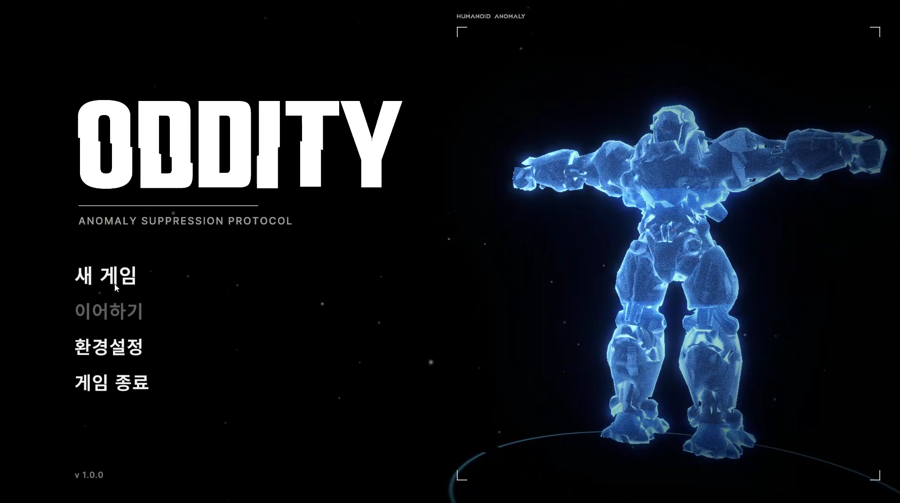
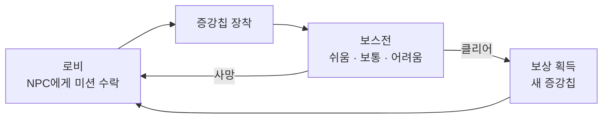
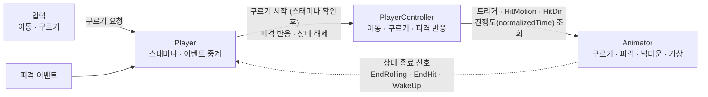
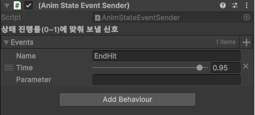
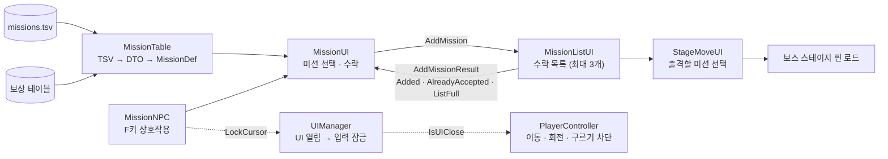
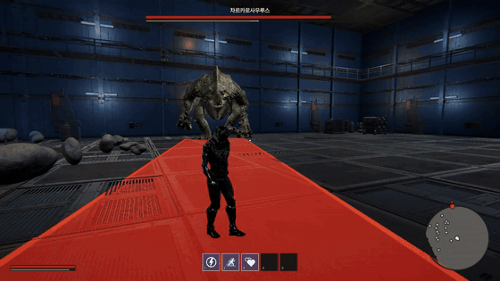
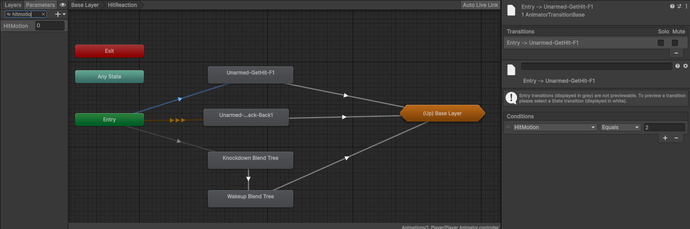
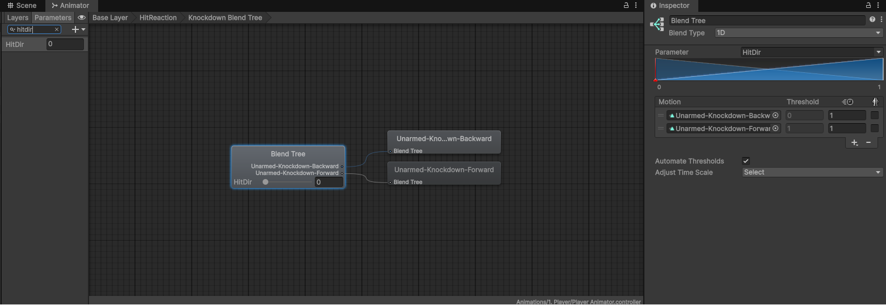
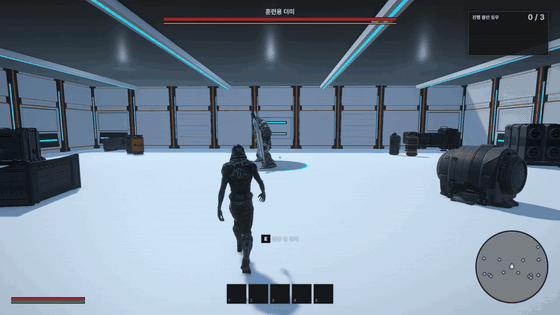

# ODDITY 기술 문서

> **보스의 공격을 구르기로 아슬아슬하게 피할 때의 쾌감을 만드는 플레이어 조작**



| 항목 | 내용 |
|---|---|
| 장르 | 3D 3인칭 보스 레이드 (보스 러시 + 소울라이크) |
| 기간 · 인원 | 2026.10.15 – 11.04 (약 3주) · 4인 팀 (학원 팀 프로젝트) |
| 엔진 · 도구 | Unity 6, C#, Git · Fork |
| 내 담당 | 플레이어 이동·구르기·피격 반응, 플레이어 애니메이터, 3인칭 카메라(기본 구조·상황별 전환), 미션 시스템, UI 입력 잠금, BGM·사운드, 에디터 툴 |
| AI 활용 | 카메라 첫 버전 초안, 미션 UI 조립 · 로비 자동 배치 에디터 툴에 Claude 사용 |
| 링크 | [시연 영상](https://tmdrn17.github.io/portfolio/src/01-ODDITY/video/oddity.mp4) · [GitHub 요청 시 공유] |

---

## 1. 개요

### 1.1 구르기 회피의 쾌감과 보스 러시를 잇는 미션

<video src="video/oddity.mp4" controls preload="metadata" playsinline width="100%"></video>

3D 보스 레이드 팀 프로젝트에서 **플레이어 이동 · 구르기 · 피격**, **애니메이터**, **미션 시스템**을 담당했습니다.

### 1.2 왜 만들었나

보스의 공격을 구르기로 아슬아슬하게 피할 때의 쾌감을 플레이어가 느끼게 하고 싶었습니다. 미션 시스템은 보스 러시 구조를 스킬인 증강칩 획득과 연결하기 위해 팀원들과 기획을 논의하며 만들었습니다.

### 1.3 게임 루프



---

## 2. 시스템 구조

입력과 애니메이터를 잇는 플레이어 구조, 데이터로 흐르는 미션

### 2.1 플레이어 — Player가 이벤트를 중계하고, PlayerController가 실제 움직임을 맡습니다



Player는 스태미나와 애니메이션 종료 신호처럼 '판단'을, PlayerController는 이동·구르기·피격 모션처럼 '실행'을 맡도록 나눴습니다. UI가 열리면 UIManager 한 곳에서 입력을 잠그고, 이동·회전·구르기가 이 값을 확인합니다.



### 2.2 미션 — TSV 데이터가 테이블을 거쳐 수락 목록과 출격까지 이어집니다



---

## 3. 핵심 기능

### 3.1 애니메이션 진행도를 따라 움직이는 커브 기반 구르기



```csharp
public float GetSpeedAt(float normalizedTime)
{
    // ① 이동 구간(moveEndTime) 밖이면 멈춤
    if (normalizedTime < 0f || normalizedTime >= moveEndTime) return 0f;

    float moveSeconds = RollStateLength * moveEndTime;
    if (moveSeconds <= 0f) return 0f;
    // ② 커브는 속도 배율만, 총 거리는 rollDistance로 고정
    return rollDistance * Mathf.Max(0f,
        speedCurve.Evaluate(normalizedTime / moveEndTime)) / moveSeconds;
}

private float ReadRollNormalizedTime(out bool found)
{
    AnimatorStateInfo current = animator.GetCurrentAnimatorStateInfo(0);
    if (current.shortNameHash == rollStateHash)
        return current.normalizedTime;
    // ③ 전이 중이면 넘어가는 대상(Roll)의 진행도를 사용
    if (animator.IsInTransition(0)) { ... next.normalizedTime ... }
    ...
}
```

1. **끝나기 전에 먼저 멈춤** — 애니메이션이 끝나는 부분보다 조금 앞(기본 80%)에서 이동을 멈춰, 구르기 끝에 미끄러지던 문제를 막았습니다.
2. **거리와 속도 변화를 분리** — 총 거리는 rollDistance로 고정하고 커브는 '어느 구간에서 빠르게 움직일지'만 정합니다. 커브를 바꿔도 거리는 같습니다.
3. **블렌딩 중에도 정확한 진행도** — 다른 동작에서 구르기로 넘어가는 중에는 다음 상태의 진행도를 읽어, 시작 프레임이 끊기지 않게 했습니다.

### 3.2 피격 종류와 방향을 애니메이터에 맡기는 피격 반응

```csharp
int motionIndex;
// ① 반응 종류 → Blend Tree 모션 번호
if (reaction == HitReaction.Knockdown)
{
    motionIndex = 1;
}
else
{
    motionIndex = push.HasMovement ? 2 : 0;
}

// ② 공격자 방향과 캐릭터 정면의 내적으로 앞(0) / 뒤(1)
Vector3 toAttacker = attackerPosition - transform.position;
toAttacker.y = 0f;
float hitDir = Vector3.Dot(toAttacker, transform.forward) >= 0f ? 0f : 1f;

animator.SetFloat(HitDir, hitDir);
animator.SetInteger(HitMotion, motionIndex);
```

넉다운·기상 Blend Tree, 피격 분기, 구르기, 사망까지 플레이어 애니메이터도 직접 구성했습니다. 넉다운 뒤에는 기상 신호 이후 조기 기상을 할 수 있고, 남용을 막기 위해 쿨타임을 두었습니다.





1. **모션 선택은 애니메이터에** — 코드는 '어떤 반응인지' 번호만 넘기고 실제 모션은 Blend Tree가 고릅니다. 피격 모션을 추가해도 코드 분기가 늘지 않습니다.
2. **내적 부호만으로 앞뒤 판정** — 앞인지 뒤인지만 알면 되므로 각도를 계산하지 않고 내적의 부호만 봤습니다.

### 3.3 결과를 enum으로 돌려주는 데이터 기반 미션 시스템

```csharp
public AddMissionResult AddMission(MissionDef missionDef)
{
    // ① 실패 이유를 bool이 아니라 enum으로 구분
    if (string.IsNullOrEmpty(missionDef.NextStageName))
        return AddMissionResult.NoStageScene;

    if (acceptedMissions.Exists(mission => mission.ID == missionDef.ID))
        return AddMissionResult.AlreadyAccepted;

    if (acceptedMissions.Count >= MaxMissionCount)
        return AddMissionResult.ListFull;
    ...
    // ② 목록이 바뀌면 이벤트로 알림
    OnAcceptedMissionsChanged?.Invoke();
    return AddMissionResult.Added;
}
```

missions.tsv → MissionTable(DTO → MissionDef 변환, 보상 테이블·아이콘 연결) → 수락 목록(최대 3개, 씬이 바뀌어도 유지) → 출격

미션 UI 전체를 코드로 조립하는 MissionUIBuilder와 로비 자동 배치 툴도 AI(Claude)로 만들어 반복 작업을 줄였습니다.

1. **상황별 안내가 가능한 결과값** — UI가 결과에 따라 '이미 수락한 미션', '목록이 가득 참' 같은 메시지를 골라 띄울 수 있습니다.
2. **목록 UI와 느슨한 연결** — 수락 목록이 바뀌면 이벤트로 알려, 목록을 보여 주는 쪽이 직접 상태를 확인하지 않아도 됩니다.

### 3.4 상황에 따라 바뀌는 3인칭 카메라

물체를 조준하고 오른쪽 마우스를 누르면, 누르고 있는 동안 카메라가 줌인됩니다.



```csharp
private Vector3 UpdatePosition()
{
    var (targetOffset, targetDistance, speed) = GetCameraTarget();

    // ① 프레임 독립 감쇠: FPS와 관계없이 같은 속도로 수렴
    float t = 1f - Mathf.Exp(-speed * Time.deltaTime);
    currentOffset = Vector3.Lerp(currentOffset, targetOffset, t);
    currentDistance = Mathf.Lerp(currentDistance, targetDistance, t);
    ...
    // ② 피벗 → 카메라 사이에 벽이 있으면 벽 앞까지만 물러남
    if (Physics.SphereCast(pivot, collisionRadius, direction, out RaycastHit hit, length,
            collisionMask, QueryTriggerInteraction.Ignore))
    {
        length = hit.distance;
    }
    return pivot + direction * length;
}
```

카메라의 첫 버전은 AI(Claude)가 만든 초안이었습니다. 검수하면서 벽 충돌 보정에 SphereCast가 쓰인 이유를 확인했고, 필요한 기능이라고 판단해 남겼습니다. 그 위에 상황에 따라 카메라가 바뀌는 부분을 직접 더했고, 이후 팀원이 보스 시네마틱과 시점 전환을 더했습니다.

1. **선 대신 공으로 벽 검사** — Raycast는 굵기가 없는 선이라 모서리에서 카메라가 벽을 살짝 파고듭니다. SphereCast는 카메라 크기만큼의 공으로 검사해 이를 막고, 충돌 대상은 LayerMask로 지정합니다.
2. **상황별 카메라 전환** — 물체를 잡고 있을 때는 다른 피벗 · 거리로, 달릴 때는 카메라가 더 뒤로 물러나도록 목표 값을 바꿉니다.
3. **FPS와 관계없는 보간** — `1 - e^(-속도 × deltaTime)`을 보간 비율로 써서, 프레임이 달라도 같은 빠르기로 목표에 다가갑니다.
4. **흔들림과 각도 조정** — DOTween.Punch로 카메라 흔들림을 넣고, 카메라를 아래로 당기면 플레이어를 뚫고 보이던 문제는 아래 각도 하한(−40° → −20°)으로 막았습니다.

---

## 4. 고민과 선택

### 4.1 구르기 이동을 어떻게 애니메이션과 맞출 것인가

| 단계 | 방식 | 결과 |
|---|---|---|
| 1. 고정 속도 · 고정 거리 | 정해진 속도로 정해진 거리만큼 이동 | 애니메이션 시간과 맞지 않아 구르기 전후에 미끄러짐 |
| 2. 진행도 기반 + AnimationCurve | 애니메이션 진행도에 맞춰 이동하고, 커브로 구르는 도중 속도를 바꿈 | 시간이 맞고, 속도 변화로 생동감까지 생김 |
| 3. 이동 종료 시점 분리 | 애니메이션이 끝나기 조금 전에 이동을 먼저 멈춤 (moveEndTime) | 끝부분 미끄러짐까지 해결 |

**왜 루트 모션이 아니었나** — 사용한 구르기 애니메이션에는 루트 모션이 없었습니다. 그래서 이동을 코드로 만들되, 애니메이션과 어긋나지 않도록 '애니메이션 진행도'를 기준으로 삼는 쪽을 택했습니다.

### 4.2 미션 데이터를 무엇으로 관리할 것인가

| | ScriptableObject | ✔ 선택: TSV 데이터 테이블 |
|---|---|---|
| 장점 | Unity 인스펙터에서 바로 보고 고칠 수 있음 · 에셋 참조(아이콘·프리팹)를 직접 연결 가능 | 표 하나에서 모든 미션을 한눈에 보고 고칠 수 있음 · 행 추가만으로 미션 확장, 보상 테이블과 ID로 연결 |
| 단점 | 미션이 늘수록 에셋 파일이 계속 늘어남 · 여러 미션의 수치를 한눈에 비교·수정하기 어려움 | 읽어 오는 코드(DTO → Def 변환)를 직접 만들어야 함 · 아이콘 같은 에셋은 경로 문자열로 불러와야 함 |

**선택한 이유** — 팀장님이 처음 TSV를 제안했고, 미션이 계속 추가·수정될 구조라 관리와 확장이 더 편하다고 판단해 동의했습니다. 변환 코드를 만드는 비용은 감수하고, 실패하면 경고 로그를 남기도록 했습니다.

---

## 5. 회고

### 5.1 결과

커브 기반 구르기와 피격·넉다운 반응으로 '아슬아슬하게 피하는' 조작을 구현했고, 미션 수락부터 보스 출격까지 한 바퀴를 연결했습니다.

[플레이 테스트 반응 · 영상 등 추가 예정]

### 5.2 배운 점 — 판단은 상태를 가진 쪽이

처음에는 보스 공격 코드 안에서 플레이어가 무적인지를 직접 확인했습니다. 무적 조건이 늘 때마다 보스 코드를 고쳐야 했고, 이후 팀원이 이 판단을 맞는 쪽으로 옮기는 리팩터링을 진행했습니다. 이를 보며 의존 방향의 기준을 배웠습니다.

이 프로젝트에서는 데이터(TSV)로 시스템을 만들고, 애니메이터 설계와 에디터 툴로 작업을 자동화했습니다.

### 5.3 아쉬운 점과 개선 계획

- **PlayerController가 1,500줄까지 커짐** — 팀원과 함께 작업하며 관리하다 보니 기능이 계속 붙었습니다. → 이동·구르기·피격을 상태 패턴으로 분리
- **애니메이션 신호를 문자열로 주고받음** — "EndRolling" 오타를 컴파일 단계에서 못 잡습니다. → enum이나 상수로 교체
- **커밋 단위** — 기능마다 브랜치는 나눠 작업했지만, 에셋 변경·코드 작성 및 수정·유니티 씬 수정이 한 커밋에 섞여 리뷰가 어려웠습니다. → 커밋 단위를 확실히 정하고 단위에 맞는 작업이 끝나면 빠르게 커밋 하기.
