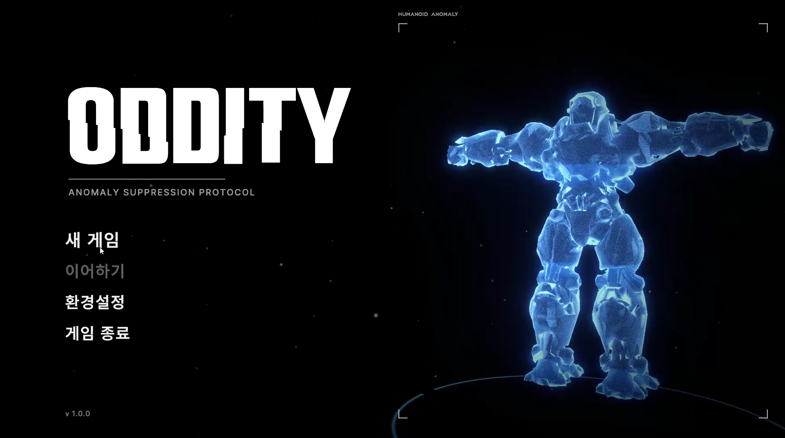
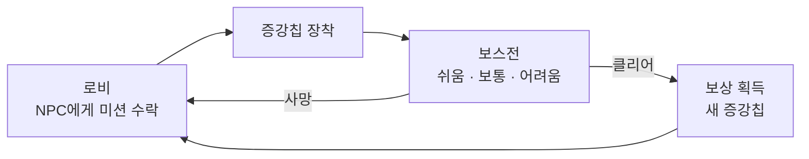
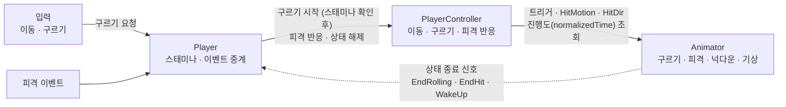
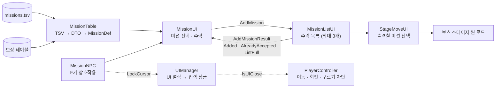
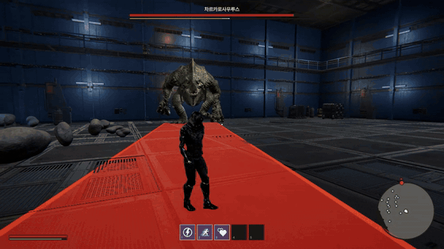
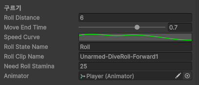
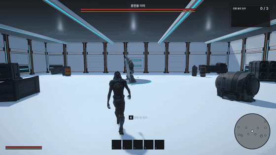

# ODDITY 프로젝트 문서

> **염동력과 증강칩 스킬로 보스를 상대하는 3D 3인칭 보스 레이드**



| 항목 | 내용 |
|---|---|
| 장르 | 3D 3인칭 보스 레이드 (보스 러시 + 소울라이크) |
| 기간 · 인원 | 2026.10.15 – 11.04 (약 3주) · 4인 팀 (학원 팀 프로젝트) |
| 엔진 · 도구 | Unity 6, C#, Git · Fork |
| 내 담당 | 플레이어 이동·구르기·피격 반응, 플레이어 애니메이터, 3인칭 카메라(기본 구조·상황별 전환), 미션 시스템, UI 입력 잠금, BGM·사운드, 에디터 툴 |
| AI 활용 | 카메라 첫 버전 초안, 미션 UI 조립 · 로비 자동 배치 에디터 툴에 Claude Code 사용 |
| 링크 | [시연 영상](https://youtu.be/JteTTdbFSEU) · [쇼츠](https://youtu.be/HQHuNsiZPmY) · [GitHub](https://github.com/tmdrn17/ODDITY-Code) |

---

## 1. 개요

### 1.1 구르기 회피의 쾌감과 보스 러시를 잇는 미션

<iframe src="https://www.youtube.com/embed/JteTTdbFSEU" title="시연 영상" allow="accelerometer; clipboard-write; encrypted-media; gyroscope; picture-in-picture" allowfullscreen style="display:block;width:55%;aspect-ratio:16/9;height:auto;border:0"></iframe>

3D 보스 레이드 팀 프로젝트에서 **플레이어 이동 · 구르기 · 피격**, **애니메이터**, **미션 시스템**을 담당했습니다.

### 1.2 목표한 경험과 기능마다의 의도

**팀이 목표한 경험** — 염동력을 기반으로 여러 스킬을 활용해 보스를 상대하며, 보스 러시 장르 특유의 고난도 컨트롤을 경험하게 하고 싶었습니다.

- **구르기** — 구르기 전후에 캐릭터가 미끄러지면 '피했다'는 느낌이 흐려지기 때문에, 애니메이션과 어긋나지 않고 입력한 만큼 정확히 굴러가는 조작을 목표로 했습니다.
- **피격 · 넉다운 반응** — 쓰러진 채 무력하게 기다리는 시간을 줄여 플레이어가 빨리 다시 조작하도록 조기 기상을 넣고, 계속 쓰면 넉다운이 의미 없어지지 않도록 쿨타임을 두었습니다.
- **3인칭 카메라** — 달릴 때는 카메라가 뒤로 물러나 속도감을, 물체를 잡을 때는 다른 피벗 · 거리로 조준감을 주고 싶었습니다.
- **미션 시스템** — 보스 러시 구조를 스킬인 증강칩 획득과 연결하기 위해 팀원들과 기획을 논의하며 만들었습니다.
- **UI 입력 잠금 · 에디터 툴** — UI를 조작하는 중에 캐릭터가 움직이지 않도록 입력 잠금을 한 곳에 모았고, 미션 UI 조립 · 로비 배치 같은 반복 작업은 에디터 툴로 줄였습니다.

### 1.3 게임 루프



---

## 2. 시스템 구조

입력과 애니메이터를 잇는 플레이어 구조, 데이터로 흐르는 미션

### 2.1 플레이어



Player는 스태미나와 애니메이션 종료 신호처럼 '판단'을, PlayerController는 이동·구르기·피격 모션처럼 '실행'을 맡도록 나눴습니다. UI가 열리면 UIManager 한 곳에서 입력을 잠그고, 이동·회전·구르기가 이 값을 확인합니다.


### 2.2 미션



#### 2.2.1 UI가 열렸을 때 플레이어를 어떻게 멈출 것인가

| | 컴포넌트를 통째로 끄기 (처음 방식) | ✔ 선택: 잠금 값 하나를 두고 확인하기 |
|---|---|---|
| 방식 | 커서를 풀 때마다 PlayerController · CameraController를 `enabled = false`로 끔 | 컴포넌트는 켜 둔 채 UIManager의 잠금 값(isUIClose)을 두고, 이동 · 회전 · 달리기 · 구르기 · 카메라가 각각 이 값을 확인 |
| 장점 | 한 줄로 모든 조작이 멈춤 | 애니메이터 갱신 · 피격 처리 같은 나머지 동작은 그대로 돌아감 |
| 단점 | 스크립트 전체가 멈춰 애니메이터 값이 마지막 상태로 남음 · 커서는 UI뿐 아니라 Esc · 사망 · 보상창에서도 풀려 그때마다 꺼짐 | 확인하는 곳이 여러 군데로 흩어져, 한 곳을 빠뜨리면 막히지 않음(구르기 확인을 처음에 빠뜨렸다가 같은 날 추가) |

**선택한 이유** — 처음에는 다른 팀원이 다른 부분에서 쓰던 컴포넌트 끄기 방식을 따라 썼습니다. 그런데 걷거나 달리다가 Esc를 누르거나 UI를 열면, 조종 스크립트가 멈추면서 애니메이터의 걷기 값이 그대로 남아 캐릭터가 제자리에서 계속 걷는 모션을 보였습니다. 그래서 컴포넌트는 켜 두고 잠금 값으로 필요한 조작만 막는 방식으로 바꿨고, 확인하는 곳이 흩어지는 단점은 받아들였습니다.

---

## 3. 핵심 기능

### 3.1 애니메이션 진행도를 따라 움직이는 커브 기반 구르기



```csharp
public float GetSpeedAt(float normalizedTime)
{
    // ① 이동 구간(moveEndTime) 밖이면 멈춤
    if (normalizedTime < 0f || normalizedTime >= moveEndTime) return 0f;

    float moveSeconds = RollStateLength * moveEndTime;
    if (moveSeconds <= 0f) return 0f;
    // ② 커브 값은 기준 속도(rollDistance / 이동 시간)의 배율
    return rollDistance * Mathf.Max(0f,
        speedCurve.Evaluate(normalizedTime / moveEndTime)) / moveSeconds;
}

private float ReadRollNormalizedTime(out bool found)
{
    AnimatorStateInfo current = animator.GetCurrentAnimatorStateInfo(0);
    if (current.shortNameHash == rollStateHash)
        return current.normalizedTime;
    // ③ 전이 중이면 넘어가는 대상(Roll)의 진행도를 사용
    if (animator.IsInTransition(0)) { ... next.normalizedTime ... }
    ...
}
```


1. **끝나기 전에 먼저 멈춤** — 애니메이션이 끝나는 부분보다 조금 앞(기본 70%)에서 이동을 멈춰, 구르기 끝에 미끄러지던 문제를 막았습니다.
2. **커브로 구간별 속도** — rollDistance를 이동 시간으로 나눈 값이 기준 속도이고, 커브가 구간마다 그 배율을 정합니다. 테스트 씬에서 시험한 첫 커브 버전은 커브 넓이로 나눠 커브를 바꿔도 총 거리가 같았지만, PlayerController로 합치면서 나누기를 빼 지금은 커브 모양에 따라 총 거리도 달라집니다(거리 = rollDistance × 커브 넓이, 지금 커브로 약 6.4).
3. **블렌딩 중에도 정확한 진행도** — 다른 동작에서 구르기로 넘어가는 중에는 다음 상태의 진행도를 읽어, 시작 프레임이 끊기지 않게 했습니다.

구르기는 스태미나 25를 쓰고(최대 100, 1초 뒤부터 초당 15 회복), 진행도 0.8까지 무적입니다.

#### 3.1.1 구르기 이동을 어떻게 애니메이션과 맞출 것인가

| 단계 | 방식 | 결과 |
|---|---|---|
| 1. 고정 속도 · 고정 거리 | 정해진 속도로 정해진 거리만큼 이동 | 애니메이션 시간과 맞지 않아 구르기 전후에 미끄러짐 |
| 2. 진행도 기반 + AnimationCurve | 애니메이션 진행도에 맞춰 이동하고, 커브로 구르는 도중 속도를 바꿈 | 시간이 맞고, 속도 변화로 생동감까지 생김 |
| 3. 이동 종료 시점 분리 | 애니메이션이 끝나기 조금 전에 이동을 먼저 멈춤 (moveEndTime) | 끝부분 미끄러짐까지 해결 |

**미끄러짐을 눈으로 확인한 방법** — 미끄러지는 원인을 보려고 AI에게 구르기 디버깅 도구를 만들어 달라고 했습니다. 커브로 계산한 목표 속도와 실제로 움직인 속도를 그래프로 겹쳐 보여 주고, 이동을 멈추는 지점과 구르기가 실제로 끝난 지점을 세로선으로 표시하며, 최근 구르기의 거리 · 시간 · 끝난 이유를 화면에 남기는 도구입니다. 이 도구를 켜고 직접 플레이하며 확인해, 이동을 멈추는 시점(0.7)과 구르기에서 다음 동작으로 넘어가는 시점을 맞췄습니다. 같은 작업에서 스태미나가 꽉 차야만 구를 수 있던 조건도 필요한 스태미나(25)만 있으면 구르도록 고쳤습니다. 확인이 끝난 뒤 도구는 지웠습니다.

**왜 루트 모션이 아니었나** — 사용한 구르기 애니메이션에는 루트 모션이 없었습니다. 그래서 이동을 코드로 만들되, 애니메이션과 어긋나지 않도록 '애니메이션 진행도'를 기준으로 삼는 쪽을 택했습니다.

### 3.2 피격 종류와 방향을 애니메이터에 맡기는 피격 반응

```csharp
int motionIndex;
// ① 반응 종류 → Blend Tree 모션 번호
if (reaction == HitReaction.Knockdown)
{
    motionIndex = 1;
}
else
{
    motionIndex = push.HasMovement ? 2 : 0;
}

// ② 공격자 방향과 캐릭터 정면의 내적으로 앞(0) / 뒤(1)
Vector3 toAttacker = attackerPosition - transform.position;
toAttacker.y = 0f;
float hitDir = Vector3.Dot(toAttacker, transform.forward) >= 0f ? 0f : 1f;

animator.SetFloat(HitDir, hitDir);
animator.SetInteger(HitMotion, motionIndex);
```

넉다운·기상 Blend Tree, 피격 분기, 구르기, 사망까지 플레이어 애니메이터도 직접 구성했습니다. 넉다운 뒤에는 기상 신호 이후 조기 기상을 할 수 있고, 남용을 막기 위해 쿨타임을 두었습니다.


1. **모션 선택은 애니메이터에** — 코드는 '어떤 반응인지' 번호만 넘기고 실제 모션은 Blend Tree가 고릅니다. 피격 모션을 추가해도 코드 분기가 늘지 않습니다.
2. **내적 부호만으로 앞뒤 판정** — 앞인지 뒤인지만 알면 되므로 각도를 계산하지 않고 내적의 부호만 봤습니다.

넉다운 뒤 기상까지는 3초, 기상 뒤 무적은 1.5초이고, 조기 기상은 8초에 한 번 쓸 수 있습니다.

#### 3.2.1 맞은 방향에 따라 어떻게 넘어지게 할 것인가

| | 공격자 쪽으로 몸을 돌리기 (처음 방식) | ✔ 선택: 내적으로 앞 · 뒤 넉다운 고르기 |
|---|---|---|
| 방식 | 맞는 순간 캐릭터를 공격자 쪽으로 강제로 돌려, 하나뿐인 '뒤로 쓰러지는' 모션으로 어느 방향에서 맞든 뒤로 날아가게 함 | 공격자 방향과 캐릭터 정면의 내적 부호로 앞(0) · 뒤(1)를 정해 HitDir로 넘기고, Blend Tree가 앞 · 뒤 넉다운 모션을 고름 |
| 장점 | 넘어지는 모션 하나로 모든 방향을 처리 · 코드가 간단함 | 캐릭터를 억지로 돌리지 않음 · 모션을 추가해도 코드 분기가 늘지 않음 |
| 단점 | 막상 적용해 보니 맞을 때마다 몸이 공격자 쪽으로 돌아가 이상해 보임 | 앞으로 쓰러지는 모션을 따로 추가해야 함 · 방향은 앞 · 뒤 두 가지로만 구분 |

**선택한 이유** — 처음에는 넘어지는 모션이 하나뿐이라 몸을 돌리는 방식으로 해결했지만, 막상 적용해 보니 이상했습니다. 그래서 다음 날 앞으로 쓰러지는 넉다운 모션을 추가하고, 강제 회전 대신 내적으로 앞 · 뒤만 골라 넘어지게 바꿨습니다.

### 3.3 결과를 enum으로 돌려주는 데이터 기반 미션 시스템

```csharp
public AddMissionResult AddMission(MissionDef missionDef)
{
    // ① 실패 이유를 bool이 아니라 enum으로 구분
    if (string.IsNullOrEmpty(missionDef.NextStageName))
        return AddMissionResult.NoStageScene;

    if (acceptedMissions.Exists(mission => mission.ID == missionDef.ID))
        return AddMissionResult.AlreadyAccepted;

    if (acceptedMissions.Count >= MaxMissionCount)
        return AddMissionResult.ListFull;
    ...
    // ② 목록이 바뀌면 이벤트로 알림
    OnAcceptedMissionsChanged?.Invoke();
    return AddMissionResult.Added;
}
```

missions.tsv → MissionTable(DTO → MissionDef 변환, 보상 테이블·아이콘 연결) → 수락 목록(최대 3개, 씬이 바뀌어도 유지) → 출격

1. **상황별 안내가 가능한 결과값** — UI가 결과에 따라 '이미 수락한 미션', '목록이 가득 참' 같은 메시지를 골라 띄울 수 있습니다.
2. **목록 UI와 느슨한 연결** — 수락 목록이 바뀌면 이벤트로 알려, 목록을 보여 주는 쪽이 직접 상태를 확인하지 않아도 됩니다.

AddMissionResult는 미션 수락 결과 enum입니다. 값마다 UI가 다른 안내 문구를 띄웁니다.

```csharp
public enum AddMissionResult
{
    Added,            // 수락됨
    AlreadyAccepted,  // 이미 수락한 미션 → "이미 수락한 미션입니다"
    ListFull,         // 수락 목록이 가득 참(최대 3개) → "미션은 최대 3개까지 수락할 수 있습니다"
    NoStageScene,     // 출격할 스테이지가 비어 있음 → "이전 미션을 클리어 해주세요"
}
```

| 자료형 | 역할 |
|---|---|
| MissionDTO | 데이터 테이블 리더(TSVReader 클래스)가 missions.tsv의 한 줄을 칸 그대로 옮겨 담는 그릇입니다. 보스 그림은 경로 글자(BossSpriteKey), 보상은 번호(Reward)로만 들어 있어 게임 코드에서는 쓰지 않고, 변환하는 데만 씁니다 |
| MissionDef | 미션 테이블(MissionTable 클래스)이 불러오면서(Load) DTO를 바꿔 만든, 게임에서 쓰는 미션 정보입니다. 그림 경로는 `Resources.Load`로 불러온 Sprite로, 보상 번호는 BossReward.tsv에서 찾은 보상 줄(RewardRows)로 바꿔 담습니다(보상 테이블 연동은 팀원 작업). 수락 목록(`AddMission`)과 임무 창 UI는 Def만 받으므로, TSV 칸 구성이 바뀌어도 변환 코드만 고치면 됩니다 |

| 필드 | MissionDTO | MissionDef | 뜻 |
|---|---|---|---|
| ID | int | int | 미션 번호. 같은 미션을 두 번 수락하는지 검사할 때 씀 |
| MissionName | string | string | 임무 창에 보이는 미션 이름 |
| MissionDescription | string | string | 미션 설명 |
| BossName | string | string | 상대할 보스 이름 |
| QuestName | string | string | 퀘스트 목록(Quest List UI)에 보이는 이름 |
| NextStageName | string | string | 출격할 스테이지 씬 이름. 비어 있으면 NoStageScene |
| Reward | int | int | BossReward.tsv의 보상 번호 |
| BossSpriteKey → BossSprite | string (Resources 경로) | Sprite | 경로로 불러온 보스 그림. 못 찾으면 경고 로그 |
| RewardRows | — | IReadOnlyList&lt;BossRewardDef&gt; | Reward 번호로 찾은 보상 줄. GetRewardText()가 임무 창의 보상 글로 만듦 (팀원 작업) |

#### 3.3.1 미션 데이터를 무엇으로 관리할 것인가

| | ScriptableObject | ✔ 선택: TSV 데이터 테이블 |
|---|---|---|
| 장점 | Unity 인스펙터에서 바로 보고 고칠 수 있음 · 에셋 참조(아이콘·프리팹)를 직접 연결 가능 | 표 하나에서 모든 미션을 한눈에 보고 고칠 수 있음 · 행 추가만으로 미션 확장, 보상 테이블과 ID로 연결 |
| 단점 | 미션이 늘수록 에셋 파일이 계속 늘어남 · 여러 미션의 수치를 한눈에 비교·수정하기 어려움 | 읽어 오는 코드(DTO → Def 변환)를 직접 만들어야 함 · 아이콘 같은 에셋은 경로 문자열로 불러와야 함 |

**선택한 이유** — 팀장님이 처음 TSV를 제안했고, 미션이 계속 추가·수정될 구조라 관리와 확장이 더 편하다고 판단해 동의했습니다. 변환 코드를 만드는 비용은 감수하고, 실패하면 경고 로그를 남기도록 했습니다.

### 3.4 상황에 따라 바뀌는 3인칭 카메라

물체를 조준하고 오른쪽 마우스를 누르면, 누르고 있는 동안 카메라가 줌인됩니다.



```csharp
private Vector3 UpdatePosition()
{
    var (targetOffset, targetDistance, speed) = GetCameraTarget();

    // ① 프레임 독립 감쇠: FPS와 관계없이 같은 속도로 수렴
    float t = 1f - Mathf.Exp(-speed * Time.deltaTime);
    currentOffset = Vector3.Lerp(currentOffset, targetOffset, t);
    currentDistance = Mathf.Lerp(currentDistance, targetDistance, t);
    ...
    // ② 피벗 → 카메라 사이에 벽이 있으면 벽 앞까지만 물러남
    if (Physics.SphereCast(pivot, collisionRadius, direction, out RaycastHit hit, length,
            collisionMask, QueryTriggerInteraction.Ignore))
    {
        length = hit.distance;
    }
    return pivot + direction * length;
}
```

카메라는 프로토타입을 빠르게 만들기 위해 AI(Claude Code)로 첫 버전 초안을 만들었습니다. 검수하면서 벽 충돌 보정에 SphereCast가 쓰인 이유를 확인했고, 필요한 기능이라고 판단해 남겼습니다. 그 위에 상황에 따라 카메라가 바뀌는 부분을 직접 더했습니다. 위 코드는 제가 작업한 초기 버전이고, 이후 팀원이 시점 모드(ViewMode) 구조로 리팩터링하면서 보스 시네마틱과 시점 전환을 더했습니다.

1. **선 대신 공으로 벽 검사** — Raycast는 굵기가 없는 선이라 모서리에서 카메라가 벽을 살짝 파고듭니다. SphereCast는 카메라 크기만큼의 공으로 검사해 이를 막고, 충돌 대상은 LayerMask로 지정합니다.
2. **상황별 카메라 전환** — 물체를 잡고 있을 때는 다른 피벗 · 거리로, 달릴 때는 카메라가 더 뒤로 물러나도록 목표 값을 바꿉니다.
3. **FPS와 관계없는 보간** — 처음에는 `속도 × deltaTime`을 보간 비율로 써서 프레임에 따라 다가가는 빠르기가 달라졌습니다. 카메라 전환 기준을 오른쪽 클릭에서 '물체를 잡았는지'로 바꾸면서, `1 - e^(-속도 × deltaTime)`을 쓰도록 고쳐 프레임이 달라도 같은 빠르기로 목표에 다가가게 했습니다.
4. **각도 제한** — 팀원이 코드에 "카메라를 아래로 쭉 당기면 플레이어를 관통해서 보인다"는 리뷰 메모를 남겼고, 아래 각도 하한을 −40°에서 −20°로 올려 막았습니다.

### 3.5 사운드

| 소리 | 한 일 |
|---|---|
| 염동력 공격 | 일반 · 끌어당기기 · 붙잡기 · 던지기 4종의 공격 소리를 염동력 동작마다 재생 |
| 발걸음 · 보스 | 플레이어 발걸음 소리와 노말 보스의 동작 소리를 애니메이터 상태에 연결 |
| BGM | 곡이 끝나면 다음 곡으로 넘어가도록 BGM 교체(ChangeBGM) |

효과음 · 볼륨을 관리하는 SoundManager와 볼륨 설정은 팀원 작업이고, 저는 그 위에서 소리를 연결했습니다.

---

## 4. AI 협업

- **쓴 방식** — AI가 만든 초안을 받아 검수하고, 필요한 부분을 골라 그 위에 직접 더했습니다.
- **맡긴 것**
  - 3인칭 카메라의 첫 버전 초안
  - 에디터 툴 전부 — 로비 맵 자동 배치(MissionLobbyBuilder), 미션 UI를 코드로 조립하는 MissionUIBuilder, 시작 화면 폰트 적용(StartSceneFontApplier). 만들 것을 요청하면 AI가 코드를 짜고 실행해 로비와 UI를 만들었고, 툴 코드는 직접 고치지 않았습니다.
  - 구르기 미끄러짐을 확인하는 디버깅 도구(3.1.1) — 도구는 AI가 만들고, 켜고 플레이하며 값을 맞추는 것은 직접 했습니다.
  - BGM이 바뀌지 않던 문제의 원인 분석(5.2)
- **직접 판단한 것** — 벽 충돌 보정(SphereCast)은 필요한 기능이라고 판단해 남겼고, 상황에 따라 카메라가 바뀌는 부분은 그 위에 직접 더했습니다(3.4).
- **확인한 방법** — 카메라 초안을 검수하면서 벽 충돌 보정에 SphereCast가 쓰인 이유를 확인했습니다.
- **안 된 것**
  - **결과를 직접 볼 수 없는 작업을 오래 맡김** — 구른 뒤 Idle로 넘어갈 때 다리가 움찔거리는 문제를 고치려고, AI에게 Blender로 구르기 FBX를 다시 만들게 했습니다. 약 2시간 16분 동안 10번 넘게 고쳤지만 AI는 발 간격 · 루트 위치 · 무릎 커브 · IK · 상체 기울기 · Foot IK 순으로 매번 원인을 다르게 짚었고, Unity에서 직접 재생해 볼 수 없어 확인은 매번 제가 했습니다. 마지막 버전은 인스펙터 미리보기에서는 재생되지만 게임에서는 재생되지 않았고, 끝내 해결하지 못해 바꾼 스크립트를 모두 되돌렸습니다.
  - **검수 없이 맡긴 커밋 · 푸시** — PR 만들기를 실행하자 AI가 커밋하지 않은 변경 5개를 커밋 하나로 묶어 팀 원격 브랜치(feat/player-move)에 바로 푸시했습니다. 그 안에는 실행하면 넉백이 계속 반복되는 작업 중인 애니메이터와 디버그 로그가 들어 있었고, 강제 푸시가 권한 설정에 막혀 바로 되돌리지 못했습니다. AI에게 한 일(커밋 내용 · 푸시 범위)을 정리하게 해 상태를 파악했습니다.
  - **다른 씬을 보고 내린 틀린 결론** — NPC와 상호작용해도 UI가 뜨지 않는 원인을 물었을 때, AI는 실제로 열려 있던 빌드 씬이 아니라 이름이 비슷한 다른 씬(요청할 때 제가 첨부한 경로)을 분석해 "Popup UI 칸이 비어 있다"는 결론을 두 번 반복했습니다. 인스펙터 스크린샷을 보여 준 뒤에야 바로잡혔고, 실제 원인은 새로 추가한 AugmentationChipPanel이 Awake()에서 Close()를 불러 첫 Open() 직후 패널을 다시 끈 것이었습니다.
  - **맡긴 범위 밖을 건드림** — AI가 구르기 코드를 고치면서 커브 넓이로 나누는 정규화가 빠졌고(3.1.1), 이 사실은 동작을 질문하다가 알게 됐습니다. 팀원이 작성한 PlayerCombatIdle.cs를 AI가 직접 고친 일도 있어, 원래 코드는 주석으로 남기고 수정을 더하는 방식으로 바꾸게 했습니다.
  - **그 뒤로 정한 규칙** — 커밋 · 푸시와 팀원 코드 수정은 AI에 맡기지 않습니다. 씬은 저장한 뒤 지금 열린 씬의 경로를 정확히 지정해 요청합니다. 같은 증상으로 2~3번 실패하면 계속 맡기지 않고 접근 방법을 바꾸거나 직접 원인을 좁히며, AI가 "실행해 보지 않았다"고 한 부분은 직접 플레이해 확인합니다.

---

## 5. 회고

### 5.1 결과

커브 기반 구르기와 피격·넉다운 반응으로 '아슬아슬하게 피하는' 조작을 구현했고, 미션 수락부터 보스 출격까지 한 바퀴를 연결했습니다.

### 5.2 배운 점

처음에는 보스 공격 코드 안에서 플레이어가 무적인지를 직접 확인했습니다. 무적 조건이 늘 때마다 보스 코드를 고쳐야 했고, 이후 팀원이 이 판단을 맞는 쪽으로 옮기는 리팩터링을 진행했습니다. 이를 보며 의존 방향의 기준을 배웠습니다.

BGM을 바꾸는 기능(ChangeBGM)으로 곡을 끄고 켜면 새 곡이 재생되지 않고, 손으로 끄고 켜면 되는 문제가 있었습니다. 제가 모르던 부분이라 AI에게 원인 분석을 맡겼습니다. 같은 프레임에 끄기(페이드아웃을 await로 기다림)와 켜기(취소 토큰으로 이전 작업 취소)가 겹쳤는데, 페이드 트윈을 Kill하면 기다리던 작업이 취소가 아니라 정상 완료로 끝나 다음 줄의 Stop이 새 곡까지 멈춘 것이 원인이었습니다. 팀원의 SoundManager는 고치지 않고, 끈 뒤 페이드(0.5초)가 끝날 때까지 0.6초 기다렸다가 다음 곡을 켜도록 고쳤습니다. 이를 통해 취소한 비동기 작업이 '완료'로 끝날 수도 있어, 기다린 뒤에 이어지는 코드가 의도와 다르게 실행될 수 있다는 것을 배웠습니다.

또한 보스 몬스터 설계는 팀장님이 맡았는데, 공격 패턴에 공통으로 들어가는 흐름(사용 조건 판정·애니메이션 재생·타격 판정·후딜)을 추상 클래스(BossMeleePattern)에 모으고, 패턴마다 달라지는 부분만 virtual 메서드로 열어 두었습니다. 그래서 할퀴기·내려찍기·콤보 같은 근접 패턴은 이 클래스를 상속한 빈 클래스에 인스펙터 수치(사거리·각도·쿨타임·피해량·공격 범위)만 넣어 만들 수 있었고, 자기 작업을 끝낸 다른 팀원도 돌진처럼 특수한 동작이 있는 패턴이 아니면 새 패턴을 금방 추가할 수 있었습니다. 이를 보며 공통 흐름은 부모 클래스에 두고 달라지는 부분만 열어 두면, 다음 사람이 기능을 더하는 비용까지 줄일 수 있다는 것을 배웠습니다.

### 5.3 아쉬운 점과 개선 계획

- **PlayerController가 1,500줄까지 커짐** — 팀원과 함께 작업하며 관리하다 보니 기능이 계속 붙었습니다. → 이동·구르기·피격을 상태 패턴으로 분리
