# We Got One 프로젝트 문서

> **손을 이용해 물고기와 판자를 잡아 다리를 짓는 2D 협동 게임**

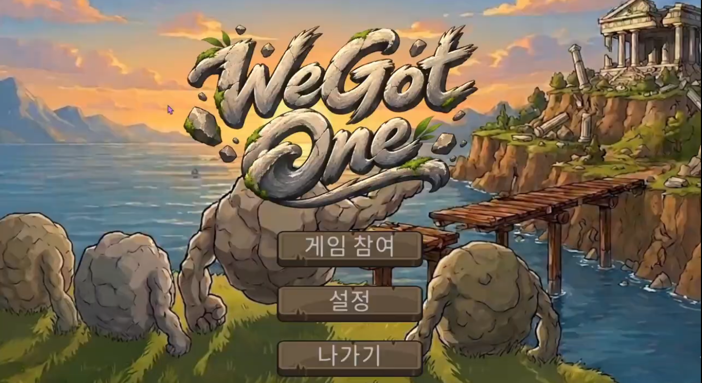

| 항목 | 내용 |
|---|---|
| 장르 | 2D 물리 기반 협동 게임 (호스트 · 게스트 네트워크) |
| 기간 · 인원 | 2026.08 – 09 · 4인 팀 (학원 팀 프로젝트) |
| 엔진 · 도구 | Unity 6, C#, UniTask, DOTween, Git · Fork |
| 내 담당 | 특수 물고기 4종 세부 기획·구현, 다리 건설 연출, 게임 피드백 효과, 초기 인벤토리·다리 건설 프로토타입 |
| 링크 | [시연 영상](https://youtu.be/gVE0l56vrGY) · [쇼츠](https://youtu.be/ul3cN-8qAfE) · [GitHub](https://github.com/tmdrn17/WeGotOne-Code) |

---

## 1. 개요

<a id="section-1-1"></a>
### 1.1 물리 팔로 물고기를 잡아 다리를 짓는 협동 게임

<iframe src="https://www.youtube.com/embed/gVE0l56vrGY" title="시연 영상" allow="accelerometer; clipboard-write; encrypted-media; gyroscope; picture-in-picture" allowfullscreen style="display:block;width:55%;aspect-ratio:16/9;height:auto;border:0"></iframe>

2D 물리 협동 팀 프로젝트에서 **특수 물고기 기믹**, **FSM 확장**, **래그돌 제어**, **다리 건설 연출**을 담당했습니다.

<a id="section-1-2"></a>
### 1.2 목표한 경험과 기능마다의 의도

**팀이 목표한 경험** — 서로 같은 목표를 향해 다 같이 협동하면서도, 때로는 서로를 방해하게 되는 불협화음을 헤쳐나가며 목적지까지 도달하는 경험을 주고 싶었습니다.

- **특수 물고기 4종** — 기획 단계에서 일반 물고기만 있으면 '잡고 버티기'만 반복될 것으로 예상했습니다. 그래서 적대 물고기 3종(대왕오징어 · 갯가재 · 전기가오리)으로 잡는 과정에 변수를 넣었고, 방해만 있으면 좌절감이 커지기 때문에 친구 물고기인 해마로 대왕오징어의 납치에 대응할 수단을 주었습니다.
- **다리 건설 연출 · 피드백 효과** — 무엇이 인벤토리에 들어갔는지, 다리가 얼마나 지어졌는지, 다음에 어디로 가야 하는지 플레이어가 헷갈리지 않도록 효과음 · 파티클 · 인벤토리 튀어 오름 · 카메라 이동으로 진행 상황을 알려 주고 싶었습니다.

<a id="section-1-3"></a>
### 1.3 게임 루프

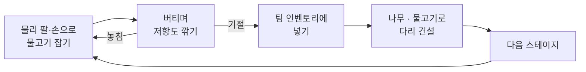

<a id="section-1-4"></a>
### 1.4 담당 파트 — 특수 물고기 4종: 잡기에 변수를, 협동에 이유를

| 물고기 | 그림 | 구분 | 동작 | 의도 |
|---|---|---|---|---|
| 대왕오징어 | 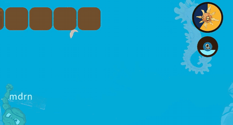 | 적대 | 촉수로 플레이어를 붙잡아 끌고 갔다가 놓아 줌 | 동료가 끌려가는 위기 상황을 만들어 협동 유도 |
| 갯가재 | 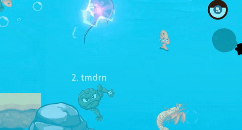 | 적대 | 펀치로 플레이어를 멀리 날려 버림 | 잡으러 다가가는 순간에 긴장감을 줌 |
| 전기가오리 | 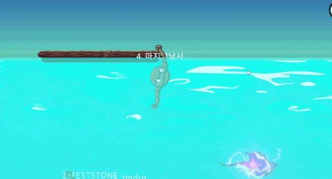 | 적대 | 감전시켜 잡고 있던 것을 놓치게 하고 잠시 못 움직이게 함 | 애써 잡은 물고기를 놓치거나 아무것도 잡지 못 해 바다에 가라앉는 변수 |
| 해마 | 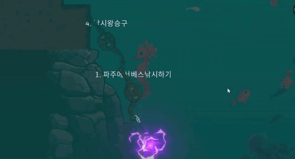 | 친구 | 손으로 잡으면 플레이어를 목적지까지 데려다 줌 | 대왕오징어의 납치에 대응하는 수단 |

특수 물고기는 기획 단계에서 아이디어가 나왔고, 각 물고기의 동작과 수치 등 세부 기획은 직접 정했습니다.

| 물고기 | 주요 수치 |
|---|---|
| 대왕오징어 | 저항도 20 · 배고픔 주기 15 · 납치 속도 10 · 복귀 속도 3 |
| 갯가재 | 저항도 12 · 넉백 힘 400 · 펀치 1초 |
| 전기가오리 | 저항도 13 · 마비 2초 · 감전 뒤 공격 정지 10초 |
| 해마 | 저항도 10 · 이동 속도 10 · 질량 15 |

---

## 2. 시스템 구조

<a id="section-2-1"></a>
### 2.1 물고기 FSM에 특수 상태와 센서를 얹는 구조

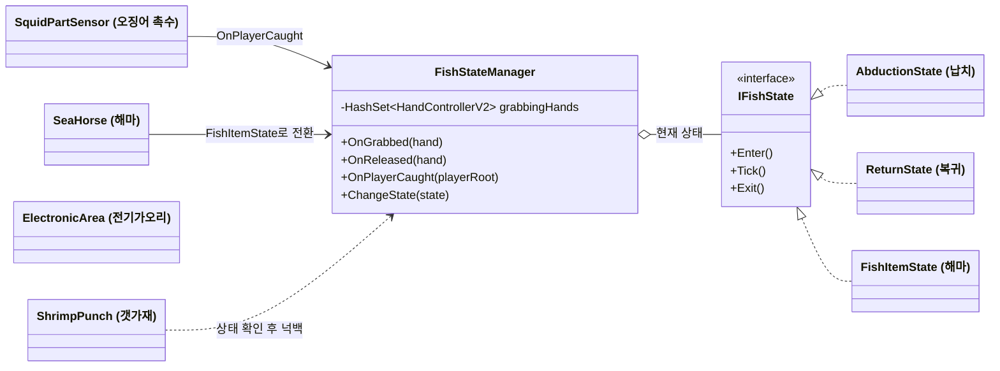

물고기의 기본 상태 머신(IFishState: Enter · Tick · Exit) 위에 납치·복귀·해마 상태를 추가했습니다.
오징어 촉수, 갯가재 펀치, 전기가오리 감전은 자식 오브젝트의 트리거 센서로 만들어, 물고기 본체는 그대로 두고 기믹만 붙이고 뗄 수 있게 했습니다.
오징어 촉수와 갯가재 펀치는 FishStateManager의 현재 상태를 확인해, 기절하거나 지친 물고기는 공격하지 않습니다. 전기가오리는 상태를 확인하지 않는 대신, 한 번 감전시키면 10초 동안 공격을 멈춥니다.

<a id="section-2-2"></a>
### 2.2 대왕오징어 상태 흐름

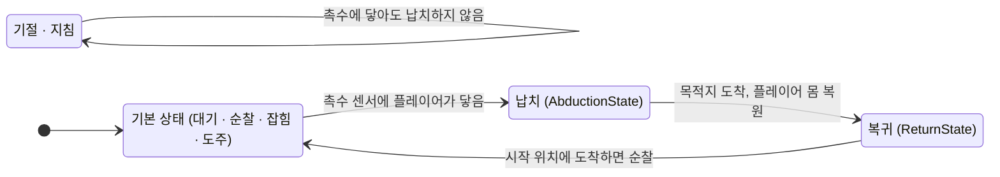

촉수 센서에 플레이어가 닿으면 납치 상태로 넘어갑니다. 목적지에 닿으면 정리(Exit)에서 플레이어 몸을 Dynamic과 처음 자세로 되돌린 뒤 복귀 상태로 넘어가고, 시작 위치에 돌아오면 순찰을 이어 갑니다.
기절 · 지침 · 납치 중에는 촉수 센서가 상태를 확인해 다시 납치하지 않습니다.

<a id="section-2-3"></a>
### 2.3 멀티 플레이에서 물고기를 처리하는 곳

물고기의 생성 · 이동 · 상태 결정은 호스트가 맡습니다. 호스트는 물고기마다 위치 · 방향 · 회전 · 현재 상태를 스냅샷에 담아 보내고, 게스트는 물고기 이동을 잠근 채 받은 값을 화면에 적용합니다. 서버는 호스트의 스냅샷을 게스트에게, 게스트의 입력을 호스트에게 넘겨 주는 중계만 합니다(동기화 구조는 팀원이 만듦).

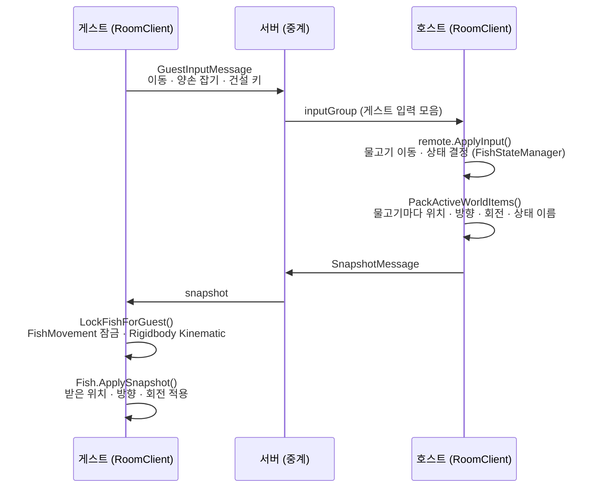

---

## 3. 핵심 기능
<a id="section-3-1"></a>
### 3.1 특수 물고기 설계
<a id="section-3-1-1"></a>
#### 3.1.1 대왕오징어


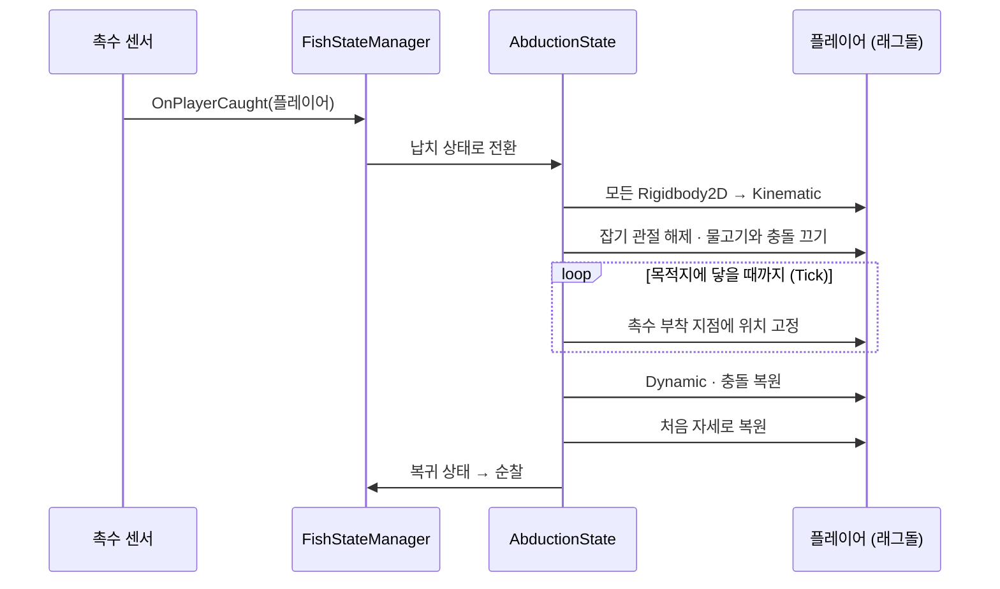

```csharp
playerRigidbodies = owner.PlayerRootPosition
    .GetComponentsInChildren<Rigidbody2D>();
foreach (var rb in playerRigidbodies)
{
    rb.linearVelocity = Vector2.zero;
    rb.bodyType = RigidbodyType2D.Kinematic; // 물리 정지
}
foreach (var ba in playerBottomArms)
    ba.grabJoint.connectedBody = null;       // 잡기 해제
```

<a id="source-abductionstate"></a>
<details>
<summary>원본 코드 전체 보기 — AbductionState.cs</summary>

```csharp
using System.Collections.Generic;
using UnityEngine;

namespace WeGotOne.Fish_Interface
{
    public class AbductionState : IFishState
    {
        private FishStateManager owner;
        
        private float moveSpeed = 10.0f; // 끌고 갈 때는 조금 더 빠르게

        private Transform caughtPlayer;
        private Rigidbody2D[] playerRigidbodies;

        private Collider2D[] playerColliders;
        private Collider2D fishCollider;
        
        private float destinationTolerance = 1.0f;

        public void Enter(FishStateManager owner)
        {
            this.owner = owner;
            
            caughtPlayer = owner.PlayerRootPosition.GetChild(0);
            
            fishCollider = owner.GetComponent<Collider2D>();
            
            playerColliders = owner.PlayerRootPosition.GetComponentsInChildren<Collider2D>();
            
            if (fishCollider != null)
            {
                foreach (var col in playerColliders)
                {
                    Physics2D.IgnoreCollision(fishCollider, col, true);
                }
            }
            
            ChangeToKinematic();
        }

        private void ChangeToKinematic()
        {
            // 1. 하위 계층(모든 자식/손자)의 Rigidbody2D를 통째로 가져옴
            playerRigidbodies = owner.PlayerRootPosition.GetComponentsInChildren<Rigidbody2D>();
            BottomArmController[] playerBottomArms =
                owner.PlayerRootPosition.GetComponentsInChildren<BottomArmController>();

            // 2. 전체 순회하며 Kinematic 전환
            foreach (var rb in playerRigidbodies)
            {
                rb.linearVelocity = Vector2.zero;
                rb.bodyType = RigidbodyType2D.Kinematic;
            }
            foreach (var ba in playerBottomArms)
            {
                ba.grabJoint.connectedBody = null;
            }
        }

        public void Tick()
        {
            // 매니저(owner)가 가지고 있는 목적지 정보를 참조하여 방향 계산
            // 나중에 스폰 매니저 결정되면 스폰매니저가 납치 장소 주입해주기
            // 지금은 인게임씬 활성화 용으로 납치 좌표 하드코딩

            Vector2 destination = owner.AbductionDestination.position - owner.transform.position;
            float distance = Vector2.Distance(owner.transform.position, owner.AbductionDestination.position);
            Debug.Log(owner.AbductionDestination.name);
            
            owner.FishMovement.Move(destination, moveSpeed);
    
            // 플레이어 위치 강제 고정
            if (caughtPlayer != null)
            {
                caughtPlayer.position = owner.PlayerAttachPosition.position;
            }

            if (distance < destinationTolerance)
            {
                Exit();
            }
        }

        public void Exit()
        {
            if (owner != null && owner.FishMovement != null)
            {
                owner.FishMovement.StopMove();
            }

            #region Ai추가

            PlayerController player = owner.PlayerRootPosition.GetComponentInParent<PlayerController>();
    
            // 2. 플레이어가 Start() 때 스스로 저장해 둔 초기 포즈를 꺼내 복원 함수 실행
            if (player != null && player.InitialPlayerState != null)
            {
                player.RestoreToInitialPose(player.InitialPlayerState);
            }
            
            if (fishCollider != null && playerColliders != null)
            {
                foreach (var col in playerColliders)
                {
                    if (col != null)
                    {
                        Physics2D.IgnoreCollision(fishCollider, col, false);
                    }
                }
            }

            #endregion

            // 6. 모든 신체 부위를 다시 Dynamic으로 정상 복원
            if (playerRigidbodies != null)
            {
                foreach (var rb in playerRigidbodies)
                {
                    if (rb != null)
                    {
                        rb.bodyType = RigidbodyType2D.Dynamic;
                        rb.linearVelocity = Vector2.zero;
                    }
                }
            }
            
            Debug.Log("Exit");
            caughtPlayer = null;
            owner.ChangeState(new ReturnState());
        }
    }
}
```

</details>

납치되는 동안에는 플레이어 몸 전체를 Kinematic으로 바꿔 촉수 부착 지점에 고정하고, 물고기와의 충돌도 끕니다.
목적지에 닿으면 Dynamic과 충돌을 되돌리고 처음 자세로 복원한 뒤, 오징어는 원래 자리로 돌아가 순찰을 이어 갑니다.

**지금 모습이 되기까지**

| 단계 | 문제 | 바꾼 것 |
|---|---|---|
| 1차 | 바닥에 닿으면 납치가 끝나는 방식이라, 끌고 가다 다리 콜라이더에 플레이어가 계속 걸림 | 바닥 대신 목적지(AbductionDestination)에 도착하면 끝나도록 |
| 2차 | 목적지에 닿으면 정리(Exit)를 부르지 않고 바로 순찰로 넘어가, 플레이어 몸이 Kinematic인 채로 남음 | 도착하면 정리를 불러 Dynamic으로 되돌린 뒤 순찰로 |
| 3차 | 몸통만 Kinematic으로 고정하고 팔은 관절에 매달린 채 끌려가, 몸이 분리되고 팔이 짧아짐(아래 비교) | 몸 전체를 Kinematic으로, 잡기 관절 해제, 물고기와 충돌 끄기, 끝나면 처음 자세로 복원 |
| 4차 | 납치를 마친 오징어가 원래 순찰 자리로 돌아오는 처리가 없음 | 시작 위치로 돌아가는 복귀 상태(ReturnState)를 만들고, 지친 · 기절 · 납치 중에는 다시 잡지 않도록 |

**납치 중인 플레이어를 어떻게 끌고 갈 것인가**

플레이어는 몸통과 팔 네 마디가 힌지 조인트로 이어진 래그돌입니다(래그돌은 팀원이 만듦).

| | 몸통만 고정해 끌기 (처음 방식) | ✔ 선택: 납치 중에만 몸 전체의 물리를 끄고 고정 |
|---|---|---|
| 방식 | 몸통만 Kinematic으로 바꿔 촉수 위치로 옮기고, 팔은 관절에 매달린 채 물리로 따라오게 함 | 몸 전체를 Kinematic으로, 잡기 관절 해제, 물고기와 충돌 끄기 |
| 장점 | 팔이 흔들리며 끌려가 물리적으로 자연스러움 · 따로 복원할 것이 적음 | 래그돌이 망가지지 않아 안정적 · 끌려가는 경로를 정확히 제어 가능 |
| 단점 | 몸통만 순간이동하니 팔 관절에 갑자기 큰 힘이 걸려 몸이 분리됨 · 팔이 몸 안으로 들어간 뒤 빠져나오지 못해 팔이 짧아지는 버그 | 끌려가는 동안은 덜 물리적으로 보임 · 끝난 뒤 Dynamic·충돌·자세를 직접 복원해야 함 |

**선택한 이유** — 처음에는 몸통만 고정해 끌었지만 팔이 짧아지는 버그가 반복됐습니다. 연출의 자연스러움보다 플레이어 몸이 망가지지 않는 안정성이 더 중요하다고 보고, 납치 중에만 Kinematic으로 고정한 뒤 끝나면 되돌리는 방식을 택했습니다. 복원 처리는 몇 차례 고친 끝에 완성했습니다.

해마는 이 납치에 대응하는 물고기로, 잡으면 플레이어를 목적지까지 데려다 줍니다.

<a id="section-3-1-2"></a>
#### 3.1.2 전기가오리

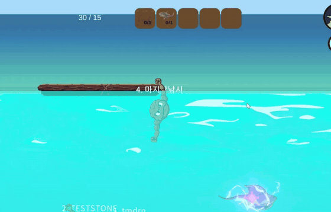

**지금 모습이 되기까지**

| 단계 | 문제 | 바꾼 것 |
|---|---|---|
| 1차 | 처음에는 가오리가 미끼를 먹고 기절한 동안에만 공격을 멈췄습니다. 그런데 팀원이 맡은 미끼 시스템에서 버그가 이어지고 완료가 늦어져, 미끼 시스템을 빼기로 하면서 공격을 멈출 조건이 사라짐 | 한 번 감전시키면 10초 동안 공격을 멈추도록 |
| 2차 | 감전돼 움직이지 못하는 동안에도 잡고 있던 물고기를 그대로 잡고 있음. 마비 중에는 입력을 받지 않아 잡기 상태가 바뀌지 않았기 때문 | 감전되는 순간 오른팔을 강제로 놓게 함(왼팔은 아직 놓지 않음 → [5.3](#section-5-3)) |

```csharp
player.IsParalysis = true;
await UniTask.Delay(TimeSpan.FromSeconds(paralysisDuration),
    cancellationToken: player.destroyCancellationToken);
if (player != null) player.IsParalysis = false;
```

<a id="source-electronicarea"></a>
<details>
<summary>원본 코드 전체 보기 — ElectronicArea.cs</summary>

```csharp
using System.Collections;
using Cysharp.Threading.Tasks;
using UnityEngine;
using WeGotOne.Fish_Interface;

namespace WeGotOne.Electronic_Manta
{
    public class ElectronicArea : MonoBehaviour
    {
        [SerializeField] private float paralysisDuration;
        [SerializeField] private float attackFalseDuration;
        [SerializeField] private FishStateManager stateManager;
        [SerializeField] private GameObject electronicParticle;

        [SerializeField] private bool isAttack = true;
        
        private void OnEnable()
        {
            stateManager = GetComponentInParent<FishStateManager>();
            if(electronicParticle)
                electronicParticle.gameObject.SetActive(true);
            isAttack = true;
        }

        private void OnTriggerEnter2D(Collider2D other)
        {
            if (other.CompareTag("Player") && isAttack)
            {
                Debug.Log("Paralysis Enter");
                PlayerParalysisAsync(other).Forget();
                other.GetComponentInChildren<BottomArmController>().Release();
                StartCoroutine(ElectronicAttackActive());
            }
        }
        
        private async UniTaskVoid PlayerParalysisAsync(Collider2D other)
        {
            PlayerController player = other.GetComponentInParent<PlayerController>();
            if (player == null) return;

            player.IsParalysis = true;

            // 오브젝트 비활성화와 무관하게 동작하며, Time.timeScale의 영향도 정상적으로 받습니다.
            // player가 도중에 파괴되면 작업이 안전하게 취소되도록 토큰을 연결합니다.
            await UniTask.Delay(
                System.TimeSpan.FromSeconds(paralysisDuration), 
                cancellationToken: player.destroyCancellationToken
            );

            if (player != null)
            {
                player.IsParalysis = false;
                Debug.Log(player.IsParalysis);
            }
        }
        
        private IEnumerator ElectronicAttackActive()
        {
            Debug.Log("Attack false");
            if(electronicParticle)
                electronicParticle.SetActive(false);
            isAttack = false;

            yield return new WaitForSeconds(attackFalseDuration);

            if(electronicParticle)
                electronicParticle.gameObject.SetActive(true);
            isAttack = true;
        }
        
    }
}
```

</details>

감전되면 잡고 있던 것을 강제로 놓고 잠시 움직이지 못합니다. 해제는 UniTask로 기다리되, 그 사이 플레이어가 사라지면 대기가 자동으로 취소되도록 destroyCancellationToken을 연결했습니다.

<a id="section-3-1-3"></a>
#### 3.1.3 갯가재

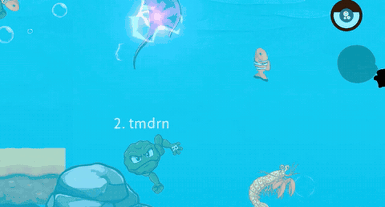

```csharp
private void Update()
{
    // 기절 · 지친 갯가재는 펀치하지 않음
    if (manager.CurrentState is FishFaintState or FishExhaustedState)
    {
        canPunch = false;
        return;
    }
    canPunch = true;
}

private void OnTriggerEnter2D(Collider2D other)
{
    if (other.CompareTag("Player") && canPunch)
    {
        Rigidbody2D bodyRb = other.transform.GetComponent<Rigidbody2D>();
        // 플레이어가 갯가재의 어느 쪽에 있는지로 날릴 방향을 정함
        bool isRight = transform.GetComponentInParent<Transform>().position.x
                       - other.transform.position.x < 0;
        knockbackForce = isRight ? knockbackForce : -knockbackForce;
        StartCoroutine(PlayPunchParticle());   // punchTime 동안 펀치 파티클
        bodyRb.AddForce(new Vector2(direction.x, 0) * knockbackForce, ForceMode2D.Impulse);
    }
}
```

<a id="source-shrimppunch"></a>
<details>
<summary>원본 코드 전체 보기 — ShrimpPunch.cs</summary>

```csharp
using System;
using System.Collections;
using UnityEngine;
using WeGotOne.Fish_Interface;

public class ShrimpPunch : MonoBehaviour
{
    [SerializeField] private float knockbackForce;
    [SerializeField] private Vector3 direction;
    [SerializeField] private ParticleSystem punchParticle;
    [SerializeField] private float punchTime;
    
    private bool canPunch;
    private FishStateManager manager;

    private void Start()
    {
        manager = GetComponentInParent<FishStateManager>();
    }

    private void Update()
    {
        if (manager.CurrentState is FishFaintState or FishExhaustedState)
        {
            canPunch = false;
            return;
        }

        canPunch = true;
    }

    private void OnTriggerEnter2D(Collider2D other)
    {
        if (other.CompareTag("Player") && canPunch)
        {
            Rigidbody2D bodyRb = other.transform.GetComponent<Rigidbody2D>();
            bool isRight = transform.GetComponentInParent<Transform>().position.x - other.transform.position.x < 0;
            knockbackForce = isRight ? knockbackForce : -knockbackForce;
            StartCoroutine(PlayPunchParticle());
            bodyRb.AddForce(new Vector2(direction.x, 0) * knockbackForce, ForceMode2D.Impulse);
        }
    }

    private IEnumerator PlayPunchParticle()
    {
        if (punchParticle == null)
            yield return null;
        if (punchParticle.isPlaying)
            yield return null;

        if(punchParticle)
            punchParticle.gameObject.SetActive(true);
        yield return new WaitForSeconds(punchTime);
        if(punchParticle)
            punchParticle.gameObject.SetActive(false);
    }
}
```

</details>

펀치는 갯가재의 자식 오브젝트에 붙은 트리거 센서입니다. 플레이어 몸이 닿으면 플레이어가 있는 쪽으로 수평 방향의 순간 힘(Impulse)을 주어 멀리 날려 보내고, 펀치 파티클을 punchTime 동안만 켭니다.
처음에는 닿기만 하면 펀치했는데, 9/5 팀 테스트에서 이미 기절한 갯가재도 플레이어가 가까이 가면 펀치하는 문제가 나왔습니다. 그래서 부모의 FishStateManager 상태를 매 프레임 확인해, 기절 · 지친 상태에서는 펀치하지 않도록 했습니다.

<a id="section-3-1-4"></a>
#### 3.1.4 해마

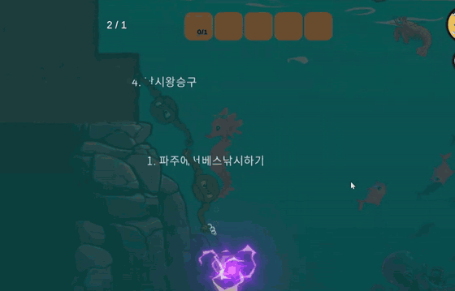

```csharp
// FishStateManager.OnGrabbed — 해마(ItemId 9)는 잡혀도 저항 상태로 가지 않음
if (WorldItem.ItemId != 9)
    TransitionTo(new FishCaughtState());
```

<a id="source-fishstatemanager"></a>
<details>
<summary>원본 코드 전체 보기 — FishStateManager.cs</summary>

```csharp
// 발췌 — 원본 Assets/01. Scripts/501. Fish/Fish_Interface/FishStateManager.cs (273줄 중 내가 쓴 줄 98줄, 커밋 ea9a54b4)
// 내가 작성한 메서드만 옮겼습니다. 팀원이 작성한 부분은 "… 팀원 작성 부분 생략"으로 표시했고,
// "[팀원 수정 포함]"은 내가 만든 메서드를 팀원이 함께 고친 것입니다. 이 파일만으로는 컴파일되지 않습니다.

using System.Collections.Generic;
using UnityEngine;
using Random = UnityEngine.Random;

namespace WeGotOne.Fish_Interface
{
    public class FishStateManager : MonoBehaviour, ICatchable
    {
        // … 팀원 작성 부분 생략

        [Header("물고기 이름")]
        [field: SerializeField]
        public string FishName { get; private set; }

        public FishObjectPool ObjectPool;

        // … 팀원 작성 부분 생략

        [Header("저항도(Resistance) 설정")]
        [SerializeField]
        private float maxResistance = 20f;

        // … 팀원 작성 부분 생략

        // 물 탈출 피드백 함수 예외값을 위한 bool값.
        public bool IsGrabbed => CurrentState is FishCaughtState || CurrentState is FishExhaustedState;
        // … 팀원 작성 부분 생략

        [Header("현재 저항도")]
        [field: SerializeField] public float CurrentResistance { get; private set; }
        [field: SerializeField] public ParticleSystem HitParticle { get; private set; }

        public string CurrentStateName
        {
            get
            {
                if (CurrentState is FishIdleState) return "Idle";
                if (CurrentState is FishPatrolState) return "Patrol";
                if (CurrentState is FishCaughtState) return "Caught";
                if (CurrentState is FishExhaustedState) return "Exhausted";
                if (CurrentState is FishFaintState) return "Faint";
                if (CurrentState is FishRunawayState) return "Runaway";
                if (CurrentState is AbductionState) return "Abduction";
                if (CurrentState is FishItemState) return "FishItem";
                return "Unknown";
            }
        }

        public IFishState CurrentState;

        public PlayerController TargetInfo; // 플레이어 정보

        // … 팀원 작성 부분 생략

        [Header("납치 기믹 설정")] // 납치 상태 설정
        // 납치 할 장소
        [field: SerializeField] public Transform AbductionDestination { get; set; } 
        // 플레이어를 어디에 달고 다닐지
        [field: SerializeField] public Transform PlayerAttachPosition { get; set; }
        public Transform PlayerRootPosition { get; set; }
        public Vector2 StartPosition { get; set; }

        [Header("공격 가능 여부")]
        public bool IsAttack = true;
        [Header("기절 쿨타임")]
        public float FaintDuration;

        [field: SerializeField] public GameObject RunawayParticle { get; set; }

        // … 팀원 작성 부분 생략

        public Animator Animator { get; set; }

        private readonly HashSet<HandControllerV2> grabbingHands = new HashSet<HandControllerV2>();

        // [팀원 수정 포함] 이 메서드에서 내가 쓴 줄 1/3
        private void Awake()
        {
            WorldItem = GetComponent<WorldItem>();
            Animator = GetComponent<Animator>();
        }

        // [팀원 수정 포함] 이 메서드에서 내가 쓴 줄 9/20
        private void OnEnable()
        {
            grabbingHands.Clear();

            StartPosition = transform.position;
            fishMovement = GetComponent<FishMovement>();
            obstacleSensor = GetComponent<FishObstacleSensor>();
            if (obstacleSensor != null)
            {
                obstacleSensor.OnMovementBlocked += HandleWaterBoundary;
            }

            ResetResistance();
            StopConfusedParticle();
            TargetPosition = Vector3.zero;
            BaitInfo = null;
            Hunger = Random.Range(60f, 100f);
            FishName = gameObject.name;
            
            switch (WorldItem.ItemId)
            {
                case 4: AbductionDestination = GameObject.Find("Squid Destination").transform;
                    break;
                case 9: AbductionDestination = GameObject.Find("Seahorse Destination").transform;
                    break;
            }

            ObjectPool = FindFirstObjectByType<FishObjectPool>();
            ChangeState(new FishIdleState());
            
        }

        // … 팀원 작성 부분 생략

        // [팀원 수정 포함] 이 메서드에서 내가 쓴 줄 1/3
        private void Update()
        {
            DecreaseFishHunger();
            CurrentState?.Tick();
        }

        private void OnDisable()
        {
            CurrentState.Exit();
        }

        // [팀원 수정 포함] 이 메서드에서 내가 쓴 줄 1/3
        private void HandleWaterBoundary(RaycastHit2D obstacleHit)
        {
            if (CurrentState is FishPatrolState patrolState)
            {
                patrolState.SetNewWaypoint(obstacleHit);
            }
        }

        // … 팀원 작성 부분 생략

        # region 배고픔 관련

        // … 팀원 작성 부분 생략

        # endregion

        #region 저항도 제어 함수

        // … 팀원 작성 부분 생략

        #endregion

        #region ICatchable 인터페이스 구현 (손 주도 상호작용)

        public void OnGrabbed(HandControllerV2 hand) // 시그니처 수정
        {
            if (hand != null)
            {
                grabbingHands.Add(hand); // 추가: 잡은 손 등록
            }
            

            // 이미 잡혀서 힘겨루기/탈진 중이라면 다른 손이 추가로 잡아도 상태 재진입 방지
            if (CurrentState is FishCaughtState || CurrentState is FishExhaustedState)
                return;

            if (CurrentState is FishFaintState)
            {
                TransitionTo(new FishExhaustedState());
            }
            else
            {
                if (WorldItem.ItemId != 9)
                    TransitionTo(new FishCaughtState());
            }
        }

        // [팀원 수정 포함] 이 메서드에서 내가 쓴 줄 10/15
        public void OnReleased(HandControllerV2 hand) // 시그니처 수정
        {
            if (hand != null)
            {
                grabbingHands.Remove(hand); // 추가: 놓은 손 제거
            }

            // [핵심]: 아직 다른 손(본인의 반대 손이든, 다른 플레이어의 손이든)이 잡고 있다면 즉시 리턴
            if (grabbingHands.Count > 0)
                return;

            // --- 아래는 모든 손이 완전히 놓였을 때(grabbingHands.Count == 0)만 실행 ---

            if (FishName.Contains("Seahorse"))
            {
                CurrentState.Exit();
                return;
            }

            float resistanceRatio = CurrentResistance / maxResistance;

            if (resistanceRatio < 0.3f)
            {
                TransitionTo(new FishFaintState());
            }
            else
            {
                TransitionTo(new FishRunawayState());
            }
        }

        // [팀원 수정 포함] 이 메서드에서 내가 쓴 줄 1/3
        public void OnMissed()
        {
            if (CurrentState is FishIdleState)
            {
                TransitionTo(new FishRunawayState());
            }
        }

        #endregion

        #region 비동기 FSM 코어

        // … 팀원 작성 부분 생략

        // [팀원 수정 포함] 이 메서드에서 내가 쓴 줄 2/4
        private void TransitionTo(IFishState newState)
        {
            if (newState == null) return;

            CurrentState = newState;
            CurrentState.Enter(this);
        }

        public void OnPlayerCaught(Transform playerTransform)
        {
            // 이미 납치 중이 아닐 때만 실행
            if (!(CurrentState is AbductionState))
            {
                PlayerRootPosition = playerTransform;

                // TODO: 플레이어의 조작을 제한하는 로직 호출 (예: playerTransform.GetComponent<PlayerController>().Lock())

                // 납치 상태로 전환
                ChangeState(new AbductionState());
            }
        }

        #endregion

        # region 상태이상 파티클

        // … 팀원 작성 부분 생략

        # endregion
    }
}
```

</details>

```csharp
// SeaHorse — 손이 해마를 잡고 있는 동안
private void OnTriggerStay2D(Collider2D other)
{
    if (other.gameObject.layer == LayerMask.NameToLayer("PlayerHand"))
    {
        if (playerHand != null && playerHand.IsGrabbing)
        {
            Vector2 destination = manager.AbductionDestination.position - manager.transform.position;
            float distance =
                Vector2.Distance(manager.transform.position, manager.AbductionDestination.position);

            manager.FishMovement.Move(destination, moveSpeed);   // 목적지로 헤엄쳐 감

            if (distance < 1.0f)   // 도착하면 손을 놓게 함
            {
                playerHand.Release();
                playerHand = null;
            }
        }
    }
}
```

<a id="source-seahorse"></a>
<details>
<summary>원본 코드 전체 보기 — SeaHorse.cs</summary>

```csharp
using System;
using UnityEngine;
using UnityEngine.InputSystem.iOS;
using WeGotOne.Fish_Interface;

namespace WeGotOne
{
    public class SeaHorse : MonoBehaviour
    {
        [SerializeField] private FishStateManager manager;
        [SerializeField] private HandControllerV2 playerHand;

        [SerializeField] private float moveSpeed;

        private void Awake()
        {
            manager = GetComponent<FishStateManager>();
        }

        private void OnTriggerEnter2D(Collider2D other)
        {
            if (other.gameObject.layer == LayerMask.NameToLayer("PlayerHand"))
            {
                playerHand = other.GetComponent<HandControllerV2>();

                if (playerHand.IsGrabbing)
                {
                    manager.ChangeState(new FishItemState());
                }
            }
        }

        private void OnTriggerStay2D(Collider2D other)
        {
            if (other.gameObject.layer == LayerMask.NameToLayer("PlayerHand"))
            {
                if (playerHand != null && playerHand.IsGrabbing)
                {
                    Vector2 destination = manager.AbductionDestination.position - manager.transform.position;
                    float distance =
                        Vector2.Distance(manager.transform.position, manager.AbductionDestination.position);
                    Debug.Log(manager.AbductionDestination.name);

                    manager.FishMovement.Move(destination, moveSpeed);
                    Debug.Log(destination);

                    if (distance < 1.0f)
                    {
                        playerHand.Release();
                        playerHand = null;
                    }
                }
            }
        }
    }
}
```

</details>

해마는 일반 물고기와 달리 잡혀도 힘겨루기(저항 상태)를 하지 않습니다. 플레이어 손이 해마를 잡으면 아무 행동도 하지 않는 FishItemState로 바뀌어 원래 움직임을 멈추고, 잡고 있는 동안 플레이어를 매단 채 목적지로 헤엄쳐 갑니다. 목적지에 가까워지면 손을 놓게 해 플레이어를 내려 줍니다.
이동은 대왕오징어 납치와 같은 AbductionDestination · FishMovement.Move를 다시 썼고, 목적지 지점만 해마용("Seahorse Destination")으로 따로 두었습니다.

**해마는 플레이어를 어떻게 데려다 줄 것인가**

| 단계 | 방식 | 결과 |
|---|---|---|
| 1차 | 해마를 잡으면 플레이어 몸통만 무중력으로 하고, 손을 놓으면 해마를 풀로 돌려보내 한 번 쓰고 사라지는 아이템처럼 처리(처음 기획에는 해마 말고도 친구 물고기가 여럿 있었고, 모두 쓰면 사라지는 아이템으로 정했기 때문) | 해마가 잡혀도 움직이지 않아 데려다 주지 못하고, 팔은 그대로 중력을 받아 아래로 처짐 |
| 2차 | 잡는 순간 대왕오징어의 납치 상태(AbductionState)를 그대로 써서, 플레이어 몸 전체를 Kinematic으로 고정하고 해마와 함께 목적지로 옮김. 손을 놓으면 납치 상태를 끝내고, 해마는 1차처럼 풀로 돌아가 사라짐 | 목적지까지 데려다 주기는 하지만, 끌려가는 동안 플레이어 몸이 통째로 고정돼 스스로 아무것도 할 수 없음. 그사이 기획이 바뀌고 일정에 맞추느라 다른 친구 물고기는 만들지 않기로 해, 해마를 아이템처럼 사라지게 할 이유가 없어짐. 9/5 팀 테스트 다음 날 새벽 긴급 수정에서 사라지게 하는 처리를 해마 스크립트째 지우고, 놓으면 일반 물고기처럼 순찰 상태로 돌아가게 함 |
| ✔ 3차 | 손으로 해마를 잡고 있는 동안에만 해마가 목적지로 헤엄쳐 가고, 플레이어는 손 관절로 매달려 끌려감 | 해마 질량을 1에서 15로 올려 플레이어 무게에 끌려 내려가지 않게 함 |

**선택한 이유** — 친구 물고기가 해마 하나로 줄면서, 해마는 쓰고 사라지는 아이템이 아니라 여러 번 잡아 쓰는 물고기가 됐습니다. 또 해마는 플레이어가 직접 잡아서 쓰는 '친구 물고기'라, 잡고 있는 동안만 움직이는 쪽이 조작과 맞았습니다. 처음 두 방식은 각각 해마가 움직이지 않거나 몸을 통째로 고정해야 했고, 마지막 방식은 플레이어 몸을 그대로 두고 손 관절만으로 끌기 때문에 질량만 맞추면 됐습니다.

<a id="section-3-2"></a>
### 3.2 다리 건설 연출

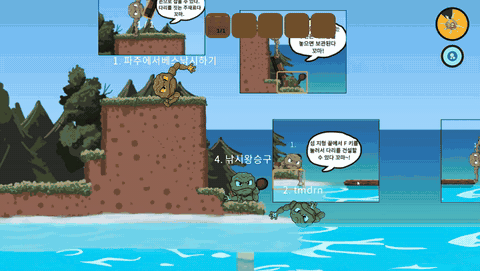

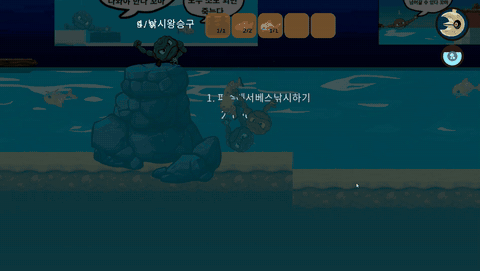

```csharp
// 다음 구역이 열리면 1초 뒤 카메라가 목적지로 이동
if (GameManager.Instance.IsCamTargetChange)
{
    ChangeWaitTime += Time.deltaTime;
    if (ChangeWaitTime >= 1.0f)
    {
        lerpSpeed = 1f;   // 천천히 따라가도록
        if (currentPoint < GameManager.Instance.CheckPoints.Length)
            return GameManager.Instance
                .CheckPoints[currentPoint].transform.position;
    }
}
return Target.position;   // 평소에는 플레이어를 따라감
```

<a id="source-simplefollowcamera"></a>
<details>
<summary>원본 코드 전체 보기 — SimpleFollowCamera.cs</summary>

```csharp
using System;
using HelloServer;
using UnityEngine;
using UnityEngine.InputSystem;

namespace WeGotOne
{
    // 타겟을 부드럽게(Lerp) 따라가는 범용 추적 카메라

    public class SimpleFollowCamera : MonoBehaviour
    {
        public enum States
        {
            Stopped,
            Holding,
            Following
        }

        [field: SerializeField] public Transform Target { get; set; }
        [SerializeField] private float lerpSpeed; // 따라가는 속도, Damping 값
        [SerializeField] private Vector3 offset;

        private Camera Cam { get; set; }
        private States State { get; set; }

        private static readonly Key[] FollowKeys = { Key.Digit1, Key.Digit2, Key.Digit3, Key.Digit4 };
        private Key followKey;
        private string followedPlayerId;

        private int currentPoint;
        public float ChangeWaitTime { get; private set; }

        private void Start()
        {
            Cam = Camera.main;

            // [보완]: 시작할 때 인스펙터에 타겟을 넣어두었다면, 바로 Following 상태로 시작하게 만듭니다.
            if (Target != null)
            {
                State = States.Following;
            }
            else
            {
                State = States.Stopped;
            }
        }


        private void Update()
        {
            SetFollowKey();
        }

        private void SetFollowKey()
        {
            if (IntegratedDebugUI.IsTeleportModeActive)
            {
                followedPlayerId = null;
                return;
            }

            if (RoomClient.IsInitialized == false 
                || RoomClient.Instance.Me == null 
                || RoomClient.Instance.SnapshotMessage == null)
            {
                followedPlayerId = null;
                return;
            }
            
            Keyboard keyboard = Keyboard.current;
            PlayerState[] players = RoomClient.Instance.SnapshotMessage?.Players;

            for (int i = 0; i < players.Length; i++)
            {
                if (keyboard[FollowKeys[i]].wasPressedThisFrame)
                {
                    followKey = FollowKeys[i];
                    followedPlayerId = players[i].Id;
                }
            }
        }

        private void LateUpdate()
        {
            switch(State)
            {
                case States.Stopped:
                    // 멈춤 상태가 되면 타겟을 비워버립니다.
                    Target = null;
                    break;
                case States.Holding:
                    // Holdin은 Target은 존재하지만 카메라를 이동하지 않는 상태
                    break;
                case States.Following:
                    // Target의 위치를 적절히 보간하여 적용합니다.
                    // ps : lerpSpeed는 댐핑값이라고 해서 속도에 대한 보정값입니다.
                    // =======================
                    // 아래의 보간내용은 (transform.position)을 (Target.position + offset)으로 초당 (lerpSpeed) 속도로
                    // 계속 가깝게 만드는 코드 입니다. Target.position이 멀다면 더 빨리, 가깝다면 느리게
                    Vector3 targetPos = GetFollowPosition();
                    Vector3 lerpPos = Vector3.Lerp(Cam.transform.position, targetPos + offset, lerpSpeed * Time.deltaTime);
                    lerpPos.z = Cam.transform.position.z; // 2D의 경우 z는 바뀌지 않습니다.
                    Cam.transform.position = lerpPos;
                    
                    if(currentPoint >= GameManager.Instance.CheckPoints.Length) return;
                    
                    if (GameManager.Instance.IsCamTargetChange && Mathf.Abs(Cam.transform.position.x -
                                                                            GameManager.Instance.CheckPoints[currentPoint].transform.position.x) <= 0.1f)
                    {
                        GameManager.Instance.IsCamTargetChange = false;
                        ChangeWaitTime = 0.0f;
                        GameManager.Instance.spawnPointIndex = currentPoint;
                        GameManager.Instance.UpdateSpawnPoint();
                        currentPoint++;
                    }
                    break;
            }
        }

        private Vector3 GetFollowPosition()
        {
            Keyboard keyboard = Keyboard.current;
            PlayerState[] players = RoomClient.Instance.SnapshotMessage?.Players;

            if (GameManager.Instance.IsCamTargetChange)
            {
                ChangeWaitTime += Time.deltaTime;
                if (ChangeWaitTime >= 1.0f)
                {
                    lerpSpeed = 1f;
                    if (currentPoint < GameManager.Instance.CheckPoints.Length)
                    {
                        return GameManager.Instance.CheckPoints[currentPoint].transform.position;    
                    }

                    return Target.position;
                }
            }
            
            if (followedPlayerId != null && keyboard[followKey].isPressed)
            {
                // 배열 순서가 바뀌어도 누를 때 선택한 플레이어를 계속 따라갑니다.
                foreach (PlayerState player in players)
                {
                    if (player.Id == followedPlayerId)
                    {
                        return new Vector3(player.Body.X, player.Body.Y, Target.position.z);
                    }
                }
            }

            // 키 해제 또는 대상 퇴장 시 기존 자신의 Target으로 복귀합니다.
            followedPlayerId = null;
            return Target.position;
        }

        private void OnDisable()
        {
            followedPlayerId = null;
        }

        public void ChangeState(States state)
        {
            if(state == States.Following && Target == null)
            {
                Debug.LogWarning("SimpleFollowCamera :: Target이 없어 Following 상태로 전환할 수 없습니다");
                return;
            }

            State = state;
            followedPlayerId = null;
        }

    }

}


```

</details>

다리를 한 칸 지을 때마다 효과음과 구름 파티클을, 물고기나 나무를 넣을 때는 인벤토리가 DOTween으로 튀어 오르는 피드백을 넣었습니다. 다리가 이어져 다음 구역이 열리면 카메라가 1초 뒤 다음 목적지까지 천천히 이동해 갈 곳을 보여 주고, 도착하면 다시 플레이어를 따라갑니다.

**물고기 피드백** — 좀 더 게임다운 표현을 위해, 도망가는 물고기에는 효과음과 버블 파티클을 붙이고 꼬리 애니메이션을 20배 빠르게 돌렸습니다. 잡힌 물고기가 지형에 부딪칠 때는 파티클과 효과음을 내고, 세게 부딪칠수록 효과음 음높이를 낮게 했습니다.

**고친 문제**

- **인벤토리 아이콘이 계속 커짐** — 튀어 오르는 연출이 끝나기 전에 아이템이 또 들어오면, 커진 크기를 기준으로 다시 튀어 크기가 쌓였습니다. 연출 전에 진행 중인 트윈을 멈추고(DOKill) 크기를 원래대로 돌린 뒤 다시 튀게 했습니다.
- **게스트 화면의 카메라** — 다리 건설 처리에서 스테이지 번호를 바꾸는 줄이 호스트만 실행하는 부분 뒤에 있어, 게스트는 다음 구역으로 넘어간 것을 알지 못했습니다. 세 번 고친 끝에 이 줄을 호스트 전용 부분 앞으로 옮겨, 게스트도 같은 목적지로 카메라가 이동하게 했습니다.

**게임 오버 · 클리어 연출** — 게임 오버 창이 뜨면 배경이 어두워지면서 캐릭터가 위에서 떨어지고, 착지하는 순간 카메라가 흔들리며 캐릭터가 납작해졌다 펴집니다. 이어서 GAME, OVER 글자가 차례로 튕기며 떨어지고 마지막에 버튼이 튀어나옵니다. 클리어 창은 "We made it!" 타이틀이 튕기며 떨어진 뒤 메뉴 버튼이 나옵니다. 모두 DOTween Sequence로 순서를 짰습니다.

<a id="section-3-3"></a>
### 3.3 두 손 · 여러 플레이어가 함께 잡는 판정

**문제** — 기존 팀원이 작성한 잡기 로직에서는 두 손 혹은 여러 플레이어가 잡고 있다가 한 손만 놓아도 물고기가 도주 상태로 넘어가고, 저항도가 더 이상 깎이지 않았습니다.

**원인** — 손을 놓을 때 불리는 `OnReleased()`가 어느 손이 놓았는지 넘겨받지 않아, 물고기는 아직 다른 손이 잡고 있는지 알 수 없었습니다.

```csharp
public void OnReleased()   // 어느 손이 놓았는지 모름
{
    // 손이 하나라도 떨어지면 바로 저항도로 기절 / 도주 결정
    if (resistanceRatio < 0.3f) TransitionTo(new FishFaintState());
    else                        TransitionTo(new FishRunawayState());
}
```

[원본 코드: FishStateManager.cs](#source-fishstatemanager)

**해결** — 처음에는 잡은 플레이어의 양손 상태(`IsLeftGrab` · `IsRightGrab`)를 확인해 막았지만, 이 값에는 마지막으로 잡은 플레이어 한 명만 들어 있어 다른 플레이어의 손은 셀 수 없었습니다. 그래서 `OnGrabbed` · `OnReleased`가 손을 넘겨받도록 바꾸고, 잡은 손을 직접 모아 두었습니다.

```csharp
public void OnReleased(HandControllerV2 hand)
{
    if (hand != null)
        grabbingHands.Remove(hand);   // ① HashSet에서 놓은 손만 제거

    // ② 아직 다른 손(반대 손이든 다른 플레이어 손이든)이 잡고 있으면 유지
    if (grabbingHands.Count > 0)
        return;

    // ③ 마지막 손이 떨어진 순간의 저항도로 기절 / 도주 결정
    ...
}
```

[원본 코드: FishStateManager.cs](#source-fishstatemanager)

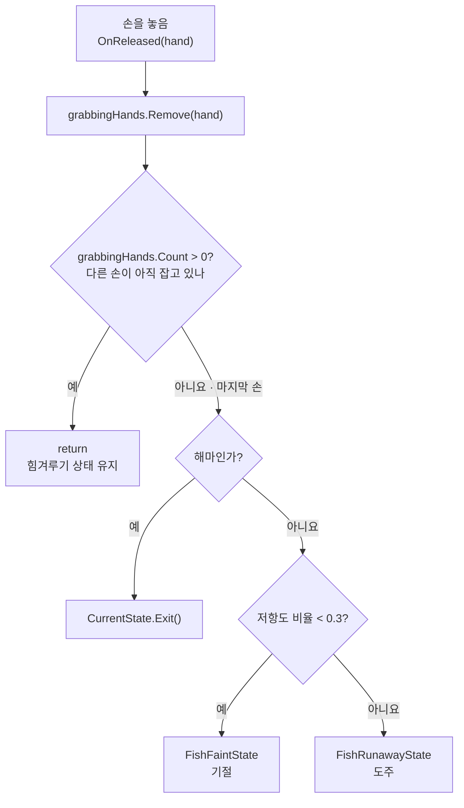

1. **양손 불값 대신 HashSet** — 플레이어 한 명의 양손 상태 대신, 물고기를 잡고 있는 손을 직접 집합으로 관리했습니다.

   처음 방식은 아래처럼 잡은 플레이어의 양손 불값(`IsLeftGrab` · `IsRightGrab`)을 확인했습니다. 그런데 손이 잡을 때마다 `TargetInfo`가 그 손의 플레이어로 바뀌어, 물고기는 마지막으로 잡은 플레이어의 손만 볼 수 있었습니다. HashSet은 어느 플레이어의 손이든 손 자체를 담기 때문에, 같은 손은 한 번만 들어가고 마지막 손이 떨어질 때까지 잡은 판정이 유지됩니다.

   ```csharp
   public PlayerController TargetInfo;   // 잡을 때마다 마지막으로 잡은 플레이어로 바뀜

   public void OnReleased()
   {
       if (TargetInfo.IsLeftGrab && TargetInfo.IsRightGrab)   // 그 플레이어의 양손만 확인
           return;
       ...
   }
   ```
2. **마지막 손일 때만 전환** — 협동해서 잡는 중에는 한 명이 손을 바꿔 잡아도 물고기가 도망가지 않습니다.

<a id="section-3-4"></a>
### 3.4 빠르게 만든 초기 인벤토리 · 다리 건설 프로토타입

팀이 기획한 최종 구조는 처음부터 정해져 있었지만, 게임 루프(잡기 → 넣기 → 짓기)를 빨리 돌려 보기 위해 프로젝트 첫 주에 초기본을 먼저 만들었습니다.

| 기능 | 초기본에서 만든 방식 |
|---|---|
| 인벤토리 | 강의 때 만든 인벤토리를 가져와 수정. 물고기가 다리의 저장 영역(트리거)에 닿으면 사라지고 팀 인벤토리에 아이콘 표시 |
| 자원 개수 | 처음에는 슬롯마다 int와 TMP_Text로 세다가, 아이템 번호를 키로 하는 Dictionary(ItemCountDic)로 한 곳에서 관리 |
| 다리 건설 | 다리 위에 플레이어가 있는지 TriggerStay2D로 확인하고, 미리 놓아 둔 다리 조각을 켜며 나무 1개를 씀 |
| 자원 생성 | 정해 둔 판자 · 물고기 자리에 풀에서 꺼내 놓는 방식 → 위치 오브젝트의 자식으로 만들어, 앞쪽 자리는 다리 칸 수만큼 판자, 나머지는 판자가 아닌 아이템을 랜덤으로 골라 비어 있을 때만 켜는 방식으로 정리 |

이후 팀원이 네트워크 동기화에 맞춰 오브젝트 풀과 다리 · 아이템 구조를 리팩터링했고, 마지막 점검까지 버그를 고치면서 지금의 최종 로직으로 바뀌었습니다.

---

## 4. AI 협업

- **쓴 방식** — 코드는 직접 짜고, Gemini와 노트북LM에게 보여 주며 검토와 설명을 받았습니다. 특수 물고기 이미지도 노트북LM으로 프롬포트를 생성하고 Gemini로 이미지를 만들었습니다.
- **맡긴 것**
  - 기존에 사용하던 애셋 스타일에 맞게 필요한 이미지를 생성했습니다.
  - 직접 짠 대왕오징어 납치 상태와, 충돌 · 장애물 감지를 Fish 하나로 합친 코드를 검토받았습니다. 물고기의 판단(State)과 이동(Movement)을 나누는 리팩터링 초안도 받았습니다.
  - 힌지 조인트 · Kinematic 같은 물리 동작과, 프로젝트에 있던 코드(지형 충돌 이벤트, 효과음 매니저)는 설명을 받아 이해했습니다.
- **직접 판단한 것**
  - Fish를 특수 물고기가 상속할 부모로 묶으려다, 그러면 Fish가 껍데기만 남는다는 점을 짚고 상속 구조를 다시 고민했습니다.
  - AI가 준 리팩터링 코드에서 원래 IFishState의 내용이 빠진 것과, 장애물 센서가 목표 지점을 받지 못하게 된 것을 찾아 지적했습니다.
  - 오징어의 순찰 이동을 아래로만 가는 대신 목적지 방향으로 가도록 직접 바꿨고, 납치 상태는 오징어에만 묶이지 않게 재사용할 수 있는 이름(AbductionState)으로 정했습니다.
  - 납치한 플레이어가 자꾸 튕겨 나가는 원인을 힌지 조인트로 짐작해 확인했고, 납치 중에만 Kinematic으로 고정하는 쪽을 택했습니다([3.1.1](#section-3-1-1)).
- **확인한 방법**
  - 직접 짠 코드를 먼저 보여 주고 검토받는 순서로 썼고, 받은 코드는 그대로 붙이지 않고 기존 구조와 맞는지 대조했습니다.
  - 이해되지 않는 답은 다시 물어 확인했습니다.
  - Unity에서 실행해 본 결과(플레이어가 튕겨 나감, 물고기가 목적지로 가지 않음, 복원 뒤 관절이 펴지지 않음)를 그대로 설명해 원인을 좁혀 갔습니다.

---

## 5. 회고

<a id="section-5-1"></a>
### 5.1 결과

기획한 특수 물고기 4종을 모두 구현했고, 오징어 납치와 해마 대응처럼 플레이어끼리 서로 도와야 하는 상황을 만들었습니다.

<a id="section-5-2"></a>
### 5.2 배운 점

- **기능별 브랜치 관리와 충돌 해결을 통해 협업 과정에서의 문제 해결 능력을 배웠습니다.** 기능별 브랜치를 생성해 개발을 진행했으며, 메인 씬·프리팹·폰트 에셋 등을 여러 팀원이 동시에 수정하면서 발생한 충돌을 직접 해결했습니다. 또한 버그 수정 브랜치를 별도로 관리해 기능 개발과 버그 수정을 분리했습니다. 이를 통해 Git 브랜치 전략을 활용하면 작업을 효율적으로 분담하고, 충돌 상황에서도 안정적으로 협업할 수 있다는 점을 배웠습니다.

- **서버와 호스트의 역할을 분리하면 멀티플레이 구조를 효율적으로 설계할 수 있다는 점을 배웠습니다.** 팀장님이 구현한 서버 구조를 살펴보며 서버와 호스트가 담당하는 역할을 이해했습니다. 서버는 게스트의 입력과 호스트의 게임 상태를 중계하고, 실제 플레이어 이동이나 다리 건설 등의 게임 로직은 호스트가 처리하는 구조였습니다. 이를 통해 멀티플레이 환경에서는 데이터 전달과 실제 게임 로직 처리를 분리해 각 구성 요소의 책임을 명확히 하는 것이 중요하다는 점을 배웠습니다.

<a id="section-5-3"></a>
### 5.3 아쉬운 점과 개선 계획

- **상태 전환 시 정리(Exit)가 자동으로 호출되지 않는 문제** — 상태 내부에서 직접 정리 작업을 수행하다 보니 동일한 정리 코드가 중복되는 문제가 있었습니다. → 상태 전환 함수 한 곳에서 Exit를 일괄 처리하도록 개선할 계획입니다.

- **목적지는 Find로 탐색하고 상태는 문자열로 비교하는 구조** — 오브젝트 이름이 변경되면 참조가 끊기거나 상태 비교가 정상적으로 이루어지지 않을 수 있습니다. → 외부에서 참조를 주입받고 enum을 활용하여 상태를 비교하는 방식으로 변경할 계획입니다.

- **비동기 처리 방식의 혼용** — 팀원들의 매니저 및 서버 코드에서 UniTask를 사용하고 있어 마비 해제 기능을 UniTask로 변경했지만, 동일한 파일의 공격 정지 쿨다운은 코루틴으로 유지하여 두 가지 비동기 처리 방식이 혼용되었습니다. → 코드의 일관성과 유지보수성을 높이기 위해 비동기 처리 방식을 UniTask로 통일할 계획입니다.

- **갯가재 넉백 방향이 반대로 적용되는 버그** — 넉백 방향을 결정하는 과정에서 지역 변수가 아닌 넉백 힘 필드 자체의 부호를 변경하여, 왼쪽에서 두 번 피격될 경우 갯가재 방향으로 날아가는 문제가 발생할 수 있습니다. → 넉백 힘 필드의 원본 값은 유지하고, 방향은 지역 변수로 별도 계산하도록 변경할 계획입니다.

- **감전 상태에서도 왼손은 놓지 않는 문제** — 놓아야 할 팔을 `GetComponentInChildren`으로 탐색하면서 가장 먼저 검색된 오른팔만 놓이는 문제가 있었습니다. → `LeftBottomArm`과 `RightBottomArm`을 각각 명시적으로 처리하여 양팔 모두 놓이도록 수정할 계획입니다.

## 종합 회고

이번 프로젝트는 제 구현 역량의 범위뿐만 아니라, 코드 설계와 일정 관리 측면의 보완점까지 명확히 확인한 계기였습니다. 기능을 구현하는 데만 급급하지 않고 유지보수성과 협업 효율을 먼저 고민해야 한다는 값진 교훈을 얻었습니다.