# We Got One 기술 문서

> **잡기에 변수를 주고 협동을 끌어내는 특수 물고기 4종 — 세부 기획부터 구현까지**

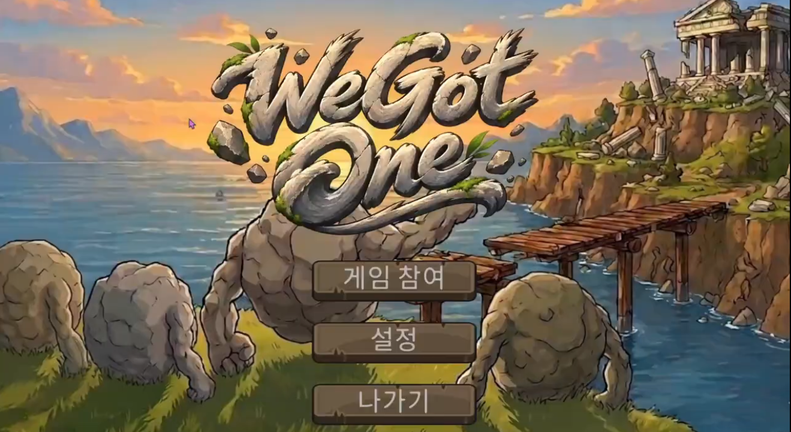

| 항목 | 내용 |
|---|---|
| 장르 | 2D 물리 기반 협동 게임 (호스트 · 게스트 네트워크) |
| 기간 · 인원 | 2026.08 – 09 · 4인 팀 (학원 팀 프로젝트) |
| 엔진 · 도구 | Unity 6, C#, UniTask, DOTween, Git · Fork |
| 내 담당 | 특수 물고기 4종 세부 기획·구현, 다리 건설 연출, 게임 피드백 효과, 초기 인벤토리·다리 건설 프로토타입 |
| 링크 | [시연 영상](https://tmdrn17.github.io/portfolio/src/02-WeGotOne/video/we-got-one.mp4) · [GitHub 요청 시 공유] |

---

## 1. 개요

### 1.1 물리 팔로 물고기를 잡아 다리를 짓는 협동 게임

<video src="video/we-got-one.mp4" controls preload="metadata" playsinline width="100%"></video>

2D 물리 협동 팀 프로젝트에서 **특수 물고기 기믹**, **FSM 확장**, **래그돌 제어**, **다리 건설 연출**을 담당했습니다.

### 1.2 왜 만들었나

**팀이 목표한 경험** — 서로 같은 목표를 향해 다 같이 협동하면서도, 때로는 서로를 방해하게 되는 불협화음을 헤쳐나가며 목적지까지 도달하는 경험을 주고 싶었습니다.

**담당 기능** — 특수 물고기 4종, 다리 건설 연출 · 피드백 효과

- **특수 물고기 4종** — 기획 단계에서 일반 물고기만 있으면 '잡고 버티기'만 반복될 것으로 예상했습니다. 그래서 적대 물고기 3종(대왕오징어 · 갯가재 · 전기가오리)으로 잡는 과정에 변수를 넣었고, 방해만 있으면 좌절감이 커지기 때문에 친구 물고기인 해마로 대왕오징어의 납치에 대응할 수단을 주었습니다.
- **다리 건설 연출 · 피드백 효과** — 무엇이 인벤토리에 들어갔는지, 다리가 얼마나 지어졌는지, 다음에 어디로 가야 하는지 플레이어가 헷갈리지 않도록 효과음 · 파티클 · 인벤토리 튀어 오름 · 카메라 이동으로 진행 상황을 알려 주고 싶었습니다.

### 1.3 게임 루프

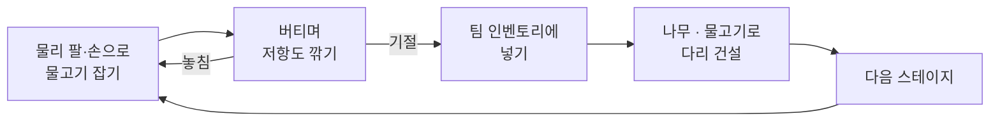

### 1.4 담당 파트 — 특수 물고기 4종: 잡기에 변수를, 협동에 이유를

| 물고기 | 그림 | 구분 | 동작 | 의도 |
|---|---|---|---|---|
| 대왕오징어 | 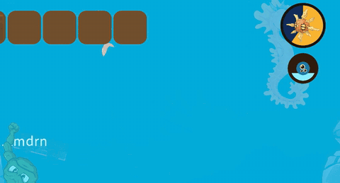 | 적대 | 촉수로 플레이어를 붙잡아 끌고 갔다가 놓아 줌 | 동료가 끌려가는 위기 상황을 만들어 협동 유도 |
| 갯가재 | 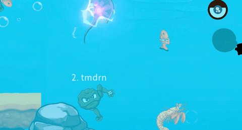 | 적대 | 펀치로 플레이어를 멀리 날려 버림 | 잡으러 다가가는 순간에 긴장감을 줌 |
| 전기가오리 | 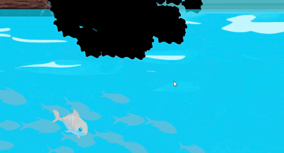 | 적대 | 감전시켜 잡고 있던 것을 놓치게 하고 잠시 못 움직이게 함 | 애써 잡은 물고기를 놓치거나 아무것도 잡지 못 해 바다에 가라앉는 변수 |
| 해마 | 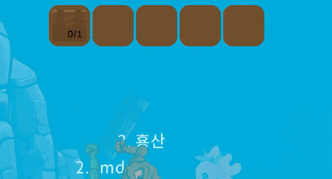 | 친구 | 손으로 잡으면 플레이어를 목적지까지 데려다 줌 | 대왕오징어의 납치에 대응하는 수단 |

특수 물고기는 기획 단계에서 아이디어가 나왔고, 각 물고기의 동작과 수치 등 세부 기획은 직접 정했습니다.


---

## 2. 시스템 구조

### 2.1 물고기 FSM에 특수 상태와 센서를 얹는 구조

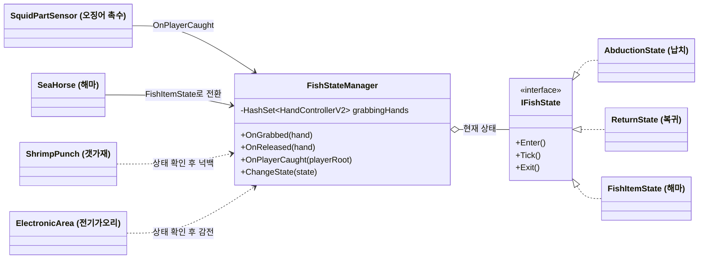

물고기의 기본 상태 머신(IFishState: Enter · Tick · Exit) 위에 납치·복귀·해마 상태를 추가했습니다.
오징어 촉수, 갯가재 펀치, 전기가오리 감전은 자식 오브젝트의 트리거 센서로 만들어, 물고기 본체는 그대로 두고 기믹만 붙이고 뗄 수 있게 했습니다.
센서는 FishStateManager의 현재 상태를 확인해, 기절하거나 지친 물고기는 공격하지 않습니다.

---

## 3. 핵심 기능

### 3.1 두 손 · 여러 플레이어가 함께 잡는 판정

**문제** — 두 손으로 잡고 있다가 한 손만 놓아도 물고기가 도주 상태로 넘어가고, 저항도가 더 이상 깎이지 않았습니다.

```csharp
public void OnReleased(HandControllerV2 hand)
{
    if (hand != null)
        grabbingHands.Remove(hand);   // ① HashSet에서 놓은 손만 제거

    // ② 아직 다른 손(반대 손이든 다른 플레이어 손이든)이 잡고 있으면 유지
    if (grabbingHands.Count > 0)
        return;

    // ③ 마지막 손이 떨어진 순간의 저항도로 기절 / 도주 결정
    ...
}
```

1. **개수 대신 HashSet** — 같은 손이 두 번 들어가거나 빠지는 일을 막기 위해, 잡은 손을 정수 카운트가 아니라 집합으로 관리했습니다.
2. **마지막 손일 때만 전환** — 협동해서 잡는 중에는 한 명이 손을 바꿔 잡아도 물고기가 도망가지 않습니다.

### 3.2 대왕오징어 — 래그돌 플레이어를 안전하게 납치하고 되돌리기

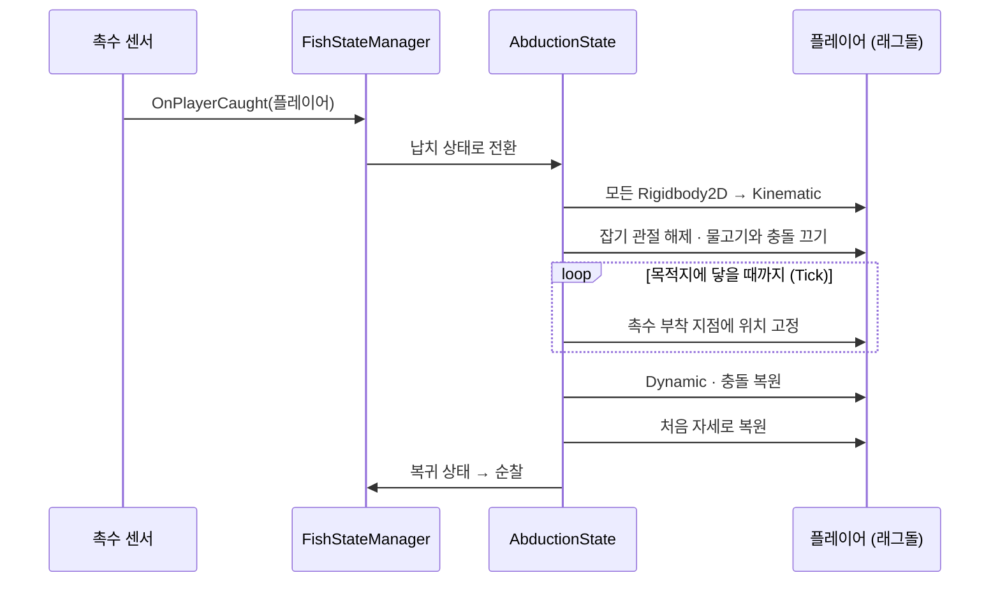

```csharp
playerRigidbodies = owner.PlayerRootPosition
    .GetComponentsInChildren<Rigidbody2D>();
foreach (var rb in playerRigidbodies)
{
    rb.linearVelocity = Vector2.zero;
    rb.bodyType = RigidbodyType2D.Kinematic; // 물리 정지
}
foreach (var ba in playerBottomArms)
    ba.grabJoint.connectedBody = null;       // 잡기 해제
```

납치되는 동안에는 플레이어 몸 전체를 Kinematic으로 바꿔 촉수 부착 지점에 고정하고, 물고기와의 충돌도 끕니다.
목적지에 닿으면 Dynamic과 충돌을 되돌리고 처음 자세로 복원한 뒤, 오징어는 원래 자리로 돌아가 순찰을 이어 갑니다.

해마는 이 납치에 대응하는 물고기로, 잡으면 플레이어를 목적지까지 데려다 줍니다.

### 3.3 전기가오리 감전과 다리 건설 연출

#### 전기가오리 감전

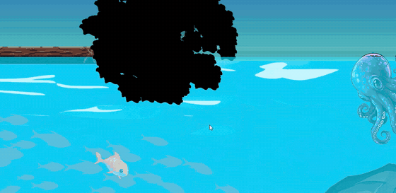

```csharp
player.IsParalysis = true;
await UniTask.Delay(TimeSpan.FromSeconds(paralysisDuration),
    cancellationToken: player.destroyCancellationToken);
if (player != null) player.IsParalysis = false;
```

감전되면 잡고 있던 것을 강제로 놓고 잠시 움직이지 못합니다. 해제는 UniTask로 기다리되, 그 사이 플레이어가 사라지면 대기가 자동으로 취소되도록 destroyCancellationToken을 연결했습니다.

#### 다리 건설 연출

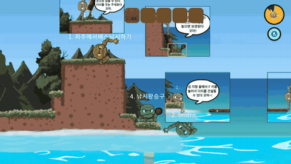

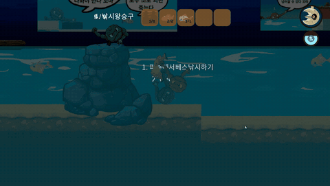

```csharp
// 다음 구역이 열리면 1초 뒤 카메라가 목적지로 이동
if (GameManager.Instance.IsCamTargetChange)
{
    ChangeWaitTime += Time.deltaTime;
    if (ChangeWaitTime >= 1.0f)
    {
        lerpSpeed = 1f;   // 천천히 따라가도록
        if (currentPoint < GameManager.Instance.CheckPoints.Length)
            return GameManager.Instance
                .CheckPoints[currentPoint].transform.position;
    }
}
return Target.position;   // 평소에는 플레이어를 따라감
```

다리를 한 칸 지을 때마다 효과음과 구름 파티클을, 물고기나 나무를 넣을 때는 인벤토리가 DOTween으로 튀어 오르는 피드백을 넣었습니다. 다리가 이어져 다음 구역이 열리면 카메라가 1초 뒤 다음 목적지까지 천천히 이동해 갈 곳을 보여 주고, 도착하면 다시 플레이어를 따라갑니다.

---

## 4. 고민과 선택

### 4.1 납치 중인 플레이어를 어떻게 끌고 갈 것인가

| | 관절로 연결해 물리로 끌기 | ✔ 선택: 납치 중에만 물리를 끄고 고정 |
|---|---|---|
| 장점 | 래그돌이 흔들리며 끌려가 물리적으로 자연스러움 · 별도 복원 처리가 필요 없음 | 래그돌이 망가지지 않아 안정적 · 끌려가는 경로를 정확히 제어 가능 |
| 단점 | 관절에 갑자기 큰 힘이 걸려 몸이 분리됨 · 팔이 몸 안으로 들어간 뒤 빠져나오지 못해 팔이 짧아지는 버그 | 끌려가는 동안은 덜 물리적으로 보임 · 끝난 뒤 Dynamic·충돌·자세를 직접 복원해야 함 |

**선택한 이유** — 처음에는 관절로 끌었지만 팔이 짧아지는 버그가 반복됐습니다. 연출의 자연스러움보다 플레이어 몸이 망가지지 않는 안정성이 더 중요하다고 보고, 납치 중에만 Kinematic으로 고정한 뒤 끝나면 되돌리는 방식을 택했습니다. 복원 처리는 몇 차례 고친 끝에 완성했습니다.

---

## 5. 회고

### 5.1 결과

기획한 특수 물고기 4종을 모두 구현했고, 오징어 납치와 해마 대응처럼 플레이어끼리 서로 도와야 하는 상황을 만들었습니다.

[플레이 테스트 반응 · 영상 등 추가 예정]

### 5.2 협업

기능마다 브랜치를 따로 만들어 작업했고(예: feature/대왕-오징어), 메인 씬·프리팹·폰트 에셋 충돌을 직접 정리했습니다. 테스트에서 나온 버그는 전용 브랜치에 모아 처리했습니다.

### 5.3 아쉬운 점과 개선 계획

- **상태 전환 때 정리(Exit)가 자동으로 불리지 않음** — 상태 안에서 직접 정리하다 보니 코드가 중복됐습니다. → 전환 함수 한 곳에서 Exit 일괄 처리
- **목적지는 Find로, 상태는 문자열로 비교** — 이름이 바뀌면 깨지는 구조입니다. → 외부에서 주입하고 enum으로 비교
- **비동기 방식이 섞임** — 감전 해제는 UniTask, 쿨다운은 코루틴으로 의도 없이 섞였습니다. → 한 방식으로 통일

### 5.4 이 프로젝트를 거치며 달라진 점

인터페이스 기반 FSM 위에 기믹을 얹고, 브랜치 단위로 팀 협업을 했습니다.
