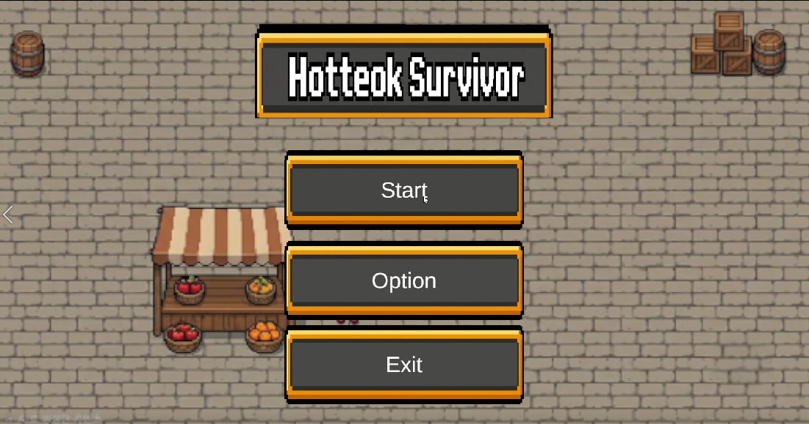
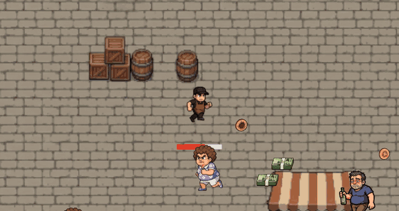
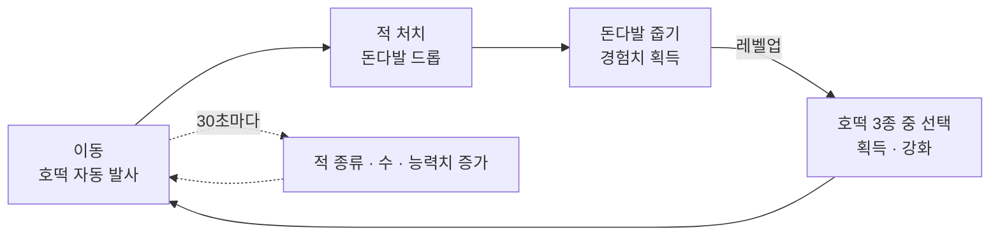
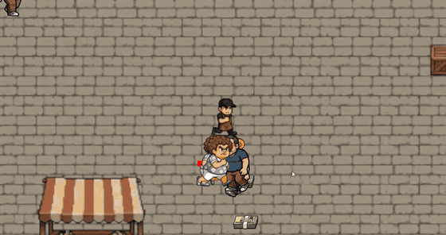
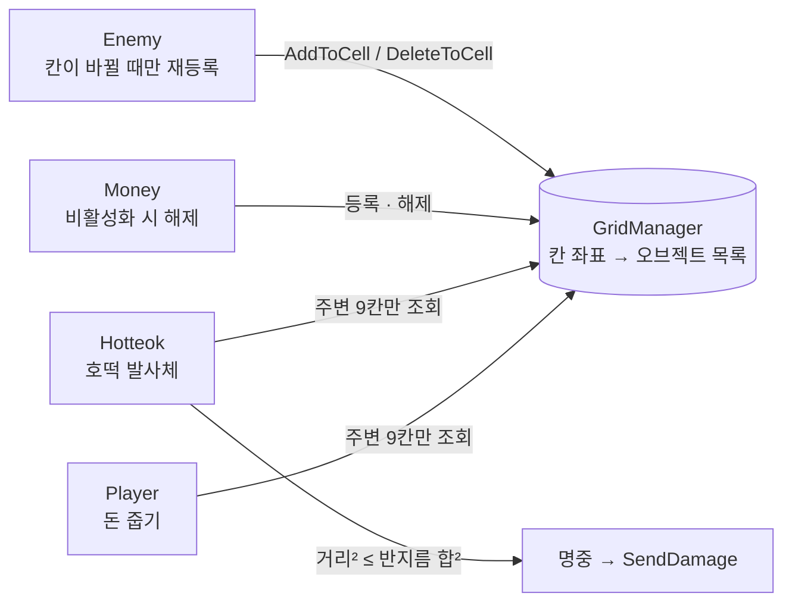
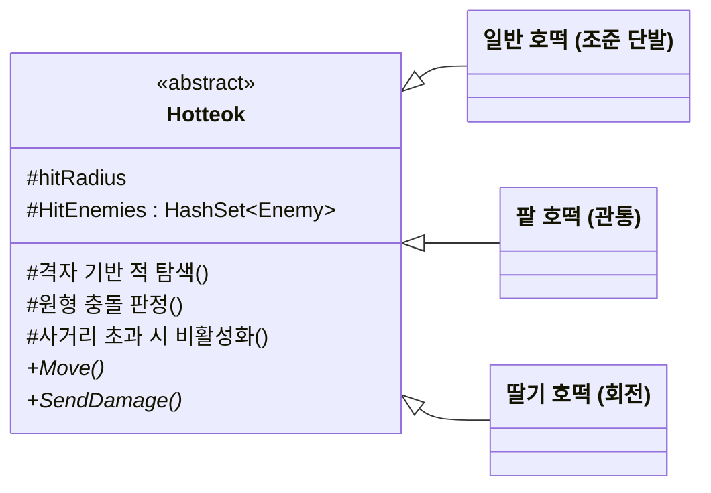
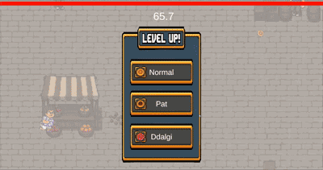
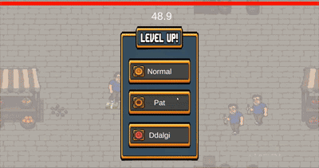
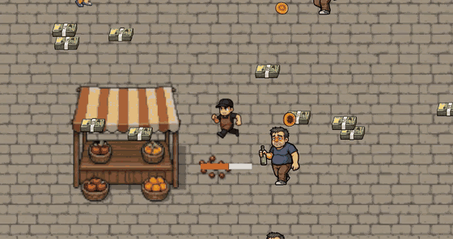

# 호떡 서바이버 프로젝트 문서

> **몰려오는 수많은 적들을 제거해 나가며 제한 시간 동안 생존하는 2D 탑다운 서바이버(뱀파이어 서바이버 라이크)**



| 항목 | 내용 |
|---|---|
| 장르 | 2D 탑다운 서바이버 (뱀파이어 서바이버 라이크) |
| 기간 · 인원 | 2026.06 – 07 · 개인 |
| 엔진 · 도구 | Unity 6, C# |
| 구현 | 기획·개발 전체 (수업 제공 풀·싱글톤 유틸 사용) |
| 링크 | [시연 영상](https://youtu.be/JJOqmqxmZzc) · [쇼츠](https://youtu.be/U7DGuq-M4d4) · [GitHub](https://github.com/tmdrn17/HotteokSurvivor-Code) |

---

## 1. 개요

<a id="section-1-1"></a>
### 1.1 최적화를 공부하기 위해 고른 뱀서류

<iframe src="https://www.youtube.com/embed/JJOqmqxmZzc" title="시연 영상" allow="accelerometer; clipboard-write; encrypted-media; gyroscope; picture-in-picture" allowfullscreen style="display:block;width:55%;aspect-ratio:16/9;height:auto;border:0"></iframe>

개인 프로젝트로 **공간 분할 격자**, **무한맵**, **추상 클래스 무기**를 구현했습니다.



최적화를 직접 공부해 보고 싶었습니다. 뱀서류는 적과 탄환이 화면 가득 몰려나오는 장르라, 처음부터 많은 오브젝트를 어떻게 가볍게 처리할지를 중심에 두고 설계했습니다.

**목표한 경험** — 끊임없이 몰려오는 적들에 대한 압박감 속에서, 레벨업 순간마다 랜덤으로 나오는 보상을 고르고, 그 선택의 결과로 패배하거나 강력한 화력으로 적들을 쓸어버리는 쾌감을 주고 싶었습니다.

<a id="section-1-2"></a>
### 1.2 게임 루프





돈다발 하나가 경험치 1이고, 레벨업에 필요한 경험치는 10에서 시작해 레벨마다 1씩 늘어납니다.

---

## 2. 시스템 구조

스크립트마다 맡을 역할을 정해 나눴습니다. (경계가 흐려진 곳은 [6.3](#section-6-3)에 적었습니다.)

| 클래스 | 맡은 일 |
|---|---|
| GameManager | 경과 시간을 재고, 100초가 되면 클리어 처리. 레벨업 때 선택 창을 띄우고 시간을 멈춤 |
| PoolingSystem | 적 · 호떡 · 돈다발 풀을 만들고 꺼냄. 화면에서 멀어진 적을 스폰 지점으로 다시 배치. 호떡 종류마다 쿨타임에 맞춰 발사 |
| GridManager | 칸 좌표마다 그 칸의 오브젝트 목록을 보관하고, 칸 등록 · 해제와 위치 → 칸 번호 계산을 맡음 |
| DifficultySystem | 30초마다 적을 추가하고 모든 적의 능력치를 올림 |
| MapSystem | 플레이어와 멀어진 배경 타일을 반대편으로 옮김 |
| UIManager | 메인 · 게임 오버 · 클리어 · 레벨업 · 게임 화면 패널을 켜고 끔. 시간 · 경험치 표시. 레벨업에서 고른 호떡을 강화 |
| Player | 이동, 주변 9칸에서 돈다발 줍기, 경험치와 레벨업 |

<a id="section-2-1"></a>
### 2.1 격자를 중심으로 모이는 충돌 판정



적과 돈다발은 자신이 속한 칸에 등록하고, 호떡과 플레이어는 자기 칸과 주변 8칸만 조회합니다. 같은 격자를 공격 판정과 돈 줍기에 함께 씁니다.

<details>
<summary>코드 전체 보기</summary>

```csharp
// ① 내 위치가 속한 칸 번호
Vector2Int myCell = GridManager.Instance.GetCellIndex(transform.position);
// ② 내 칸 + 주변 8칸만 확인
for (int x = -1; x <= 1; x++)
    for (int y = -1; y <= 1; y++)
    {
        checkCell = myCell + new Vector2Int(x, y);
        if (!Grid.TryGetValue(checkCell, out List<GameObject> enemies))
            continue;
        for (int i = 0; i < enemies.Count; i++)
        {
            Enemy enemy = enemies[i].GetComponent<Enemy>();
            // ③ 제곱 거리와 반지름 합으로 원형 충돌
            Vector3 diff = transform.position - enemy.transform.position;
            float sqrDist = diff.sqrMagnitude;
            float radius = hitRadius + enemy.hitRadius;
            // ④ 같은 적 중복 타격 방지
            if (sqrDist <= radius * radius && !HitEnemies.Contains(enemy))
            {
                HitEnemies.Add(enemy);
                SendDamage();
                return;
            }
        }
    }
```

</details>

가독성을 위해 일부 줄을 줄여 옮겼습니다. 원본: Hotteok.SearchEnemy()

1. **칸은 Dictionary로** — 칸 좌표(Vector2Int)를 키로, 그 칸의 오브젝트 목록을 값으로 둡니다. 적은 칸이 바뀔 때만 다시 등록합니다.
2. **검사 대상을 줄이기** — 화면 전체가 아니라 가까운 9칸에 있는 소수의 적과만 거리를 계산합니다.
3. **제곱근 없는 거리 비교** — 실제 거리 대신 제곱 거리로 비교해 매 프레임 제곱근 계산을 피했습니다.
4. **관통 호떡의 다단히트 방지** — 이미 맞힌 적은 HashSet에 기록해 같은 적을 여러 번 때리지 않습니다.

<a id="section-2-2"></a>
### 2.2 추상 클래스로 늘어나는 무기



탐색·충돌·사거리처럼 모든 호떡에 공통인 부분은 추상 클래스가 맡고, 각 호떡은 이동(Move)과 피해(SendDamage)만 구현합니다.

---

## 3. 핵심 기능

<a id="section-3-1"></a>
### 3.1 끝없는 맵과 늘어나는 호떡

**지금 코드가 되기까지** — 처음에는 플레이어의 이동량을 x와 y의 합으로 판정했는데, 축별로 나눠 고쳤습니다. 합으로 보면 가로 1칸 · 세로 0.6칸처럼 어느 축도 경계(1.5칸)를 넘지 않았는데 타일이 옮겨지고, 어느 방향으로 옮길지도 정할 수 없기 때문입니다. 또 처음에는 타일 크기를 숫자 하나(20)로 고정해 두었는데, 플레이해 보니 옮긴 타일 사이에 틈이 보였습니다. 그래서 스프라이트 크기에서 가로 · 세로를 따로 계산하도록 바꿨습니다.

<details>
<summary>코드 전체 보기</summary>

```csharp
// 플레이어와 1.5칸 넘게 멀어진 타일을
// 반대편 끝(3칸 너비)으로 옮김
if (absDiffX > tileSizeX * 1.5f)
{
    float dirX = Mathf.Sign(diffX);
    mapTiles[i].position += Vector3.right * (dirX * tileSizeX * 3f);
}
if (absDiffY > tileSizeY * 1.5f)
{
    float dirY = Mathf.Sign(diffY);
    mapTiles[i].position += Vector3.up * (dirY * tileSizeY * 3f);
}
```

</details>

배경 타일 9장만으로 끝없는 맵을 만들었습니다. 타일 크기는 스프라이트 크기에서 자동으로 계산하고, 같은 발상으로 화면에서 너무 멀어진 적도 다시 배치해 재사용합니다.

적은 PoolingSystem이 매 프레임 화면 기준점과의 가로 · 세로 거리를 보고, 정해 둔 거리(가로 17 · 세로 13)를 넘으면 무작위 스폰 지점으로 옮긴 뒤 격자에 다시 등록합니다(RegistGrid).

**선택한 이유** — 뱀서류는 몬스터가 넘치게 소환되고, 플레이어는 계속 도망치면서 적을 요격해야 합니다. 그래서 정적으로 커다란 맵을 만들기보다 동적으로 계속 넓어지는 맵을 만들고 싶었습니다. 또 맵을 계속 새로 만들기보다 이미 렌더링된 맵을 재활용하는 쪽이 리소스 측면에서 낫다고 판단했습니다.

#### 호떡 3종

| 호떡 | 동작 |
|---|---|
| 일반 호떡 | 가까운 칸에서 찾은 적을 조준하는 단발. 적이 없으면 마우스 방향으로 발사 |
| 팥 호떡 | 적을 관통. 이미 맞힌 적은 HashSet으로 걸러 다단히트 방지 |
| 딸기 호떡 | 플레이어 주위를 회전. 일정 시간 켜졌다 꺼지기를 반복하고, 다시 켜질 때 맞힌 기록을 비움 |





레벨업 때 세 호떡 중 하나를 골라 얻거나 강화합니다. 일반 · 팥 호떡은 강화 레벨만큼 풀에서 꺼내 재사용하고, 딸기 호떡은 최대 4개에서 더 늘어나지 않기 때문에 풀 없이 미리 둔 4개 중 강화 레벨만큼만 켭니다. 새 호떡은 이동과 피해 방식만 구현하면 추가됩니다.

<a id="section-3-2"></a>
### 3.2 30초마다 오르는 난이도

게임은 100초를 버티면 클리어되고, 30초마다 적이 늘고 강해집니다. 시작할 때는 두 종류의 적이 3마리씩, 모두 6마리 나옵니다.

| 시간 | 추가되는 적 | 모든 적의 능력치 |
|---|---|---|
| 30초 | Drunker +2 | 최대 체력 +50 · 방어력 +1 · 공격력 +1 |
| 60초 | Old Woman +1 | 최대 체력 +50 · 방어력 +1 · 공격력 +1 |
| 90초 | Drunker +1 | 최대 체력 +50 · 방어력 +1 · 공격력 +1 |

| 적 | 체력 | 방어력 | 공격력 | 이동 속도 |
|---|---|---|---|---|
| Old Woman | 30 | 1 | 1 | 2 |
| Drunker | 50 | 2 | 2 | 1.5 |

적이 받는 피해는 호떡의 피해에서 방어력을 뺀 값이고, 0보다 작아지지 않습니다.

**이렇게 짠 이유** — 경과 시간이 기준을 넘었는지만 보면, 기준을 넘은 뒤로는 매 프레임 조건이 참이 되어 적이 매 프레임 추가됩니다. 그래서 한 번 오르면 다음 기준을 30초 뒤로 밀어(③) 단계마다 한 번만 오르게 했습니다. 또 새로 추가되는 적만 강하게 하면, 죽은 뒤 풀에서 다시 켜지는 기존 적은 처음 능력치로 계속 나와 난이도가 일부만 오릅니다. 그래서 이미 나와 있는 적까지 모든 적의 능력치를 올립니다(②).

<details>
<summary>코드 전체 보기</summary>

```csharp
if (GameManager.Instance.CurrentTime >= difficultyTime && curTime <= difficultyTime)
{
    // ① 이번 단계의 적 종류 · 수만큼 풀에 추가
    PoolingSystem.Instance.AddEnemyList(enemyKind[enemyPoolLevel], enemyCount[enemyPoolLevel]);

    // ② 이미 나와 있는 적까지 모두 강해짐
    for (int i = 0; i < PoolingSystem.Instance.enemiseList.Count; i++)
    {
        PoolingSystem.Instance.enemiseList[i].Stat.MaxHp += 50;
        PoolingSystem.Instance.enemiseList[i].Stat.DefensivePower += 1;
        PoolingSystem.Instance.enemiseList[i].Stat.Damage += 1;
    }

    // ③ 다음 상승은 30초 뒤
    enemyPoolLevel++;
    curTime = GameManager.Instance.CurrentTime;
    difficultyTime += 30f;
}
```

</details>

DifficultySystem.cs — 단계마다 추가할 적 종류 · 수는 인스펙터 배열(enemyKind · enemyCount)로 정합니다.

---

## 4. 고민과 선택

<a id="section-4-1"></a>
### 4.1 충돌 판정을 물리 엔진에 맡길 것인가

| | 콜라이더 + Rigidbody | ✔ 선택: 공간 분할 격자 (직접 구현) |
|---|---|---|
| 장점 | Unity가 충돌을 처리해 주므로 구현이 쉬움 · 원형 외에 다양한 모양을 지원 | 가까운 칸만 확인해 검사 대상이 크게 줄어듦 · 최적화를 직접 공부해 볼 수 있음 |
| 단점 | 오브젝트마다 물리 계산이 붙어 무거움 · 적과 탄환이 수백 개씩 나오는 장르에서 부담이 커질 것으로 예상 | 충돌 판정 수식을 직접 짜야 함 (모양이 다양해질수록 늘어남) · 칸 등록·해제를 직접 관리해야 함 |

**선택한 이유** — 처음에는 Physics2D.CircleCast와 Enemy 태그로 호떡과 적의 충돌을 판정하기 시작했지만, 다음 날 격자와 제곱 거리 비교로 바꿨습니다. 뱀서류는 적과 탄환이 대량으로 몰려나오기 때문에, 문제가 생기기 전에 미리 예상하고 물리 엔진 대신 격자 방향을 택했습니다. 판정 수식과 칸 관리를 직접 맡는 비용은 감수했고, 적과 탄환은 원으로 단순화해 거리 비교만으로 판정했습니다.

<a id="section-4-2"></a>
### 4.2 관통 호떡이 같은 적을 여러 번 때리지 않게 하려면

팥 호떡은 적을 뚫고 지나가는데, 적과 겹쳐 있는 동안에는 매 프레임 충돌 판정에 걸립니다.

| | bool 하나(isAttack) | ✔ 선택: 맞힌 적 목록(HashSet&lt;Enemy&gt;) |
|---|---|---|
| 방식 | 호떡이 한 번 맞혔는지만 기록 | 맞힌 적 자체를 기록하고, 이미 있는 적은 건너뜀 |
| 결과 | 기록만 하고 판정에서 확인하지 않아, 적과 겹친 동안 같은 적에게 매 프레임 피해가 들어감(다단히트). 확인하게 하더라도 첫 적 하나만 맞고 그다음 적은 못 때려 관통이 의미 없어짐 | 같은 적은 한 번만 맞고, 뚫고 지나가며 만나는 다른 적은 계속 맞힘 |

**선택한 이유** — 관통은 "여러 적을 한 번씩" 때려야 하므로, 맞혔는지가 아니라 누구를 맞혔는지를 알아야 했습니다. 같은 적이 두 번 들어가지 않고 들어 있는지 확인이 빠른 HashSet을 골랐습니다. 이 목록은 모든 호떡의 부모 클래스에 두고 비우는 시점만 다르게 해, 팥 호떡은 발사할 때마다 비우고, 회전하는 딸기 호떡은 적을 맞히고 0.5초 뒤에 비워 주위를 도는 동안 같은 적을 다시 때릴 수 있게 했습니다.

---

## 5. AI 협업

- **쓴 방식** — 코드는 직접 쓰고, AI는 설계 상담 · 모르는 구현 방법의 설명 · 버그 원인 분석 · 애셋 프롬프트 작성에 썼습니다.
- **맡긴 것**
  - 강의 자료를 넣은 NotebookLM에 설계를 물었습니다(총알을 추상 클래스로 만들지, 데미지를 총알이 줄지 적이 받을지 등). 구현 방법을 모르던 공간 분할 격자와 관통 호떡의 다단히트 방지(HashSet)는 설명과 예시를 받았습니다.
  - NotebookLM에 Gemini를 프롬프트 보조로 정해 두고, 프로젝트에 사용할 애셋 생성용 프롬프트 작성을 맡겼습니다.
- **직접 판단한 것**
  - 총알 근처의 적을 리스트에 담아 거리로 판정하자는 답에, 그러면 결국 적을 전부 찾아 거리를 계산해야 한다는 점을 짚었습니다. 리지드바디만 빼고 콜라이더를 남겨도 부담은 같다는 점도 확인해, 물리 엔진 대신 격자로 직접 판정하기로 했습니다([2.1](#section-2-1), [4.1](#section-4-1)).
  - 무한맵은 타일 9장을 두고 플레이어가 일정 거리 이상 움직이면 반대편 타일을 앞으로 옮기는 방식을 먼저 생각해 확인받았고, 이동량을 x와 y의 합으로 보던 부분을 축별로 나눠 고쳤습니다([3.1](#section-3-1)).
  - 기획서로 뽑은 애니메이션 목록 중 플레이어 공격(투척) 모션은, 호떡이 자동으로 나가는 게임이라 필요 없다고 보고 뺐습니다.
- **확인한 방법**
  - 받은 설명은 그대로 쓰지 않고 제 말로 다시 정리해 맞는지 되물은 뒤, 코드는 직접 짰습니다.
  - 짠 코드는 붙여 넣어 로직이 맞는지 검수받았고, 답이 이해되지 않거나 맞지 않아 보이면 다시 물었습니다.
  - 게임에서 생긴 문제는 오류 메시지와 관련 코드를 함께 넣어 원인을 좁혔습니다. 돈이 먹혔다 안 먹혔다 하는 버그는 클래스 세 개를 함께 넣어, 꺼진 돈이 격자에 남아 있던 것이 원인임을 찾고 켜질 때 등록 · 꺼질 때 해제하도록 고쳤습니다.

---

## 6. 회고

<a id="section-6-1"></a>
### 6.1 결과

격자 기반 충돌, 무한맵, 호떡 3종과 시간에 따른 난이도 상승까지 한 판의 루프를 혼자 완성했습니다.



<a id="section-6-2"></a>
### 6.2 배운 점

**맞혔는지가 아니라 누구를 맞혔는지** — 팥 호떡의 다단히트를 bool 하나(isAttack)로 막으려 했을 때는, 같은 적에게 매 프레임 피해가 들어가거나 첫 적만 맞아 관통이 의미 없어졌습니다. 맞힌 적 자체를 HashSet에 기록하고 나서야 "여러 적을 한 번씩"이 됐습니다. 기능이 의도대로 안 될 때 로직보다 먼저, 무엇을 기록하고 있는지를 다시 보게 됐습니다.

**공통은 부모에, 다른 점만 자식에** — 탐색, 충돌, 사거리와 같은 공통 기능은 추상 클래스 Hotteok에서 관리하고, 각 호떡의 고유한 동작인 Move와 SendDamage는 자식 클래스에서 구현했습니다. 또한, 적중한 적 목록을 부모 클래스에서 공통으로 관리하되 비우는 시점을 각 호떡의 특성에 맞게 분리했습니다. 이를 통해 관통하는 팥 호떡과 회전하는 딸기 호떡을 동일한 구조 안에서 처리할 수 있었습니다. 이 과정을 통해 상속을 활용하면 공통 로직의 중복을 줄이고, 각 클래스의 고유한 기능을 독립적으로 확장할 수 있다는 점을 이해했습니다.

**AI 설명은 제 말로 다시 정리한 뒤에 쓰기** — 공간 분할 격자와 HashSet은 처음 써 보는 방법이라 AI에게 설명을 받았습니다. 받은 설명은 그대로 쓰지 않고, 제 말로 다시 정리해 맞는지 되물은 뒤 직접 짰습니다. 그래서 이 문서의 격자와 다단히트 방지를 남의 코드가 아니라 제 코드로 설명할 수 있게 됐습니다.

<a id="section-6-3"></a>
### 6.3 아쉬운 점과 개선 계획

- **개발 일정이 지연된 점** — 개발 일정 지연으로 선택 가능한 능력이 호떡 3종에 한정되어 항상 같은 능력만 제시되었습니다. 또한 적의 동시 등장 수가 최대 10마리에 그쳐 뱀서류 게임 특유의 물량감이 부족했습니다. → 개발 초기 단계부터 기능별 우선순위와 일정을 세분화하고, 핵심 시스템을 먼저 완성하여 개발 지연을 줄일 계획입니다.

- **성능 개선 효과를 검증하지 못한 점** — 예상에 의존해 최적화 효과를 판단하고 실제 성능을 측정하지 못했습니다. → 앞으로 성능을 비교해야 할 때에는 Unity Profiler를 사용해 수치화할 계획입니다.

- **격자 시스템의 정리 처리가 불완전했던 점** — `OnDisable`에서 격자 해제가 누락되고, 재활성화 시 위치 변경보다 활성화가 먼저 이루어지는 문제가 있었습니다. → 비활성화 시 격자를 해제하고 위치 변경 후 활성화하도록 수정할 계획입니다.

- **가장 가까운 적을 조준하지 못한 점** — `SearchEnemy`를 조준에도 재사용하여 가장 가까운 적이 아닌 마지막으로 탐색된 적을 공격했습니다. → 탐색 과정에서 제곱 거리를 비교해 가장 가까운 적을 조준하도록 수정할 계획입니다.

- **클래스별 역할 분리가 부족했던 점** — `PoolingSystem`이 여러 기능을 담당하고, `UIManager`가 호떡 강화까지 직접 처리했습니다. → 기능별로 책임을 분리하고 UI는 선택 결과만 전달하도록 개선할 계획입니다.

## 종합 회고

이번 프로젝트를 통해 단순히 기능이 동작하게 만드는 것과, 탄탄한 구조와 성능·완성도까지 챙기는 것은 별개의 문제임을 깊이 체감했습니다. 특히 기술적 선택의 이유를 스스로 설명할 수 있어야 한다는 점과, 초기 설계부터 객체 생명주기·역할 분리·객관적 성능 검증까지 함께 고민해야 한다는 과제를 명확히 확인했습니다.