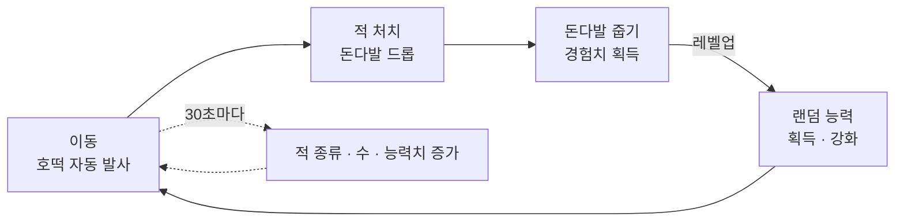
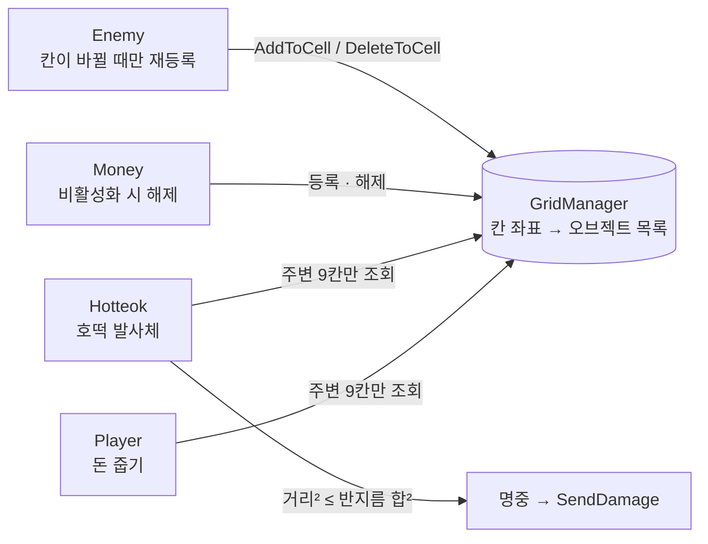
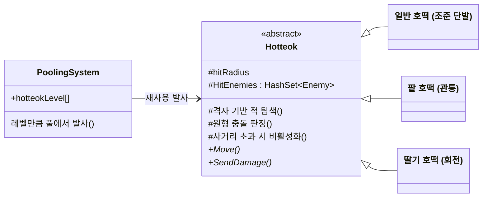

# 호떡 서바이버 기술 문서

> **수많은 적과 탄환을 감당하기 위해 물리 엔진 대신 공간 분할 격자로 충돌을 직접 구현**

| 항목 | 내용 |
|---|---|
| 장르 | 2D 탑다운 서바이버 (뱀서류) |
| 기간 · 인원 | 2026.06 – 07 · 개인 |
| 엔진 · 도구 | Unity 6, C# |
| 구현 | 기획·개발 전체 (수업 제공 풀·싱글톤 유틸 사용) |
| 링크 | [시연 영상 예정] · [GitHub 요청 시 공유] |

---

## 1. 개요

### 1.1 최적화를 공부하기 위해 고른 뱀서류

개인 프로젝트로 **공간 분할 격자**, **무한맵**, **추상 클래스 무기**를 구현했습니다.

### 1.2 왜 만들었나

최적화를 직접 공부해 보고 싶었습니다. 뱀서류는 적과 탄환이 화면 가득 몰려나오는 장르라, 처음부터 많은 오브젝트를 어떻게 가볍게 처리할지를 중심에 두고 설계했습니다.

### 1.3 게임 루프



---

## 2. 시스템 구조

### 2.1 격자를 중심으로 모이는 충돌 판정



적과 돈다발은 자신이 속한 칸에 등록하고, 호떡과 플레이어는 자기 칸과 주변 8칸만 조회합니다. 같은 격자를 공격 판정과 돈 줍기에 함께 씁니다.

### 2.2 추상 클래스로 늘어나는 무기



탐색·충돌·사거리처럼 모든 호떡에 공통인 부분은 추상 클래스가 맡고, 각 호떡은 이동(Move)과 피해(SendDamage)만 구현합니다.

---

## 3. 핵심 기능

### 3.1 주변 9칸만 확인하는 공간 분할 격자

```csharp
// ① 내 위치가 속한 칸 번호
Vector2Int myCell = GridManager.Instance.GetCellIndex(transform.position);
// ② 내 칸 + 주변 8칸만 확인
for (int x = -1; x <= 1; x++)
    for (int y = -1; y <= 1; y++)
    {
        checkCell = myCell + new Vector2Int(x, y);
        if (!Grid.TryGetValue(checkCell, out List<GameObject> enemies))
            continue;
        for (int i = 0; i < enemies.Count; i++)
        {
            Enemy enemy = enemies[i].GetComponent<Enemy>();
            // ③ 제곱 거리와 반지름 합으로 원형 충돌
            Vector3 diff = transform.position - enemy.transform.position;
            float sqrDist = diff.sqrMagnitude;
            float radius = hitRadius + enemy.hitRadius;
            // ④ 같은 적 중복 타격 방지
            if (sqrDist <= radius * radius && !HitEnemies.Contains(enemy))
            {
                HitEnemies.Add(enemy);
                SendDamage();
                return;
            }
        }
    }
```

가독성을 위해 일부 줄을 줄여 옮겼습니다. 원본: Hotteok.SearchEnemy()

1. **칸은 Dictionary로** — 칸 좌표(Vector2Int)를 키로, 그 칸의 오브젝트 목록을 값으로 둡니다. 적은 칸이 바뀔 때만 다시 등록합니다.
2. **검사 대상을 줄이기** — 화면 전체가 아니라 가까운 9칸에 있는 소수의 적과만 거리를 계산합니다.
3. **제곱근 없는 거리 비교** — 실제 거리 대신 제곱 거리로 비교해 매 프레임 제곱근 계산을 피했습니다.
4. **관통 호떡의 다단히트 방지** — 이미 맞힌 적은 HashSet에 기록해 같은 적을 여러 번 때리지 않습니다.

### 3.2 끝없는 맵과 늘어나는 호떡

```csharp
// 플레이어와 1.5칸 넘게 멀어진 타일을
// 반대편 끝(3칸 너비)으로 옮김
if (absDiffX > tileSizeX * 1.5f)
{
    float dirX = Mathf.Sign(diffX);
    mapTiles[i].position += Vector3.right * (dirX * tileSizeX * 3f);
}
if (absDiffY > tileSizeY * 1.5f)
{
    float dirY = Mathf.Sign(diffY);
    mapTiles[i].position += Vector3.up * (dirY * tileSizeY * 3f);
}
```

배경 타일 9장만으로 끝없는 맵을 만들었습니다. 타일 크기는 스프라이트 크기에서 자동으로 계산하고, 같은 발상으로 화면에서 너무 멀어진 적도 다시 배치해 재사용합니다.

#### 호떡 3종

| 호떡 | 동작 |
|---|---|
| 일반 호떡 | 가장 가까운 적을 조준하는 단발. 적이 없으면 마우스 방향으로 발사 |
| 팥 호떡 | 적을 관통. 이미 맞힌 적은 HashSet으로 걸러 다단히트 방지 |
| 딸기 호떡 | 플레이어 주위를 회전. 일정 시간 켜졌다 꺼지기를 반복하고, 다시 켜질 때 맞힌 기록을 비움 |

레벨업 때 랜덤으로 능력을 얻거나 강화하면, 강화 레벨만큼 풀에서 호떡을 꺼내 재사용합니다. 새 호떡은 이동과 피해 방식만 구현하면 추가됩니다.

---

## 4. 고민과 선택

### 4.1 충돌 판정을 물리 엔진에 맡길 것인가

| | 콜라이더 + Rigidbody | ✔ 선택: 공간 분할 격자 (직접 구현) |
|---|---|---|
| 장점 | Unity가 충돌을 처리해 주므로 구현이 쉬움 · 원형 외에 다양한 모양을 지원 | 가까운 칸만 확인해 검사 대상이 크게 줄어듦 · 최적화를 직접 공부해 볼 수 있음 |
| 단점 | 오브젝트마다 물리 계산이 붙어 무거움 · 적과 탄환이 수백 개씩 나오는 장르에서 부담이 커질 것으로 예상 | 충돌 판정 수식을 직접 짜야 함 (모양이 다양해질수록 늘어남) · 칸 등록·해제를 직접 관리해야 함 |

**선택한 이유** — 뱀서류는 적과 탄환이 대량으로 몰려나오기 때문에, 문제가 생기기 전에 미리 예상하고 물리 엔진 대신 격자 방향을 택했습니다. 판정 수식과 칸 관리를 직접 맡는 비용은 감수했고, 적과 탄환은 원으로 단순화해 거리 비교만으로 판정했습니다.

---

## 5. 회고

### 5.1 결과

격자 기반 충돌, 무한맵, 호떡 3종과 시간에 따른 난이도 상승까지 한 판의 루프를 혼자 완성했습니다.

[프로파일러 측정 결과 추가 예정 — 격자 사용 vs 전체 검사]

### 5.2 트러블슈팅 — 재시작하면 호떡이 나가지 않음

파괴된 오브젝트 참조가 격자에 남아 있던 것이 원인이었습니다. null 확인과 초기화로 먼저 막았고, 근본적으로는 적이 비활성화될 때 격자에서 빠져야 한다는 걸 알게 됐습니다.

### 5.3 아쉬운 점과 개선 계획

- **효과를 수치로 확인하지 못함** — 예상만으로 방향을 잡았습니다. → 프로파일러로 격자 사용과 물리 사용의 프레임을 비교
- **격자 정리가 불완전함** — 적이 재배치·파괴될 때 칸에서 빠지지 않는 경우가 있습니다. → OnDisable에서 칸 해제
- **PoolingSystem의 책임이 많음** — 풀 관리, 적 재배치, 발사 일정까지 한 클래스가 맡습니다. → 역할별로 분리
