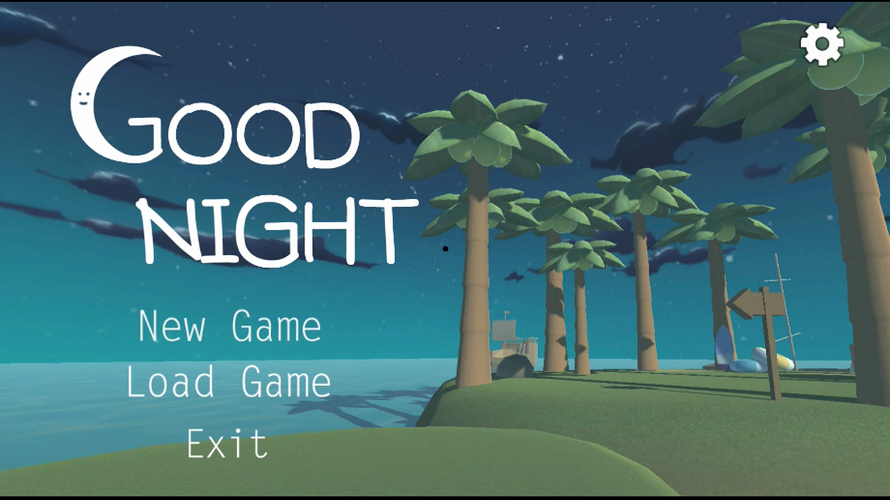
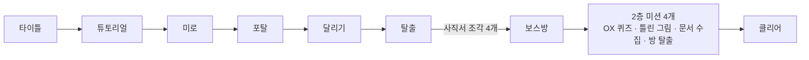
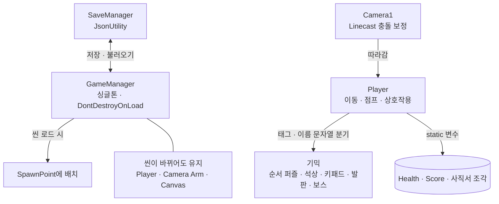
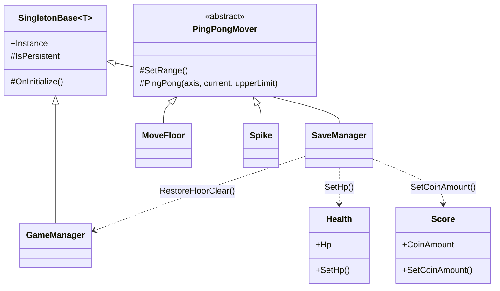
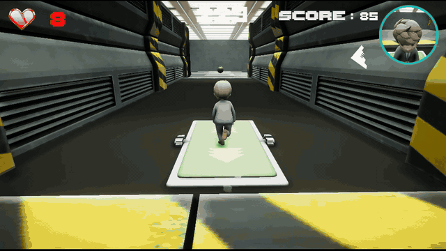
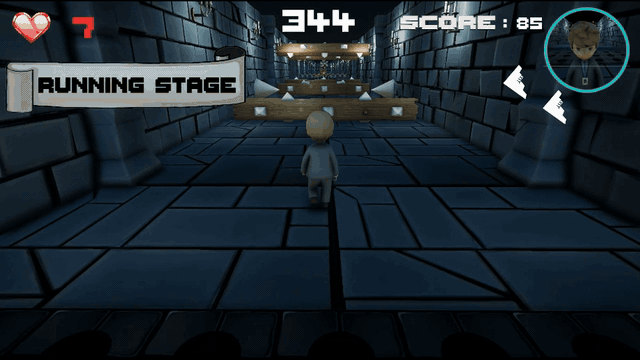
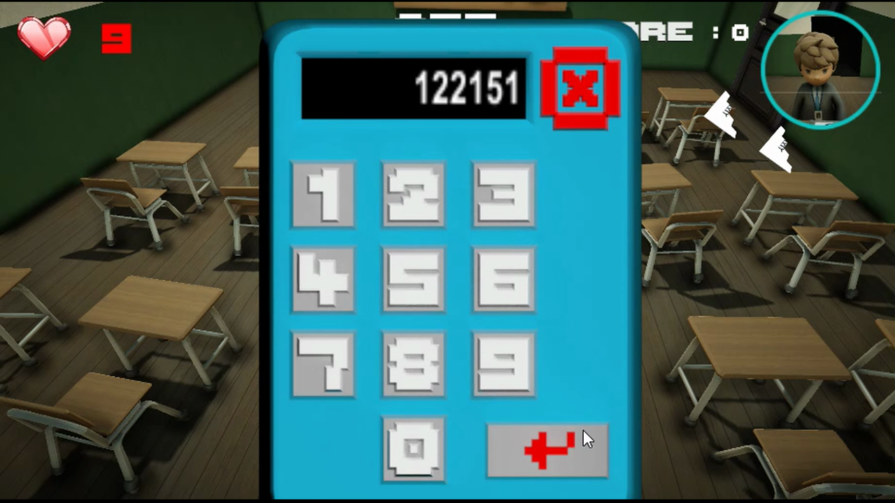

# 잘자요 프로젝트 문서

> **스테이지마다 다른 기믹으로 여러 경험을 주는 졸업 작품 — 지금의 실력으로 다시 고치는 중**



| 항목 | 내용 |
|---|---|
| 장르 | 3D 3인칭 퍼즐 어드벤처 |
| 기간 · 인원 | 2023 (3개월) · 4인 팀, 팀장 (학교 팀 프로젝트) |
| 엔진 · 도구 | Unity 2020.3, C# · 리팩터링에 Claude Code |
| 내 담당 | 팀장(일정·역할·회의), 게임 프로그래밍 전반 |
| 버전 | v1 (2023 원본) · v2 (2026.11 코드 스타일 리팩터링 — 게임 동작은 그대로) |
| 링크 | [시연 영상](https://youtu.be/7Z23aZDVGV8) · [쇼츠](https://youtube.com/shorts/BOf3R-7C5Qc) |

---

## 1. 개요

### 1.1 성에 들어가 스테이지를 하나씩 깨는 3D 퍼즐 어드벤처

<iframe src="https://www.youtube.com/embed/7Z23aZDVGV8" title="시연 영상" allow="accelerometer; clipboard-write; encrypted-media; gyroscope; picture-in-picture" allowfullscreen style="display:block;width:55%;aspect-ratio:16/9;height:auto;border:0"></iframe>

학교 팀 프로젝트(4인, 팀장)로 **3인칭 카메라**, **발판 기믹**, **JSON 세이브**를 만들었습니다. 2026년에는 v1 코드 전체를 지금의 코딩 스타일로 고치는 **v2 리팩터링**을 했습니다. 게임 동작은 그대로 두고 구조와 표현만 바꿔, 코드 양이 4,462줄에서 3,741줄로 16% 줄었습니다.

스테이지마다 다른 기믹으로 플레이어에게 여러 경험을 주고 싶었습니다. 목표는 완성도 있는 프로젝트로 교내·교외 전시회에 출품하는 것이었습니다.

### 1.2 스테이지 흐름 — 사직서 조각을 모아 보스방으로



---

## 2. 시스템 구조

### 2.1 v1 (2023)



씬이 바뀌어도 Player·카메라·UI를 유지하고, 새 스테이지에 들어가면 시작 지점에 배치합니다.
체력·점수 같은 상태는 static 변수로, 기믹 상호작용은 태그·이름 문자열로 나눴습니다. 당시에 알던 방법이 이것뿐이었습니다.

### 2.2 v2 (리팩터링)



v1에서 두 매니저가 따로 만들던 싱글톤은 제네릭 부모 `SingletonBase<T>`로, MoveFloor와 Spike에 똑같이 있던 왕복 이동 코드는 abstract 부모 `PingPongMover`로 묶었습니다.
다른 스크립트가 static 변수나 public 필드를 직접 바꾸던 곳은 읽기 전용 프로퍼티와 메서드(`SetHp()`, `SetCoinAmount()` 등)로 바꿨습니다.

| 정리한 것 | 내용 |
|---|---|
| 이름을 바꾼 스크립트 | 6개 — `Camera1` → `CameraArm`, `tmp` → `VolumeControl`, `NewBehaviourScript` → `WallSpawnTrigger` 등 역할에 맞는 이름으로 |
| 새로 만든 부모 클래스 | 2개 — `SingletonBase<T>`, `PingPongMover` |
| 안 쓰는 스크립트 | 13개를 trash 폴더로 (빌드 씬과 코드 어디에서도 쓰이지 않는 것만) |
| 모든 스크립트 공통 | public 필드 → `[SerializeField] private` · 프로퍼티, 태그 · 씬 이름 문자열과 숫자를 `const`로, 빈 Start/Update · 주석 처리된 옛 코드 삭제, 깨진 CP949 주석을 UTF-8로 |
| 씬 · 프리팹 | 필드 이름을 바꾼 곳은 씬 · 프리팹 YAML 키와 프리팹 오버라이드도 같이 바꿔 인스펙터 값을 유지 (47개) |

---

## 3. 핵심 기능

### 3.1 카메라 v1 → v2: 벽에 가려지지 않는 3인칭 카메라

#### v1 (2023) — 당시에 알던 방법

```csharp
FinalDir = transform.TransformPoint(DirNormalized * MaxDistance);
if (Physics.Linecast(transform.position, FinalDir, out Hit))
{
    if (Hit.collider.gameObject.tag == "Wall")
        FinalDistance = Mathf.Clamp(Hit.distance, MinDistance, MaxDistance);
}
else FinalDistance = MaxDistance;

RealCam.localPosition = Vector3.Lerp(RealCam.localPosition,
    DirNormalized * FinalDistance, Time.deltaTime * Smoothness);
```

**지금 다시 보면**

- Linecast는 굵기가 없는 선이라, 모서리에서 카메라가 벽을 살짝 파고듭니다.
- "Wall" 태그만 확인해서, 다른 물체에 맞으면 이전 거리에 그대로 머뭅니다.

#### v2 (2026) — 리팩터링

```csharp
public class CameraArm : MonoBehaviour   // 이전 이름 Camera1
{
    [Header("따라가기")]
    [SerializeField] private Transform followTarget;
    [SerializeField] private float followSpeed = 10f;

    [Header("회전")]
    [SerializeField] private float sensitivity = 100f;
    [SerializeField] private float clampAngle = 70f;

    private Vector3 dirNormalized;   // 런타임 값은 직렬화에서 뺌
    private Vector3 finalDir;
    private float finalDistance;
    ...
        if (Physics.Linecast(transform.position, finalDir, out RaycastHit hit))
        {
            if (hit.collider.gameObject.CompareTag(WallTag))
                finalDistance = Mathf.Clamp(hit.distance, minDistance, maxDistance);
        }
        else
        {
            finalDistance = maxDistance;
        }
```

**바꾼 것**

- 플레이어를 따라가는 카메라 암 역할에 맞게 클래스 이름을 `CameraArm`으로
- public 필드를 `[SerializeField] private`으로, 런타임 값(`dirNormalized` 등)은 직렬화에서 뺌
- `tag == "Wall"` 비교를 `CompareTag(WallTag)` 상수로

**다음 단계 — 동작 개선** (이번 리팩터링은 동작을 바꾸지 않는 것이 원칙이라 남겨 둠)

- SphereCast로 카메라 크기만큼의 공을 쏴서 모서리 파고듦을 막기
- 태그 대신 LayerMask로 충돌 대상을 지정
- ODDITY에서 처음 카메라를 짤 때 썼던 방식을 적용

### 3.2 발판 v1 → v2: 움직이는 발판 위의 플레이어



#### v1 (2023) — 당시에 알던 방법

```csharp
// 오브젝트 이름으로 동작을 고름
if (gameObject.name == "UD_Floor") upDown();
if (gameObject.name == "LR_Floor") leftRight();

// 발판에 올라타면 플레이어를 자식으로 붙임
private void OnTriggerEnter(Collider other)
{
    if (other.tag == "Player")
    {
        other.transform.SetParent(transform);
        player.isMovePanel = true;   // 발판 위에서는 transform으로 이동
    }
}
```

**지금 다시 보면**

- 이름이 바뀌면 발판이 멈추고, 축마다 같은 코드가 반복됩니다.
- Rigidbody가 있는 플레이어를 transform으로 옮겨 물리와 직접 이동이 섞입니다.
- 회전 발판에서는 플레이어도 함께 회전하고, 내릴 때 DontDestroyOnLoad를 다시 걸어야 합니다.

#### v2 (2026) — 리팩터링

```csharp
// upperLimit에 닿으면 아래로, turningPoint에 닿으면 위로 방향을 바꾸며 axis 방향으로 움직인다
protected void PingPong(Vector3 axis, float currentPosition, float upperLimit)
{
    if (currentPosition >= upperLimit)
    {
        turnSwitch = false;
    }
    else if (currentPosition <= turningPoint)
    {
        turnSwitch = true;
    }

    Vector3 direction = turnSwitch ? axis : -axis;
    transform.position = transform.position + direction * moveSpeed * Time.deltaTime;
}
```

PingPongMover.cs — MoveFloor · Spike가 함께 쓰는 왕복 이동

**바꾼 것**

- 축마다 반복되던 왕복 코드를 abstract 부모 `PingPongMover`의 `PingPong()` 하나로 묶음 (템플릿 메서드). 발판은 축 벡터만 넘김
- 이름 문자열은 `const`로 모으고, Awake에서 한 번만 이름을 보고 enum(`FloorMove`)으로 바꿔 `switch`로 분기
- 플레이어 값을 직접 바꾸던 `player.isMovePanel = true`를 `player.SetMovePanel(true)` 메서드로
- 인스펙터 키(`distance`, `moveSpeed`, `turnSwitch`)는 그대로 유지해 씬에 넣어 둔 값이 바뀌지 않게 함

**다음 단계 — 동작 개선**

- 발판은 Rigidbody로 움직이고, 이번 프레임에 움직인 양을 공개
- 플레이어는 부모를 바꾸지 않고, 발판 이동량을 자기 이동에 더함
- 이름 대신 인스펙터에서 방향을 지정

### 3.3 세이브 v1 → v2: 스테이지를 이어 하는 JSON 세이브

#### v1 (2023) — 당시에 알던 방법

```csharp
[System.Serializable]
public class SaveList
{
    public int HP;
    public float Time;
    public int Score;
    public int PaperNum;          // 사직서 조각 수
    public bool[] Clear;
    public string SceneName;
    public bool[] CoinCheck;
    public Vector3 SavePointPos;
}
string SaveJson = JsonUtility.ToJson(Save);
File.WriteAllText(SaveDataDir + SaveFileName, SaveJson);
```

**지금 다시 보면**

- 저장 경로가 Application.dataPath라 빌드 환경에서는 쓰기가 막힐 수 있습니다.
- 여러 static 변수에서 값을 모아 오는 구조라 저장할 값이 늘 때마다 SaveManager를 고쳐야 합니다.

#### v2 (2026) — 리팩터링

```csharp
// 2. 각 매니저에 값을 되돌린다.
Health.SetHp(save.HP);
Score.SetCoinAmount(save.Score);
CoinManager.RestoreCollectedFlags(save.CoinCheck);
gameManager.RestoreFloorClear(save.Clear);
gameManager.SetRemainTime(save.Time);
gameManager.RestorePapers(save.PaperNum);
gameManager.MarkLoadedFromSave();
```

SaveManager.cs — 불러온 값을 각 매니저의 메서드로 되돌림 (v1은 `Health.HealthPoint = Save.HP;`처럼 static 변수에 직접 대입)

**바꾼 것**

- `SingletonBase<SaveManager>`를 상속하고, 세이브 파일 확인은 `HasSaveFile` · `SaveFilePath` 프로퍼티로
- 다른 스크립트의 static 변수 · public 필드에 직접 대입하던 것을 `SetHp()`, `RestoreFloorClear()` 같은 메서드 호출로
- 기존 세이브 파일을 계속 읽을 수 있게 `SaveList`의 필드 이름은 그대로 유지

**다음 단계 — 동작 개선**

- 저장 경로를 persistentDataPath로 변경 (지금도 Application.dataPath)
- 저장 대상이 자기 데이터를 직접 내보내고 불러오도록 정리
- 미로 스테이지 밖에서만 저장한 세이브를 불러온 뒤 코인을 먹으면 예외가 나는 버그 고치기 (리팩터링 중 찾아 TODO로 표시)
- [PlayerPrefs와 비교한 선택 이유 추가 예정]

### 3.4 스테이지마다 다른 경험을 주는 기믹

| 기믹 | 내용 |
|---|---|
| 순서 퍼즐 | 밟은 발판 순서를 리스트에 쌓아 정답 순서와 비교 |
| 보스 패턴 | 코루틴으로 램프 낙하 · 파일 발사 · 바닥 붕괴 중 하나를 골라 실행 |
| 움직이는 · 떨어지는 발판 | 왕복 · 회전 발판, 밟으면 잠시 뒤 떨어지는 발판 |
| 쫓아오는 벽 · 가시 발사기 | 달리기 스테이지의 시간 압박과 장애물 |
| 석상 · 키패드 · 제단 | 정답을 맞히면 문이 열리는 퍼즐, 사직서 조각을 바치는 제단 |
| 2층 미션 | OX 퀴즈, 틀린 그림 찾기, 문서 수집, 방 탈출 |






#### v1 대표 — 순서 퍼즐

```csharp
if (SaveNum.Count == 8)
{
    if (SaveNum.SequenceEqual(CorrectNum))
        Door.SetBool("Open", true);
    else
        SaveNum.Clear();   // 틀리면 처음부터
}
```

#### v2 대표 — 순서 퍼즐

```csharp
private bool IsCorrect()
{
    if (savedNum.Count != correctNum.Count) return false;

    for (int i = 0; i < savedNum.Count; i++)
    {
        if (savedNum[i] != correctNum[i]) return false;
    }
    return true;
}
```

ColorBoxAnswer.cs — LINQ `SequenceEqual`을 `for` 비교로, 밟은 순서 리스트는 private으로 (`AddNum()`으로만 쌓음)

v1에서는 Player 한 클래스가 태그 문자열로 모든 기믹과의 상호작용을 나눴습니다. 이번 리팩터링에서는 장애물 · 보스 · 발판(13개)과 1층 퍼즐(19개) 스크립트의 public 필드를 메서드 · 프로퍼티로 감싸고 이름을 정리했습니다. 기믹마다 상호작용 인터페이스를 두어 Player가 기믹 종류를 몰라도 되게 하는 것은 다음 단계 계획입니다.

---

## 4. AI 협업

v2 리팩터링은 새 기능 추가나 버그 수정이 아니라, **과거에 짠 코드를 지금의 코딩 스타일과 새로 익힌 지식에 맞춰 바꾸기만 하는 작업**이었습니다.
바꾸는 기준은 `코딩스타일.md`에 이미 정해 두었고, 스크립트 72개와 씬 · 프리팹 47개에 같은 규칙을 적용해야 하는 반복 작업이 많았습니다.
그래서 **기준을 정하고, 작업을 나누고, 결과를 Unity에서 검증하는 일은 직접** 했고, **기준대로 코드를 바꾸는 반복 작업은 Claude Code에 맡겼습니다.**

| 모델 | 맡긴 작업 | 고른 이유 |
|---|---|---|
| Opus 5.5 | 계획 · 조율, S1 코어 매니저 | 전체를 분석해 작업을 나누고, 다른 스크립트가 모두 따를 공용 API(`SingletonBase<T>` 등)를 설계하는 일 |
| Sonnet 5.5 | S2~S5(플레이어 · 장애물 · 퍼즐 · 2층), 브랜치 합치기 | Player(633줄)처럼 많이 얽힌 코드와 합칠 때의 충돌 해결에 어느 정도 판단이 필요. Opus의 절반 가격 |
| Haiku 5.5 | S6 UI · 연출, S7 정리 | 작고 독립된 스크립트에 규칙만 맞추기, 안 쓰는 스크립트 골라내기 — 판단이 적고 양이 많은 일 |

작업은 S1(코어) → S2 · S6 → 합치기 → S3 · S4 · S5 → 합치기 → S7(정리) 순서로, 서로 겹치지 않는 묶음은 동시에 돌렸습니다.

**지킨 원칙과 확인한 방법**

- 수치 · 타이밍 · 판정 · 씬 흐름 · 세이브 형식은 그대로 두었습니다. 버그로 보이는 곳도 고치지 않고 `// TODO(리팩토링):`으로 표시만 해, 고칠지는 직접 판단하도록 남겼습니다(13곳).
- 스크립트를 바꿀 때 `.meta`의 GUID를 유지해, 씬과 프리팹의 컴포넌트 연결이 끊기지 않게 했습니다.
- Unity batchmode가 라이선스 오류로 실행되지 않아, 컴파일은 `dotnet build`로 확인했습니다(에러 0). 에디터에서 직접 확인할 항목은 목록으로 정리했습니다.

**겪은 일**

- 필드 이름을 바꾸자 씬에 저장된 프리팹 오버라이드 키가 옛 이름으로 남아 값이 사라졌습니다. 합치기 단계(M2)에서 `cameraArm`이 비어 플레이어가 움직이지 않은 적이 있고, M3에서는 공격 쿨타임 키를 고치지 않았다면 1초가 0.5초가 될 뻔했습니다.
- 그래서 리팩터링 스킬에 "필드 이름을 바꾸면 프리팹 오버라이드의 `propertyPath`도 확인한다"는 규칙을 추가했습니다.

---

## 5. 회고

### 5.1 결과

목표였던 전시회 출품을 이뤘습니다. 「잘자요」를 완성해 교내 전시회에 출품했고, 졸업 과제 기준도 통과했습니다.

v2 리팩터링 결과는 다음과 같습니다.

| 지표 | 값 |
|---|---|
| 바뀐 C# 파일 | 80개 (+2,393 / −2,635줄) |
| 함께 고친 씬 · 프리팹 | 47개 |
| 코드 양 | 4,462줄 → 3,741줄 (−16%) |
| 브랜치를 합칠 때 충돌 | 0건 |
| 빌드 에러 | 0개 |
| 작업 시간 | 하루(4시간 32분), 그중 Claude Code 순수 작업 85분 |

### 5.2 배운 점 — 처음 만든 코드를 다시 보며

당시에는 인터넷에서 찾은 방법을 따라 하고, 아는 자료 구조가 리스트와 배열뿐이라 그걸 썼습니다. 실력이 늘고 다시 보니 개선할 점이 보여, 먼저 코드 스타일과 구조를 v2로 정리했습니다.

프로젝트를 거치며 달라진 점은 다음과 같습니다.

| 프로젝트 | 달라진 점 |
|---|---|
| 잘자요 · 2023 | static 변수와 태그 문자열로 동작을 나누고, Player 하나에 모든 상호작용을 넣음 |
| 호떡 서바이버 | 추상 클래스로 무기를 확장하고, 공간 분할 격자로 성능을 미리 고민하기 시작 |
| We Got One | 인터페이스 기반 FSM 위에 기믹을 얹고, 브랜치 단위로 팀 협업 |
| ODDITY | 데이터(TSV)로 시스템을 만들고, 애니메이터 설계와 에디터 툴로 작업을 자동화 |
| 잘자요 v2 | 처음 만든 코드를 지금의 실력으로 다시 열어 고침 |

### 5.3 아쉬운 점과 개선 계획

- **리팩터링 중 찾은 버그 13곳을 TODO로만 남김** — 코인 배열 범위 초과, 보스 체력이 음수가 되면 죽지 않음, OX 퀴즈 재시작 시 초기화 안 됨 등은 동작을 바꾸지 않는다는 원칙에 따라 표시만 했습니다. → **(✍ 개선 계획을 직접 적어 주세요)**
- **다음 과제** — 커진 클래스를 상태 패턴으로 나누고, 전역 상태 의존을 줄이고, 결과를 수치로 확인하는 습관 들이기
