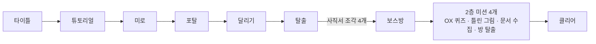
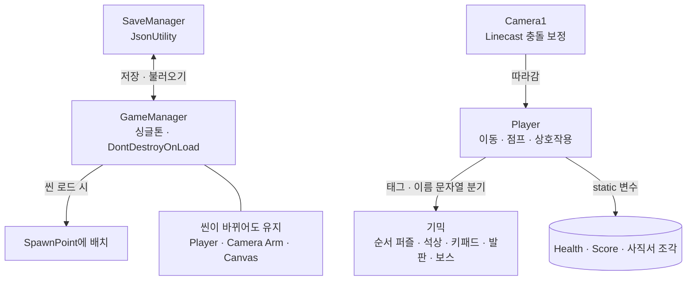

# 잘자요 기술 문서

> **스테이지마다 다른 기믹으로 여러 경험을 주는 졸업 작품 — 지금의 실력으로 다시 고치는 중**

| 항목 | 내용 |
|---|---|
| 장르 | 3D 3인칭 퍼즐 어드벤처 |
| 기간 · 인원 | 2023 (3개월) · 4인 팀, 팀장 (학교 팀 프로젝트) |
| 엔진 · 도구 | Unity 2020.3, C# |
| 내 담당 | 팀장(일정·역할·회의), 게임 프로그래밍 전반 |
| 버전 | v1 (2023 원본) · v2 (2026 리팩터링 진행 중) |

---

## 1. 개요

### 1.1 성에 들어가 스테이지를 하나씩 깨는 3D 퍼즐 어드벤처

학교 팀 프로젝트(4인, 팀장)로 **3인칭 카메라**, **발판 기믹**, **JSON 세이브**를 만들었고, 지금은 **v1 → v2 리팩터링**을 진행하고 있습니다.

### 1.2 왜 만들었나

스테이지마다 다른 기믹으로 플레이어에게 여러 경험을 주고 싶었습니다. 목표는 완성도 있는 프로젝트로 교내·교외 전시회에 출품하는 것이었습니다.

### 1.3 스테이지 흐름 — 사직서 조각을 모아 보스방으로



---

## 2. 시스템 구조

### 2.1 v1 (2023)



씬이 바뀌어도 Player·카메라·UI를 유지하고, 새 스테이지에 들어가면 시작 지점에 배치합니다.
체력·점수 같은 상태는 static 변수로, 기믹 상호작용은 태그·이름 문자열로 나눴습니다. 당시에 알던 방법이 이것뿐이었습니다.

### 2.2 v2 (리팩터링)

v2 구조 다이어그램 자리 — 리팩터링 후 Mermaid로 추가

---

## 3. 핵심 기능

### 3.1 카메라 v1 → v2: 벽에 가려지지 않는 3인칭 카메라

#### v1 (2023) — 당시에 알던 방법

```csharp
FinalDir = transform.TransformPoint(DirNormalized * MaxDistance);
if (Physics.Linecast(transform.position, FinalDir, out Hit))
{
    if (Hit.collider.gameObject.tag == "Wall")
        FinalDistance = Mathf.Clamp(Hit.distance, MinDistance, MaxDistance);
}
else FinalDistance = MaxDistance;

RealCam.localPosition = Vector3.Lerp(RealCam.localPosition,
    DirNormalized * FinalDistance, Time.deltaTime * Smoothness);
```

**지금 다시 보면**

- Linecast는 굵기가 없는 선이라, 모서리에서 카메라가 벽을 살짝 파고듭니다.
- "Wall" 태그만 확인해서, 다른 물체에 맞으면 이전 거리에 그대로 머뭅니다.

#### v2 (2026) — 리팩터링

v2 카메라 코드 자리 — 리팩터링 후 추가

**바꾸는 방향**

- SphereCast로 카메라 크기만큼의 공을 쏴서 모서리 파고듦을 막기
- 태그 대신 LayerMask로 충돌 대상을 지정
- ODDITY에서 처음 카메라를 짤 때 썼던 방식을 적용

### 3.2 발판 v1 → v2: 움직이는 발판 위의 플레이어

#### v1 (2023) — 당시에 알던 방법

```csharp
// 오브젝트 이름으로 동작을 고름
if (gameObject.name == "UD_Floor") upDown();
if (gameObject.name == "LR_Floor") leftRight();

// 발판에 올라타면 플레이어를 자식으로 붙임
private void OnTriggerEnter(Collider other)
{
    if (other.tag == "Player")
    {
        other.transform.SetParent(transform);
        player.isMovePanel = true;   // 발판 위에서는 transform으로 이동
    }
}
```

**지금 다시 보면**

- 이름이 바뀌면 발판이 멈추고, 축마다 같은 코드가 반복됩니다.
- Rigidbody가 있는 플레이어를 transform으로 옮겨 물리와 직접 이동이 섞입니다.
- 회전 발판에서는 플레이어도 함께 회전하고, 내릴 때 DontDestroyOnLoad를 다시 걸어야 합니다.

#### v2 (2026) — 리팩터링

v2 발판 코드 자리 — 리팩터링 후 추가

**바꾸는 방향**

- 발판은 Rigidbody로 움직이고, 이번 프레임에 움직인 양을 공개
- 플레이어는 부모를 바꾸지 않고, 발판 이동량을 자기 이동에 더함
- 이동 방향은 이름 대신 방향 벡터 하나로 지정

### 3.3 세이브 v1 → v2: 스테이지를 이어 하는 JSON 세이브

#### v1 (2023) — 당시에 알던 방법

```csharp
[System.Serializable]
public class SaveList
{
    public int HP;
    public float Time;
    public int Score;
    public int PaperNum;          // 사직서 조각 수
    public bool[] Clear;
    public string SceneName;
    public bool[] CoinCheck;
    public Vector3 SavePointPos;
}
string SaveJson = JsonUtility.ToJson(Save);
File.WriteAllText(SaveDataDir + SaveFileName, SaveJson);
```

**지금 다시 보면**

- 저장 경로가 Application.dataPath라 빌드 환경에서는 쓰기가 막힐 수 있습니다.
- 여러 static 변수에서 값을 모아 오는 구조라 저장할 값이 늘 때마다 SaveManager를 고쳐야 합니다.

#### v2 (2026) — 리팩터링

v2 세이브 코드 자리 — 리팩터링 후 추가

**바꾸는 방향**

- 저장 경로를 persistentDataPath로 변경
- 저장 대상이 자기 데이터를 직접 내보내고 불러오도록 정리
- [PlayerPrefs와 비교한 선택 이유 추가 예정]

### 3.4 스테이지마다 다른 경험을 주는 기믹

| 기믹 | 내용 |
|---|---|
| 순서 퍼즐 | 밟은 발판 순서를 리스트에 쌓아 정답 순서와 비교 |
| 보스 패턴 | 코루틴으로 램프 낙하 · 파일 발사 · 바닥 붕괴 중 하나를 골라 실행 |
| 움직이는 · 떨어지는 발판 | 왕복 · 회전 발판, 밟으면 잠시 뒤 떨어지는 발판 |
| 쫓아오는 벽 · 가시 발사기 | 달리기 스테이지의 시간 압박과 장애물 |
| 석상 · 키패드 · 제단 | 정답을 맞히면 문이 열리는 퍼즐, 사직서 조각을 바치는 제단 |
| 2층 미션 | OX 퀴즈, 틀린 그림 찾기, 문서 수집, 방 탈출 |

#### v1 대표 — 순서 퍼즐

```csharp
if (SaveNum.Count == 8)
{
    if (SaveNum.SequenceEqual(CorrectNum))
        Door.SetBool("Open", true);
    else
        SaveNum.Clear();   // 틀리면 처음부터
}
```

v2 기믹 코드 자리 — 예: 상호작용 인터페이스로 기믹 분리

v1에서는 Player 한 클래스가 태그 문자열로 모든 기믹과의 상호작용을 나눴습니다. v2에서는 기믹마다 상호작용 인터페이스를 두어 Player가 기믹 종류를 몰라도 되게 바꿀 계획입니다.

---

## 4. 회고

### 4.1 결과

목표였던 전시회 출품을 이뤘습니다. 「잘자요」를 완성해 교내 전시회에 출품했고, 졸업 과제 기준도 통과했습니다.

### 4.2 다시 보며 배운 점

당시에는 인터넷에서 찾은 방법을 따라 하고, 아는 자료 구조가 리스트와 배열뿐이라 그걸 썼습니다. 실력이 늘고 다시 보니 개선할 점이 보여, 핵심 기능을 v2로 다시 짜고 있습니다.

### 4.3 v2 리팩터링 결과

v2 결과 정리 자리 — 카메라 · 발판 · 세이브 · 기믹을 바꾼 결과와 비교

### 4.4 프로젝트를 거치며 달라진 점

| 프로젝트 | 달라진 점 |
|---|---|
| 잘자요 · 2023 | static 변수와 태그 문자열로 동작을 나누고, Player 하나에 모든 상호작용을 넣음 |
| 호떡 서바이버 | 추상 클래스로 무기를 확장하고, 공간 분할 격자로 성능을 미리 고민하기 시작 |
| We Got One | 인터페이스 기반 FSM 위에 기믹을 얹고, 브랜치 단위로 팀 협업 |
| ODDITY | 데이터(TSV)로 시스템을 만들고, 애니메이터 설계와 에디터 툴로 작업을 자동화 |
| 잘자요 v2 | 처음 만든 코드를 지금의 실력으로 다시 열어 고침 |

**다음 과제** — 커진 클래스를 상태 패턴으로 나누고, 전역 상태 의존을 줄이고, 결과를 수치로 확인하는 습관 들이기
