# 잘자요 프로젝트 문서

> **스테이지마다 다른 기믹으로 여러 경험을 주는 3D 어드벤처 게임**


| 항목 | 내용 |
|---|---|
| 장르 | 3D 3인칭 퍼즐 어드벤처 |
| 기간 · 인원 | 2022.10 ~ 2023.10 · 4인 팀, 팀장 (학교 팀 프로젝트) |
| 엔진 · 도구 | Unity 2020.3, C# · 리팩터링에 Claude Code |
| 내 담당 | 팀장(일정 조율, 역할 분배, 회의 진행) / 코드: 3인칭 카메라 · 세이브 · 게임 흐름 · 보스 · 1층 퍼즐 · 2층 미션 · UI, 플레이어 · 맵 제작(방 탈출 · 미로 · 메인홀 · 타이틀 · 튜토리얼 · 보스방 · 달리기 · 포탈) · 애니메이션(캐릭터 · 피격 · 문) · 문 사운드 · 포스트 프로세싱 |
| 버전 | v1 (2023 원본) · v2 (2026.11 리팩터링 — 1차 코드 스타일, 2차 구조 개선) |
| 링크 | [시연 영상](https://youtu.be/es15ky2ecds) · [쇼츠](https://youtu.be/AwqeZA52i9A) · [소스코드](https://github.com/tmdrn17/Jaljayo-Code) |

---

## 1. 개요

<a id="section-1-1"></a>
### 1.1 성에 들어가 스테이지를 하나씩 깨는 3D 퍼즐 어드벤처

<iframe src="https://www.youtube.com/embed/es15ky2ecds" title="시연 영상" allow="accelerometer; clipboard-write; encrypted-media; gyroscope; picture-in-picture" allowfullscreen style="display:block;width:55%;aspect-ratio:16/9;height:auto;border:0"></iframe>

학교 팀 프로젝트로 **3인칭 카메라**, **세이브**, **게임 흐름(GameManager)**, **보스**, **1층 퍼즐**, **2층 미션**, **UI**를 만들고, 미로 · 방 탈출 같은 **맵**을 꾸몄습니다. **플레이어**의 기본 이동, 점프 공격 등을 구현했습니다.
2026년에는 v1 코드 전체(팀원 코드 포함)를 **v2로 리팩터링**했습니다. 1차에서는 게임 동작을 그대로 두고 코드 스타일을, 2차에서는 데이터와 표시를 나누고 보스 패턴을 상속 구조로 바꾸는 등 **구조**를 고쳤습니다.

스테이지마다 다른 기믹으로 플레이어에게 여러 경험을 주고 싶었습니다. 목표는 완성도 있는 프로젝트로 교내·교외 전시회에 출품하는 것이었습니다.

<a id="section-1-2"></a>
### 1.2 스테이지 흐름 — 1층은 사직서 조각을 모아 보스를 없애고 2층은 맵을 돌아 다니면서 미션 클리어

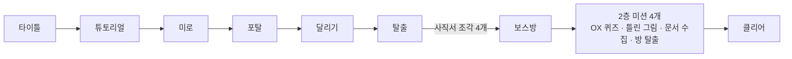

---

## 2. 시스템 구조

<a id="section-2-1"></a>
### 2.1 v1 (2023)

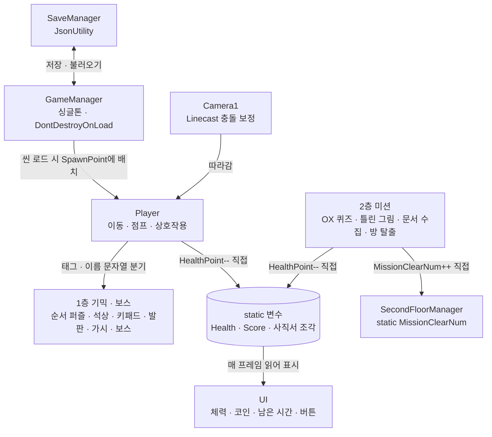

씬이 바뀌어도 Player·카메라·UI(Canvas)를 유지하고, 새 스테이지에 들어가면 시작 지점에 배치합니다.
체력·점수 같은 상태는 static 변수로 두고, Player와 2층 미션이 그 값을 직접 바꿨습니다. 기믹 상호작용은 태그·이름 문자열로 나눴습니다. 당시에 알던 방법이 이것뿐이었습니다.

<a id="section-2-2"></a>
### 2.2 v2 (리팩터링)

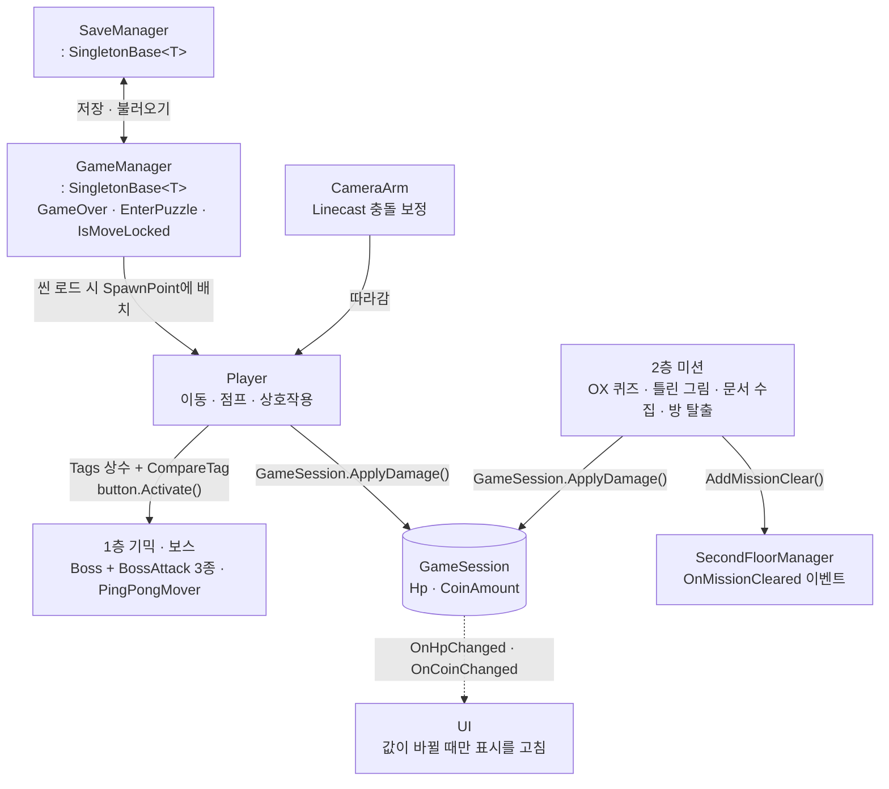

**1차 (코드 스타일)** — 게임 동작은 그대로 두고 이름 · 접근 범위 · 중복 코드를 정리했습니다.
스크립트 6개의 이름을 바꾸고, public 필드는 `[SerializeField] private`과 프로퍼티로 바꿨습니다. 두 매니저가 따로 만들던 싱글톤과 MoveFloor · Spike에 똑같이 있던 왕복 이동 코드는 부모 클래스 `SingletonBase<T>` · `PingPongMover`로 묶었습니다.
다른 스크립트가 static 변수나 public 필드를 직접 바꾸던 곳은 읽기 전용 프로퍼티와 메서드로 바꿨습니다.

**2차 (구조 개선)** — 데이터와 표시를 나누고, 여러 곳에 흩어진 흐름을 한 곳으로 모았습니다.
체력 · 코인은 static 클래스 `GameSession` 한 곳이 갖고, 값이 바뀔 때 이벤트로 알립니다. UI는 매 프레임 값을 읽지 않고 이벤트를 구독해 표시만 고칩니다.
게임 오버 · 퍼즐 창 열기처럼 여러 곳에서 같은 일을 하던 흐름은 GameManager의 메서드 하나로 모았고, 보스 패턴은 상속 구조로 바꿨습니다(§[3.1](#section-3-1)). 태그 · 씬 이름은 상수 모음 클래스로 모았습니다(§[2.3](#section-2-3)).

| 정리한 것 | 1차 | 2차 |
|---|---|---|
| 이름을 바꾼 스크립트 | 6개 — `Camera1` → `CameraArm`, `tmp` → `VolumeControl`, `NewBehaviourScript` → `WallSpawnTrigger` 등 | — |
| 새로 만든 스크립트 | `SingletonBase<T>`, `PingPongMover` | `GameSession` · `SceneNames` · `Tags`, `BossAttack`과 자식 3개 |
| 안 쓰는 스크립트 | 13개를 trash 폴더로 | — |
| 모든 스크립트 공통 | public 필드 → `[SerializeField] private` · 프로퍼티, 빈 Start/Update · 옛 주석 코드 삭제, 깨진 CP949 주석을 UTF-8로 | 태그 · 씬 이름을 공용 상수 `Tags` · `SceneNames`로, `tag ==` → `CompareTag`, 에디터에서 바꿔야 하는 값은 `const` → `[SerializeField]` |
| 서로 부르던 참조 | — | 한쪽이 값을 매개변수로 넘기게 바꿈, 트리거로 들어온 대상은 `GameObject.Find` 대신 `TryGetComponent`로 받음 |
| 씬 · 프리팹 | 필드 이름을 바꾼 곳의 YAML 키와 프리팹 오버라이드를 같이 바꿔 인스펙터 값 유지 (47개) | 같은 방식으로 9개 (보스 패턴 값, OX 퀴즈 문제 데이터 등) |

<a id="section-2-3"></a>
### 2.3 상수 모음 클래스

v1은 태그 · 씬 이름을 쓰는 곳마다 `"Player"`처럼 문자열로 적었습니다. 2차에서 이 문자열을 상수만 담는 static class `Tags` · `SceneNames`로 모았습니다(이후 입력 축 이름 `InputNames`, 오브젝트 이름 `ObjectNames`도 같은 방식).

```csharp
// 태그 이름을 한 곳에 모은 상수 모음 (Tags.cs 일부)
public static class Tags
{
    public const string Player = "Player";
    public const string Wall = "Wall";
    public const string Boss = "Boss";
}

// 쓰는 곳 — 문자열 대신 상수 이름으로
if (other.CompareTag(Tags.Player)) { }
```

<a id="source-tags"></a>
<details>
<summary>원본 코드 전체 보기 — Tags.cs</summary>

```csharp
// 코드에서 쓰는 태그 이름. 태그는 Tag Manager에 프로젝트 전체로 등록되므로 한 파일만 쓰는 태그도 여기에 모은다.
public static class Tags
{
    // 여러 스크립트가 쓰는 태그
    public const string Player = "Player";
    public const string Wall = "Wall";
    public const string Bullet = "Bullet";
    public const string Spike = "Spike";
    public const string SliceWall = "SliceWall";

    // 플레이어 상호작용
    public const string Statue = "Statue";
    public const string AnswerArea = "AnswerArea";
    public const string AnswerButton = "AnswerButton";
    public const string KeyPad = "KeyPad";
    public const string Button = "Button";
    public const string Water = "Water";
    public const string JumpItem = "Item_Jump";
    public const string DocumentItem = "Item_document";
    public const string Enemy = "Enemy";
    public const string Ground = "Ground";

    // 보스·장애물
    public const string Boss = "Boss";
    public const string Floor = "Floor";
    public const string SideSpike = "SideSpike";
    public const string Destination = "Destination";

    // 스테이지
    public const string SpawnPoint = "SpawnPoint";
    public const string Image = "Image";
    public const string RightButton = "RightButton";
    public const string DragWall = "Wall_D";
}
```

</details>

**왜 만들었나**

- 태그 · 씬 이름을 문자열로 쓰면 오타가 나도 컴파일 오류가 나지 않아 실행해 봐야 알 수 있습니다. 상수 이름으로 쓰면 오타가 컴파일 단계에서 잡힙니다.
- 값이 한 곳에만 있어 이름을 바꿀 때 한 곳만 고치면 되고, 한 파일만 보면 코드가 쓰는 태그 · 씬 이름이 다 보입니다.

#### static class로 만든 이유

상수 모음을 만들 때 "struct가 class보다 가벼우니 struct가 낫지 않나?"를 따져 봤지만, 상수만 쓰면 인스턴스를 만들 일이 없어 어느 쪽이든 실행 비용은 같습니다. 그래서 **의도를 컴파일러가 지켜 주는지**로 골랐습니다.

| 비교 | static class (고름) | struct |
|---|---|---|
| `new Tags()` | 컴파일 오류 | 됨 (쓸모없는 인스턴스가 생김) |
| 인스턴스 필드 · 메서드 추가 | 컴파일 오류 | 됨 |
| 실행 비용 | 없음 | 없음 |

static class는 "상수만 모아 둔 곳"이라는 뜻을 문법이 막아 주고, C#에서 상수 · 유틸리티 모음을 만드는 관례(`System.Math`, `System.IO.Path`)이기도 합니다.

#### 어떤 상수를 어디에 두나

2차가 끝난 뒤 공용 클래스로 옮기지 못한 상수를 다시 점검하면서 정한 기준입니다(§[4](#section-4) 겪은 일).

| 종류 | 둘 곳 | 이유 |
|---|---|---|
| 태그 | `Core/Tags` (한 파일만 써도) | Tag Manager에 프로젝트 전체로 등록되는 값이라, 한 곳만 보면 코드가 쓰는 태그가 다 보이고 새 태그가 겹치는지 바로 확인됨 |
| 씬 이름 | `Core/SceneNames` (한 파일만 써도) | 빌드 설정과 맞춰 볼 때 한 곳만 보면 됨 |
| Input Manager 축 · 버튼 | `Core/InputNames` | `InputManager.asset`에 프로젝트 전체로 등록되는 값 |
| 씬 오브젝트 이름 (`GameObject.Find`, `name ==`) | 두 파일 이상이면 `Core/ObjectNames`, 한 파일이면 그 클래스 | 특정 씬의 특정 오브젝트 이름이라 찾는 클래스 옆에 있어야 읽기 쉬움 |
| 애니메이터 해시 | 그 Animator를 쓰는 클래스 | 오브젝트마다 다른 Animator Controller에 딸린 값 |
| 조정 값 (속도, 힘, 지연 시간) | `[SerializeField]` | 에디터에서 바꿀 수 있어야 하므로 상수로 두지 않음 |

- 공용 클래스로 모으면 값이 한 곳에만 있어 오타나 값 불일치가 생기지 않고, 이름을 바꿀 때 한 곳만 고치면 됩니다.
- 대신 한 파일만 쓰는 값도 읽을 때 다른 파일을 열어야 하고, 공용 파일이 커져 여러 사람이 줄을 추가하면 충돌이 날 수 있습니다.
- 그래서 **프로젝트 전체에 등록되는 이름**(태그 · 씬 · 입력)은 모두 옮기고, **씬 오브젝트 이름**은 여러 파일이 쓸 때만 옮겼습니다.

---

## 3. 핵심 기능

<a id="section-3-1"></a>
### 3.1 보스 패턴 v1 → v2: 패턴을 하나씩 고르는 보스

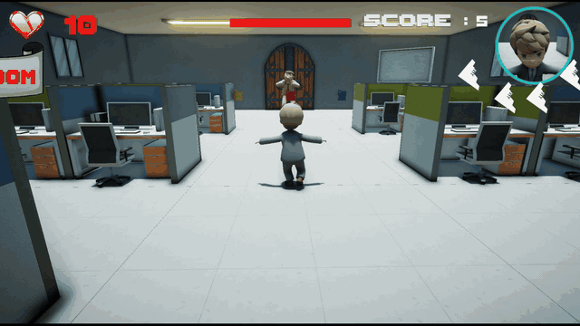

보스는 잠깐 생각한 뒤 **점프(전등 떨어뜨리기) · 고함(서류 발사) · 내려찍기(바닥 타일 끄기)** 중 하나를 무작위로 골라 실행하기를 반복합니다.

#### v1 (2023) — 당시에 알던 방법

```csharp
IEnumerator Think()
{
    yield return new WaitForSeconds(0.1f);
    int RandAction = Random.Range(0, 3);
    switch (RandAction)
    {
        case 0: StartCoroutine(Jump()); break;
        case 1: StartCoroutine(Yell()); break;
        case 2: StartCoroutine(Strike()); break;
    }
}

IEnumerator Jump()
{
    Anim.SetTrigger("Jump");
    yield return new WaitForSeconds(0.5f);
    for (int i = 0; i < 6; i++)
    {
        GameObject DropObject = Instantiate(Lamp, LampPos[i].position, Quaternion.Euler(0f, -90.0f, 180f));
        DropObject.GetComponent<Rigidbody>().velocity = Vector3.down * DropForce;
    }
    yield return new WaitForSeconds(3f);
    StartCoroutine(Think());   // 끝나면 다시 Think를 부름
}
```

<a id="source-boss-cs-2023"></a>
<details>
<summary>원본 코드 전체 보기 — Boss.cs (2023 원본)</summary>

```csharp
using System.Collections;
using System.Collections.Generic;
using UnityEngine;

public class Boss : MonoBehaviour
{
    public int BossHealth;

    [SerializeField]
    Transform Target;
    Vector3 LookVec;
    bool IsLook;
    Animator Anim;

    [SerializeField]
    float DropForce;
    [SerializeField]
    GameObject Lamp;
    [SerializeField]
    Transform[] LampPos;

    [SerializeField]
    Transform[] FilePos;
    [SerializeField]
    GameObject[] File;
    [SerializeField]
    int FileSpeed;

    [SerializeField]
    GameObject[] Tile;

    [SerializeField]
    Animator Door;
    [SerializeField]
    bool IsDie = false;

    AudioSource audio;
    public AudioClip DieSound;
    public AudioClip OpenSound;

    public BossHealth bossHealth;

    // Start is called before the first frame update
    void Awake()
    {
        Anim = GetComponent<Animator>();
        audio = GetComponent<AudioSource>();
        IsLook = true;
        StartCoroutine(Think());

    }

    // Update is called once per frame
    void Update()
    {
        //if (IsLook)
        //{
        //    float H = Input.GetAxisRaw("Horizontal");
        //    float V = Input.GetAxisRaw("Vertical");
        //    LookVec = new Vector3(H, 0, V);
        //    transform.LookAt(Target.position + LookVec);
        //}

        if (BossHealth == 0)
        {
            StopAllCoroutines();
            Die();
        }
    }

    IEnumerator Think()
    {
        yield return new WaitForSeconds(0.1f);

        int RandAction = Random.Range(0, 3);

        switch (RandAction)
        {
            case 0:
                StartCoroutine(Jump());
                break;

            case 1:
                StartCoroutine(Yell());
                break;
            case 2:
                StartCoroutine(Strike());
                break;
        }
    }

    IEnumerator Jump()
    {
        Debug.Log("Jump");
        Anim.SetTrigger("Jump");
        yield return new WaitForSeconds(0.5f);
        for(int i=0; i < 6; i++)
        {
            GameObject DropObject = Instantiate(Lamp, LampPos[i].position, Quaternion.Euler(0f, -90.0f, 180f));
            Rigidbody Rig = DropObject.GetComponent<Rigidbody>();
            Rig.velocity = Vector3.down * DropForce;
        }
        yield return new WaitForSeconds(3f);
        StartCoroutine(Think());
    }

    IEnumerator Yell()
    {
        Debug.Log("Yell");
        Anim.SetTrigger("Yell");
        yield return new WaitForSeconds(0.5f);
        for(int i = 0; i < 3; i++)
        {
            GameObject InstantBullet = Instantiate(File[i], FilePos[i].position, FilePos[i].rotation);
            Rigidbody BulletRig = InstantBullet.GetComponent<Rigidbody>();
            BulletRig.velocity = FilePos[i].forward * FileSpeed;
        }
        yield return new WaitForSeconds(1f);
        for (int i = 0; i < 3; i++)
        {
            GameObject InstantBullet = Instantiate(File[i], FilePos[i].position, FilePos[i].rotation);
            Rigidbody BulletRig = InstantBullet.GetComponent<Rigidbody>();
            BulletRig.velocity = FilePos[i].forward * FileSpeed;
        }
        yield return new WaitForSeconds(3f);
        StartCoroutine(Think());
    }

    IEnumerator Strike()
    {
        Debug.Log("Strike");
        Anim.SetTrigger("Strike");
        yield return new WaitForSeconds(0.5f);
        int RandTile = Random.Range(0, 24);
        Tile[RandTile].SetActive(false);
        yield return new WaitForSeconds(2f);
        Tile[RandTile].SetActive(true);
        yield return new WaitForSeconds(3f);
        StartCoroutine(Think());
    }

    void Die()
    {   
        BossHealth--;
        print("Die");
        Anim.SetTrigger("Die");
        Door.SetTrigger("Open");
        audio.PlayOneShot(DieSound);
        audio.PlayOneShot(OpenSound);
        Destroy(gameObject, 5);
    }

    void OnTriggerEnter(Collider col)
    {
        if (col.gameObject.tag == "Bullet")
        {
            Bullet PaperBullet = col.GetComponent<Bullet>();
            BossHealth -= PaperBullet.Damage;
        }
    }
}
```

</details>

**지금 다시 보면**

- 전등 · 서류 · 타일 등 **세 패턴의 데이터를 Boss 한 클래스가 모두** 들고 있습니다.
- "애니메이션 → 0.5초 대기 → 공격 → 3초 쉬기 → `Think()` 다시 부르기"가 패턴마다 반복됩니다.
- 패턴을 하나 더하려면 Boss의 필드 · `switch` · 코루틴을 모두 고쳐야 합니다.
- 전등 6개, 타일 24개처럼 인스펙터 배열의 길이를 숫자로 적어, 배열을 바꾸면 코드도 고쳐야 합니다.

#### v2 (2026) — 리팩터링

```csharp
// 보스 공격 패턴 하나. 자기가 쓰는 프리팹·위치·시간 값을 직접 가진다.
// 흐름(애니메이션 → 공격 전 대기 → 공격 → 쿨타임)은 모든 패턴이 같고, 공격 내용만 자식이 정한다.
[System.Serializable]
public abstract class BossAttack
{
    [SerializeField] private float attackDelay = 0.5f;
    [SerializeField] private float cooldown = 3f;

    protected abstract int TriggerHash { get; }

    public IEnumerator Run(Boss owner)
    {
        owner.PlayTrigger(TriggerHash);                     // 1. 애니메이션
        yield return new WaitForSeconds(attackDelay);       // 2. 공격 전 대기
        yield return owner.StartCoroutine(Attack());        // 3. 공격
        yield return new WaitForSeconds(cooldown);          // 4. 쿨타임
    }

    protected abstract IEnumerator Attack();
}
```

<a id="source-bossattack"></a>
<details>
<summary>원본 코드 전체 보기 — BossAttack.cs</summary>

```csharp
using System.Collections;
using UnityEngine;

// 보스 공격 패턴 하나. 자기가 쓰는 프리팹·위치·시간 값을 직접 가진다.
// 흐름(애니메이션 → 공격 전 대기 → 공격 → 쿨타임)은 모든 패턴이 같고, 공격 내용만 자식이 정한다.
[System.Serializable]
public abstract class BossAttack
{
    [SerializeField] private float attackDelay = 0.5f;
    [SerializeField] private float cooldown = 3f;

    /// <summary>패턴 시작 때 보스 애니메이터에 보낼 트리거</summary>
    protected abstract int TriggerHash { get; }

    public IEnumerator Run(Boss owner)
    {
        // 1. 애니메이션
        owner.PlayTrigger(TriggerHash);

        // 2. 공격 전 대기
        yield return new WaitForSeconds(attackDelay);

        // 3. 공격
        yield return owner.StartCoroutine(Attack());

        // 4. 쿨타임
        yield return new WaitForSeconds(cooldown);
    }

    protected abstract IEnumerator Attack();
}
```

</details>

BossAttack.cs — 흐름은 부모가 정하고, 자식은 `Attack()`만 채움 (템플릿 메서드)

```csharp
private IEnumerator AttackLoop()
{
    while (true)
    {
        yield return new WaitForSeconds(thinkDelay);

        BossAttack attack = attacks[Random.Range(0, attacks.Length)];
        yield return StartCoroutine(attack.Run(this));
    }
}
```

<a id="source-boss-cs"></a>
<details>
<summary>원본 코드 전체 보기 — Boss.cs (현재)</summary>

```csharp
using System.Collections;
using UnityEngine;

// 1층 보스. 잠깐 생각한 뒤 공격 패턴(점프·고함·내려찍기) 중 하나를 무작위로 실행하기를 반복한다.
public class Boss : MonoBehaviour
{
    private static readonly int DieHash = Animator.StringToHash("Die");
    private static readonly int OpenHash = Animator.StringToHash("Open");

    [Header("체력")]
    [SerializeField] private int hp;

    [Header("공격 패턴")]
    [SerializeField] private float thinkDelay = 0.1f;
    [SerializeField] private LampDropAttack jumpAttack = new LampDropAttack();
    [SerializeField] private FileFireAttack yellAttack = new FileFireAttack();
    [SerializeField] private TileStrikeAttack strikeAttack = new TileStrikeAttack();

    [Header("죽음")]
    [SerializeField] private Animator door;
    [SerializeField] private AudioClip dieSound;
    [SerializeField] private AudioClip openSound;
    [SerializeField] private float destroyDelay = 5f;

    private Animator anim;
    private AudioSource audioSource;
    private BossAttack[] attacks;

    public int Hp => hp;
    /// <summary>시작 체력. 체력바 비율 계산에 쓴다.</summary>
    public int MaxHp { get; private set; }

    private void Awake()
    {
        anim = GetComponent<Animator>();
        audioSource = GetComponent<AudioSource>();
        MaxHp = hp;
        attacks = new BossAttack[] { jumpAttack, yellAttack, strikeAttack };
        StartCoroutine(AttackLoop());
    }

    private void Update()
    {
        // TODO(리팩토링): 체력이 정확히 0일 때만 죽는다. 피해가 남은 체력보다 크면(음수) 죽지 않는다.
        if (hp == 0)
        {
            StopAllCoroutines();
            Die();
        }
    }

    /// <summary>패턴이 시작할 때 애니메이션 트리거를 보낸다.</summary>
    public void PlayTrigger(int triggerHash)
    {
        anim.SetTrigger(triggerHash);
    }

    #region 공격 패턴
    // 잠깐 생각하고 → 무작위 패턴 실행 → 반복
    private IEnumerator AttackLoop()
    {
        while (true)
        {
            yield return new WaitForSeconds(thinkDelay);

            BossAttack attack = attacks[Random.Range(0, attacks.Length)];
            yield return StartCoroutine(attack.Run(this));
        }
    }
    #endregion

    #region 피격·죽음
    private void OnTriggerEnter(Collider col)
    {
        if (col.CompareTag(Tags.Bullet) == false) return;

        if (col.TryGetComponent(out Bullet paperBullet)) hp -= paperBullet.Damage;
    }

    private void Die()
    {
        hp--;
        anim.SetTrigger(DieHash);
        door.SetTrigger(OpenHash);
        audioSource.PlayOneShot(dieSound);
        audioSource.PlayOneShot(openSound);
        Destroy(gameObject, destroyDelay);
    }
    #endregion
}
```

</details>

Boss.cs — 패턴을 고르고 실행만 함 (v1의 `Think()` 연쇄를 반복문 하나로)

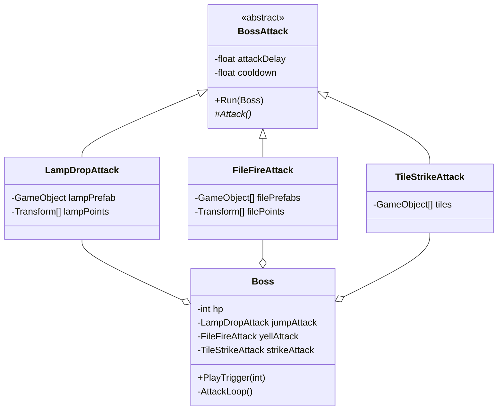

**바꾼 것**

- (1차) 중복되던 서류 발사 코드를 FireFiles() 메서드로 통합하고, 무작위 숫자를 BossPattern 열거형(Enum)과 switch문으로 관리하도록 개선했습니다.
- (2차) 공격 패턴별로 데이터를 독립적으로 관리할 수 있도록 BossAttack의 자식 클래스 3개로 분리했습니다. 이에 따라 Boss 클래스는 체력, 사망 처리, 공격 패턴 선택만 담당하도록 역할을 축소했습니다.
- (2차) 새로운 공격 패턴을 추가할 때 기존 Boss 클래스의 switch문이나 코루틴을 수정하지 않고, 새로운 자식 클래스와 필드만 추가하면 되도록 확장성을 개선했습니다.
- (2차) 공격 패턴을 MonoBehaviour가 아닌 `[Serializable]` 클래스로 구현하여 Boss의 필드에서 관리하도록 변경했습니다. 이를 통해 별도의 컴포넌트를 추가하지 않고도 패턴을 관리할 수 있어 씬에 배치된 보스 오브젝트의 구조를 변경하지 않아도 되도록 했습니다. Unity 2020.3에서는 `[SerializeReference]`로 선언한 목록의 요소를 선택할 수 있는 기본 인스펙터 기능이 부족했기 때문에, 각 공격 패턴마다 개별 필드를 선언하는 방식으로 구현했습니다.
- (2차) 배열의 길이를 직접 숫자로 지정하던 부분(6, 3, 24)을 lampPoints.Length와 같이 배열에서 직접 가져오도록 변경했습니다. 공격 패턴별 시간 설정값을 각 패턴의 `[SerializeField]` 필드로 분리했습니다. 또한 인스펙터에 설정되어 있던 기존 값은 프리팹 및 씬 YAML 키를 이전하여 그대로 유지했습니다.

**다음 단계 — 동작 개선**

- 현재 체력이 정확히 0일 때만 사망 처리되는 문제를 개선할 예정입니다. 남은 체력보다 큰 피해를 받으면 체력이 음수가 되어도 사망하지 않는 버그를 리팩터링 과정에서 발견하여 TODO로 표시했습니다.

<a id="section-3-2"></a>
### 3.2 세이브 v1 → v2: 스테이지를 이어 하는 JSON 세이브

#### v1 (2023) — 당시에 알던 방법

```csharp
[System.Serializable]
public class SaveList
{
    public int HP;
    public float Time;
    public int Score;
    public int PaperNum;          // 사직서 조각 수
    public bool[] Clear;
    public string SceneName;
    public bool[] CoinCheck;
    public Vector3 SavePointPos;
}
string SaveJson = JsonUtility.ToJson(Save);
File.WriteAllText(SaveDataDir + SaveFileName, SaveJson);
```

<a id="source-savemanager"></a>
<details>
<summary>원본 코드 전체 보기 — SaveManager.cs</summary>

```csharp
using System;
using System.IO;
using UnityEngine;
using UnityEngine.SceneManagement;

// 저장 파일 형식. 필드 이름을 바꾸면 기존 세이브 JSON이 깨지므로 그대로 둔다.
[Serializable]
public class SaveList
{
    public int HP;
    public float Time;
    public int Score;
    public int PaperNum;
    public bool[] Clear;
    public string SceneName;
    public bool[] CoinCheck;
    public Vector3 SavePointPos;
}

// 진행 상황을 JSON 파일로 저장하고 불러온다. GameManager와 같은 오브젝트에 붙어 있다.
public class SaveManager : SingletonBase<SaveManager>
{
    private const string SaveFolderName = "/Save/";
    private const string SaveFileName = "/SaveFile.txt";

    private SaveList save = new SaveList();

    public string SaveDataDir { get; private set; }
    public string SaveFilePath => SaveDataDir + SaveFileName;
    public bool HasSaveFile => File.Exists(SaveFilePath);

    protected override void OnInitialize()
    {
        PrepareSaveFolder();
    }

    // 1. persistentDataPath에 폴더를 만든다.
    // 2. 예전 위치(Application.dataPath/Save)에 세이브가 있으면 한 번 복사해 온다.
    private void PrepareSaveFolder()
    {
        SaveDataDir = Application.persistentDataPath + SaveFolderName;
        if (Directory.Exists(SaveDataDir) == false)
        {
            Directory.CreateDirectory(SaveDataDir);
        }

        string oldFilePath = Application.dataPath + SaveFolderName + SaveFileName;
        if (File.Exists(SaveFilePath) == false && File.Exists(oldFilePath))
        {
            File.Copy(oldFilePath, SaveFilePath);
        }
    }

    // 버튼 OnClick 연결
    public void SaveData()
    {
        GameManager gameManager = GameManager.Instance;

        // 코인 상태는 코인이 있는 미로 스테이지에서만 갱신한다.
        if (SceneManager.GetActiveScene().name == SceneNames.MazeStage)
        {
            save.CoinCheck = CoinManager.GetCollectedFlags();
        }
        save.HP = GameSession.Hp;
        save.Clear = gameManager.GetFloorClearForSave();
        save.Score = GameSession.CoinAmount;
        save.Time = gameManager.RemainTime;
        save.PaperNum = gameManager.PaperNum;
        save.SceneName = SceneManager.GetActiveScene().name;
        save.SavePointPos = gameManager.PlayerPosition;

        try
        {
            File.WriteAllText(SaveFilePath, JsonUtility.ToJson(save));
        }
        catch (IOException e)
        {
            Debug.LogWarning($"[{nameof(SaveManager)}] 저장 실패: {e.Message}", this);
        }
    }

    /// <summary>세이브를 읽어 적용하고 저장된 씬을 연다. 파일이 없거나 읽지 못하면 false.</summary>
    public bool TryLoadData()
    {
        if (HasSaveFile == false)
        {
            Debug.LogWarning($"[{nameof(SaveManager)}] 세이브 파일이 없습니다.", this);
            return false;
        }

        // 1. 파일을 읽는다. 실패하면 아무것도 바꾸지 않는다.
        SaveList loaded;
        try
        {
            loaded = JsonUtility.FromJson<SaveList>(File.ReadAllText(SaveFilePath));
        }
        catch (Exception e)
        {
            Debug.LogWarning($"[{nameof(SaveManager)}] 불러오기 실패: {e.Message}", this);
            return false;
        }
        if (loaded == null) return false;
        save = loaded;

        GameManager gameManager = GameManager.Instance;

        // 2. 값을 되돌린다.
        GameSession.SetHp(save.HP);
        GameSession.SetCoinAmount(save.Score);
        // TODO(리팩토링): 미로 스테이지 밖에서만 저장한 세이브는 CoinCheck가 빈 배열이라, 불러온 뒤 코인을 먹으면 범위 밖 예외가 난다.
        CoinManager.RestoreCollectedFlags(save.CoinCheck);
        gameManager.RestoreFloorClear(save.Clear);
        gameManager.SetRemainTime(save.Time);
        gameManager.RestorePapers(save.PaperNum);

        // 3. 저장된 씬을 열고, 로드 뒤 저장 위치에 플레이어를 놓는다.
        gameManager.MarkLoadedFromSave(save.SavePointPos);
        SceneManager.LoadScene(save.SceneName);
        return true;
    }
}
```

</details>

**지금 다시 보면**

- 저장 경로가 Application.dataPath라 빌드 환경에서는 쓰기가 막힐 수 있습니다.
- 파일이 없거나 깨졌을 때를 처리하지 않습니다.
- 여러 static 변수에서 값을 모아 오는 구조라 저장할 값이 늘 때마다 SaveManager를 고쳐야 합니다.

#### v2 (2026) — 리팩터링

```csharp
public bool TryLoadData()
{
    if (HasSaveFile == false) return false;

    // 1. 파일을 읽는다. 실패하면 아무것도 바꾸지 않는다.
    SaveList loaded;
    try
    {
        loaded = JsonUtility.FromJson<SaveList>(File.ReadAllText(SaveFilePath));
    }
    catch (Exception e)
    {
        Debug.LogWarning($"[{nameof(SaveManager)}] 불러오기 실패: {e.Message}", this);
        return false;
    }
    if (loaded == null) return false;
    save = loaded;

    // 2. 값을 되돌린다.
    GameSession.SetHp(save.HP);
    GameSession.SetCoinAmount(save.Score);
    CoinManager.RestoreCollectedFlags(save.CoinCheck);
    gameManager.RestoreFloorClear(save.Clear);
    gameManager.SetRemainTime(save.Time);
    gameManager.RestorePapers(save.PaperNum);

    // 3. 저장된 씬을 열고, 로드 뒤 저장 위치에 플레이어를 놓는다.
    gameManager.MarkLoadedFromSave(save.SavePointPos);
    SceneManager.LoadScene(save.SceneName);
    return true;
}
```

[원본 코드: SaveManager.cs](#source-savemanager)

SaveManager.cs — 읽기에 실패하면 아무 값도 바꾸지 않고 `false`를 돌려줌 (v1은 `Health.HealthPoint = Save.HP;`처럼 static 변수에 직접 대입)

SaveManager는 세이브 파일을 읽은 뒤 다른 스크립트의 값을 직접 바꾸지 않고, 값을 가진 쪽의 메서드를 차례로 부릅니다.

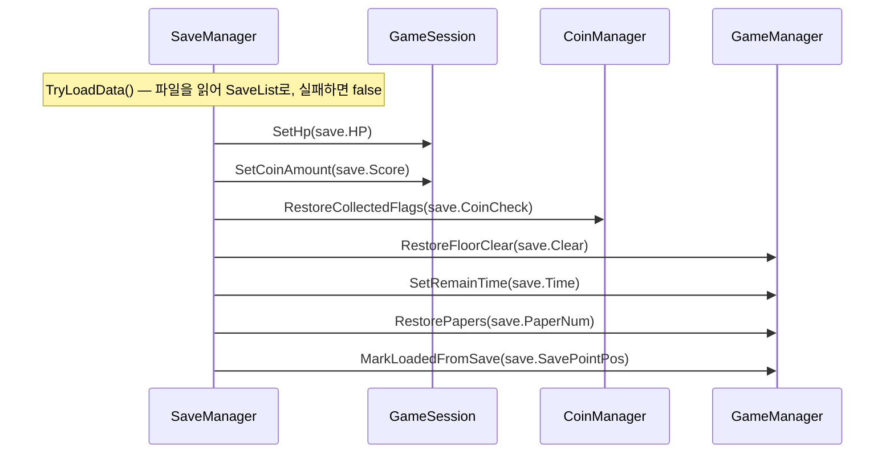

**바꾼 것**

- (1차) SingletonBase<SaveManager>를 상속하도록 변경하고, 세이브 파일 확인 기능을 HasSaveFile, SaveFilePath 프로퍼티로 분리했습니다.
- (1차) 다른 스크립트의 static 변수나 public 필드에 직접 값을 대입하던 방식을 SetHp(), RestoreFloorClear() 등의 메서드를 호출하는 방식으로 변경했습니다.
- (2차) 저장 위치를 Application.persistentDataPath로 변경하고, 기존 저장 위치에 세이브 파일이 존재하는 경우 최초 실행 시 한 번 복사하도록 구현했습니다.
- (2차) 저장 및 불러오기 작업을 try/catch문으로 감싸 예외 상황에 대응하도록 개선했습니다.
- 기존 LoadData()를 성공 여부를 반환하는 TryLoadData()로 변경했습니다. 이를 통해 호출하는 측(불러오기 버튼)에서 실행 결과에 따라 커서 숨김 여부를 결정하도록 역할을 분리했습니다.
- (2차) 플레이어 위치를 가져오기 위해 SaveManager가 플레이어를 직접 참조하지 않고, GameManager의 PlayerPosition 프로퍼티를 통해 접근하도록 변경했습니다. 세이브 데이터를 불러올 때는 플레이어 위치를 매개변수로 전달하도록 개선했습니다.
- 기존 세이브 파일과의 호환성을 유지하기 위해 SaveList의 필드명과 JSON 데이터 형식은 변경하지 않았습니다.

**다음 단계 — 동작 개선**

- 미로 스테이지 외부에서 저장한 세이브 파일을 불러온 후 코인을 획득하면 예외가 발생하는 문제를 리팩터링 과정에서 발견하여 TODO로 표시했습니다.

- 각 저장 대상이 자신의 데이터를 직접 내보내고 불러오는 구조로 개선할 예정입니다.

<a id="section-3-3"></a>
### 3.3 서로 다른 경험을 주는 스테이지

| 스테이지 | 내용 |
|---|---|
| 미로 스테이지 | 미로를 헤매며 코인을 모아 목숨을 늘리고 열쇠와 사직서 조각 찾아서다음 스테이지 이동    |
| 포탈 스테이지 | 여러 방을 돌아다니며 각 방에 있는 기믹을 클리어 후 사직서 조각 획득 후 다음 스테이지 이동     |
| 러닝 스테이지 | 뒤에서 쫓아오는 가시 벽을 피해 앞으로 달리며 장애물 돌파 후 사직서 조각 획득 후다음 스테이지 이동    |
| 탈출 스테이지 | 동물 모형 맞추기 · 순서대로 발판 밟기 · 교실 문제 풀기 이렇게 3개의 수수께끼 풀이 후 사직서 조각 획득 및 다음 스테이지 이동   |
| 보스 룸  | 파일 투척 · 바닥 타일 삭제 · 전등 떨어뜨리기 이렇게 3개의 패턴을 가진 보스를 무찌르고 탈출                |
| 2층 미션 | OX 퀴즈 · 틀린 그림 찾기 · 방 정리하기 · 아이템 모으기 이렇게 4개의 미션을 클리어 후 열쇠 획득 후 다음 스테이지 이동(현재는 게임 클리어)       |

<div style="display:grid;grid-template-columns:repeat(2,minmax(0,1fr));gap:12px;max-width:640px;margin:24px auto 0">
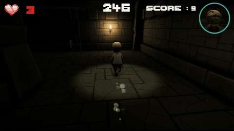
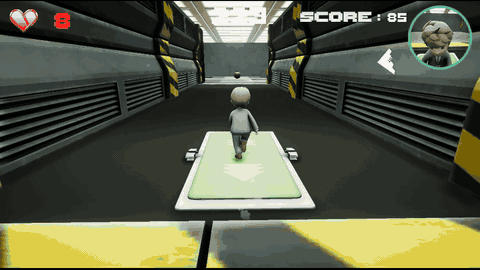
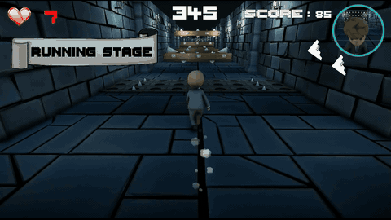
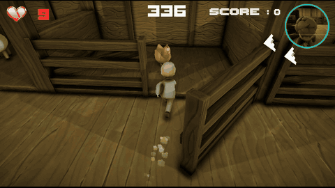
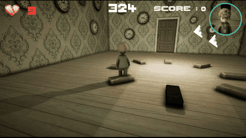
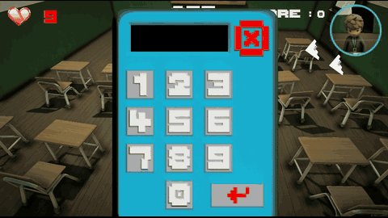
</div>
<p style="text-align:center;margin:8px auto 28px">1층 스테이지 — 미로 · 포탈 · 러닝 · 탈출(동물 모형 맞추기 · 순서대로 발판 밟기 · 교실 문제 풀기)</p>

<div style="display:grid;grid-template-columns:repeat(2,minmax(0,1fr));gap:12px;max-width:640px;margin:0 auto">
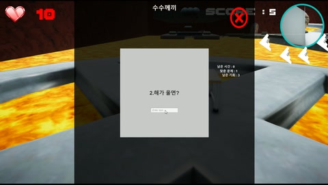
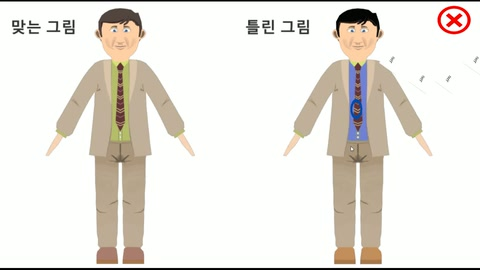
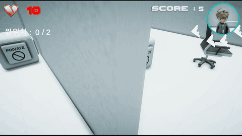
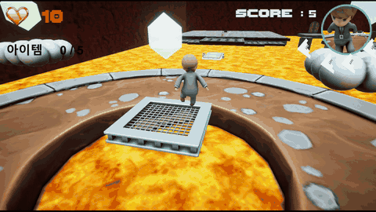
</div>
<p style="text-align:center;margin:8px auto 28px">2층 미션 — OX 퀴즈 · 틀린 그림 찾기 · 방 정리하기 · 아이템 모으기</p>

**지금 구조의 문제와 수정 예정**

스테이지가 늘어날수록 기믹 정보가 Player와 공용 UI 한곳에 모이는 구조입니다.

- **Player가 기믹을 다 알고 있음** — `Player.cs`의 트리거 · 충돌 함수가 태그와 오브젝트 이름 19가지(점프 아이템, 레버, 석상, 제단, 키패드, NPC 2명, OX 퀴즈, 틀린 그림, 문서, 가시 등)로 기믹을 나눕니다. Player가 키패드 창 · OX 퀴즈 창 · 틀린 그림 창, 손에 드는 동물 모형 배열, NPC 근처 여부, 모은 문서 수까지 직접 들고 있고, 제단은 `GameObject.Find`로 이름을 찾아 부릅니다.
- **UI 한 프리팹에 스테이지 UI가 모두 들어 있음** — 게임 내내 유지되는(`DontDestroyOnLoad`) `Canvas.prefab` 안에 체력 · 점수 · 일시정지 메뉴와 함께 1층 탈출 스테이지의 키패드, 2층 틀린 그림 창, 사직서 조각 표시가 들어 있어 어느 스테이지에서나 모두 함께 올라옵니다.

```csharp
void OnTriggerEnter(Collider other)
{
    if (other.CompareTag(Tags.JumpItem)) EnterJumpItem();
    if (other.name == GateOpenLeverName) Destroy(wall);
    if (other.CompareTag(Tags.AnswerArea)) isAreaIn = true;
    if (other.CompareTag(Tags.Water)) transform.position = GameManager.Instance.SpawnPoint.transform.position;
    if (other.CompareTag(Tags.Bullet)) EnterBullet(other);
    if (other.CompareTag(Tags.DocumentItem)) EnterDocument(other.gameObject);
    if (other.CompareTag(Tags.Spike) || other.CompareTag(Tags.SliceWall)) EnterSpike();
}

void OnTriggerStay(Collider other)
{
    StayStatue(other);   // 동물 모형
    StayKeyPad(other);   // keyPad 창을 Player가 직접 켬
    StayNpc(other);      // nearNpc[0] · nearNpc[1]
    StayQuiz(other);     // oxQuiz · findCanvas 창을 Player가 직접 켬

    if (other.gameObject.name == FloorRoomName) Cursor.visible = true;
    if (other.CompareTag(Tags.Button)) StayButton(other);   // 2차: Button이 동작을 정함
}
```

Player.cs (v2) — 트리거 함수 하나가 태그 · 오브젝트 이름으로 기믹을 모두 나눔

2차 리팩터링에서 순서 퍼즐 버튼은 Player가 아니라 Button이 동작을 정하도록(`button.Activate()`) 바꿨지만, 나머지는 그대로입니다. 다음 단계로 기믹마다 상호작용을 맡겨 Player는 "가까운 기믹에 상호작용한다"만 알게 하고, 스테이지 전용 UI는 그 스테이지 씬으로 옮겨 기믹이 직접 열도록 고칠 예정입니다.

---

<a id="section-4"></a>
## 4. AI 협업

v2 리팩터링은 새 기능 추가나 버그 수정이 아니라, **과거에 짠 코드를 지금의 코딩 스타일과 새로 익힌 지식에 맞춰 바꾸는 작업**이었습니다. 리팩터링을 혼자 진행하다 보니 팀원 코드도 함께 바꿨습니다.
바꾸는 기준은 평소 정리해 둔 `코딩스타일.md`에 정해 두었고, 스크립트 72개와 씬 · 프리팹 47개에 같은 규칙을 적용해야 하는 반복 작업이 많았습니다.
1차에서 `코딩스타일.md`를 주자 Claude Code가 그 내용을 리팩터링 스킬용 기준 문서 [`style.md`](https://github.com/tmdrn17/Jaljayo-Code/blob/main/docs/refactoring/style.md)로 옮겼고, 세션마다 이 문서를 읽고 작업했습니다. 2차 기준은 1차 규칙을 그대로 둔 채 이 `style.md`에 덧붙였습니다.
그래서 **기준을 정하고, 작업을 나누고, 결과를 Unity에서 검증하는 일은 직접** 했고, **기준대로 코드를 바꾸는 반복 작업은 Claude Code에 맡겼습니다.**

| 모델 | 1차 (코드 스타일) | 2차 (구조 개선) | 고른 이유 |
|---|---|---|---|
| Opus 5.5 | 계획 · 조율, S1 코어 매니저 | T1 공용 기반(`GameSession` · `Tags` · `SceneNames`) · GameManager · SaveManager | 다른 스크립트가 모두 따를 공용 API를 설계하는 일 |
| Sonnet 5.5 | S2~S5(플레이어 · 장애물 · 퍼즐 · 2층), 브랜치 합치기 | T2~T5(플레이어 · 보스 · 1층 퍼즐 · 2층), T6 OX 퀴즈 데이터, 합치기 | Player(633줄)처럼 많이 얽힌 코드와 합칠 때의 충돌 해결에 어느 정도 판단이 필요. Opus의 절반 가격 |
| Haiku 5.5 | S6 UI · 연출, S7 정리 | T7 스타일 점검 · 확인 | 작고 독립된 스크립트에 규칙만 맞추기, 점검 — 판단이 적고 양이 많은 일 |

- 1차는 S1(코어) → S2 · S6 → 합치기 → S3 · S4 · S5 → 합치기 → S7(정리) 순서로, 서로 겹치지 않는 묶음은 동시에 돌렸습니다.
- 2차는 먼저 `style.md`에 **구조 판단 기준 8개**(책임 · 참조 방향 · 상속이 필요한지 · 바꾼 이유를 한 줄로 말할 수 있는지 등)와 **쓰지 않을 것**을 더하고, 항목 R1-R12로 계획을 세웠습니다. 그 뒤 T1 → T2-T5 동시 → 합치기 → T6 → T7 순서로 진행했습니다.

**세션을 나눈 기준** ([sessions.md](https://github.com/tmdrn17/Jaljayo-Code/blob/main/docs/refactoring/sessions.md))

- **결합도가 큰 것부터** — 다른 스크립트가 모두 쓰는 공용 API를 바꾸는 세션(S1 · T1)을 먼저 혼자 하고, 바뀐 API를 노트로 남겼습니다. 뒤 세션은 앞 코드를 다시 읽지 않고 노트만 보고 따라가게 해 토큰을 줄였습니다.
- **세션 하나는 약 400~900줄** — 한 세션 안에서 컨텍스트가 넘치지 않게 나눴습니다.
- **동시에 돌리는 세션끼리 부딪히지 않게** — 다른 세션이 쓰는 클래스는 public 이름을 바꾸지 않게 **동결**하고, 2차에서는 부르는 쪽과 만드는 쪽이 따로 작업하는 메서드를 **약속 API**로 미리 정해 합치기 단계(N2)에서 양쪽이 같은지 확인했습니다.

| 약속 API (2차) | 만드는 세션 | 부르는 세션 |
|---|---|---|
| `Button.Activate()` | T4 (1층 퍼즐) | T2 (플레이어) |
| `AnswerArea.PlaceStatue(Statue statue)` | T4 | T2 |
| `Stage2UI.ChangePoint(int collectedCount)` | T5 (2층 · UI) | T2 |

**2차에 더한 판단 기준 (일부)** — 전체 8개는 [style.md 8절](https://github.com/tmdrn17/Jaljayo-Code/blob/main/docs/refactoring/style.md#8-리팩터링-판단-기준)

| # | 확인할 것 | 걸리면 |
|---|---|---|
| 4 | 원본과 비교했을 때 바꾼 이유를 한 줄로 설명할 수 있는가 | 이유가 약하면 바꾸지 않는다 |
| 5 | 리팩터링했을 때 이점이 확실한가 | 성능 이점은 실제 규모로 따진다(예: 보스가 한 번에 6개 만드는 정도면 풀링 이점이 불확실). 불확실하면 보류하고 이유를 적는다 |
| 6 | 에디터나 코드에서 바뀔 수 있는 값이 상수로 박혀 있는가 | 조정 값은 `[SerializeField]`로 인스펙터에 두고, 배열 길이는 `array.Length`로, 다른 클래스의 값은 그 클래스의 프로퍼티로 받는다 — 숫자로 박아 두면 에디터에서 값을 바꿔도 코드를 따로 고쳐야 하기 때문 |

**지킨 원칙과 확인한 방법**

- 1차는 수치 · 타이밍 · 판정 · 씬 흐름 · 세이브 형식을 그대로 두었습니다. 2차에서 동작이 달라지는 것(세이브 위치, 실패 씬을 매 프레임이 아니라 한 번만 불러오기 등)은 계획에 적은 것만 허용했습니다.
- 버그로 보이는 곳은 고치지 않고 `// TODO(리팩토링):`으로 표시만 해, 고칠지는 직접 판단하도록 남겼습니다(지금 코드에 11곳).
- 스크립트를 바꿀 때 `.meta`의 GUID를 유지해, 씬과 프리팹의 컴포넌트 연결이 끊기지 않게 했습니다.
- 1차는 Unity batchmode가 라이선스 오류로 실행되지 않아 `dotnet build`로, 2차는 Unity 에디터 콘솔에서 컴파일 에러 0개를 확인했습니다. 에디터에서 직접 확인할 항목은 목록으로 정리했습니다.

**겪은 일**

- 필드 이름을 바꾸자 씬에 저장된 프리팹 오버라이드 키가 옛 이름으로 남아 값이 사라졌습니다. 합치기 단계(M2)에서 `cameraArm`이 비어 플레이어가 움직이지 않은 적이 있고, M3에서는 공격 쿨타임 키를 고치지 않았다면 1초가 0.5초가 될 뻔했습니다.
  그래서 리팩터링 스킬([SKILL.md](https://github.com/tmdrn17/Jaljayo-Code/blob/main/docs/refactoring/SKILL.md))에 이 규칙을 추가했습니다.

  > **프리팹 오버라이드도 같이 바꾼다.** 씬이나 다른 프리팹에 놓인 프리팹 인스턴스는 `m_Modifications` 안에 `propertyPath: 옛이름`으로 값을 덮어쓴다. … (M2에서 이것을 놓쳐 Player의 `cameraArm`이 비고 플레이어가 움직이지 않았다.)

- 1차에서 AI가 이동 속도 · 쿨타임 · 목숨 수처럼 에디터에서 바꿀 수 있어야 하는 값까지 `const`로 만들었습니다(§[5.3](#section-5-3)).

  ```csharp
  // 1차 결과 (Player) — 걷기 · 달리기 속도를 상수로 만듦
  private const float WalkSpeed = 3f;
  ```

  2차에서는 `style.md` 5절에 하지 말 것과 예외를 함께 적어 넣고, 그 값들을 `[SerializeField]`로 되돌렸습니다.

  > - **조정 값:** 속도, 쿨타임, 거리, 지연 시간, 시작 체력, 목숨 수 등 **에디터에서 바꿀 수 있어야 하는 값은 `const`로 두지 않는다.** `[Header("이동")]` + `[SerializeField]`로 인스펙터에 묶는다. 기존 인스펙터 값은 유지한다.
  > - **배열 길이:** 인스펙터 배열과 개수가 같아야 하는 값은 상수로 쓰지 않고 `array.Length`/`list.Count`를 쓴다.
  > - **값을 베끼지 않는다:** 다른 클래스의 인스펙터 값을 const로 다시 적지 않는다. 그 값을 가진 클래스가 프로퍼티로 내보낸다 (`Boss.MaxHp`, `GameManager.HasAllPapers`).
  > - **const로 두는 것:** 바뀌지 않는 약속 값(OnClick 정수 인자, 저장 배열 길이, 오디오 믹서 최솟값), 애니메이터 해시, 태그·씬 이름.

- 2차가 끝난 뒤 AI가 낸 결과를 다시 점검해 보니, 상수 정리가 계획대로 다 되지 않았습니다([상수_관리_정리.md](https://github.com/tmdrn17/Jaljayo-Code/blob/main/docs/refactoring/상수_관리_정리.md)).
  - 원래 의도는 상수를 공용 static 클래스로 모으는 것이었는데, 계획에 "두 파일 이상이 쓰는 상수만 공용 클래스로"라는 제한이 묻혀 들어가 확인받지 않은 채 적용됐습니다. 그래서 `Player`처럼 자기만 쓰는 태그 10개를 클래스 안에 가진 파일이 남았습니다.
  - 계획(R1)에 `Tags.Player`로 바꾼다고 적은 7개 파일이 어느 세션에도 배정되지 않아 그대로 남았습니다.
  - 그래서 상수를 어디에 둘지 기준을 다시 정하고(§[2.3](#section-2-3)), `Tags`를 5개에서 23개로 늘리고 입력 이름 `InputNames` · 오브젝트 이름 `ObjectNames`를 새로 만들어 스크립트 23개를 고쳤습니다. 문자열 값은 하나도 바꾸지 않았고, 컴파일 에러 0개를 확인했습니다.

AI에게 준 기준 문서와 작업 기록은 소스코드 레포의 [docs/refactoring](https://github.com/tmdrn17/Jaljayo-Code/tree/main/docs/refactoring)에 있습니다. 직접 정한 기준은 `style.md`, 세션마다 따른 규칙은 `SKILL.md`, 세션 나누기는 `sessions.md`이고, 파일별 변경 기록 [리팩토링_결과.md](https://github.com/tmdrn17/Jaljayo-Code/blob/main/docs/refactoring/리팩토링_결과.md)는 Claude Code가 작업하며 남긴 것입니다.

---

## 5. 회고

<a id="section-5-1"></a>
### 5.1 결과

「잘자요」를 완성해 교내 전시회에 출품했고, 졸업 과제 기준도 통과했습니다.

v2 리팩터링 결과는 다음과 같습니다.

| 지표 | 1차 (코드 스타일) | 2차 (구조 개선) |
|---|---|---|
| 바뀐 C# 파일 | 80개 (+2,393 / −2,635줄) | 49개 (+756 / −625줄) |
| 함께 고친 씬 · 프리팹 | 47개 | 9개 |
| 코드 양 | 4,462줄 → 3,741줄 (−16%) | +131줄 (새 파일 7개 포함) |
| 브랜치를 합칠 때 충돌 | 0건 | 0건 |
| 컴파일 에러 | 0개 | 0개 |
| 작업 시간 | 하루(4시간 32분), 그중 Claude Code 순수 작업 85분 | 재지 않음 |

<a id="section-5-2"></a>
### 5.2 배운 점

- **반복 작업을 효율적으로 수행하려면 명확한 기준을 먼저 정의해야 했습니다.** 변경할 규칙을 코딩스타일.md에 사전에 정리한 덕분에 동일한 규칙을 하루 만에 적용할 수 있었습니다. 이를 통해 직접 코드를 수정하는 작업에서 벗어나, 변경 기준을 수립하고 작업 범위를 분배하며 결과물을 검토하는 역할의 중요성을 배웠습니다.
- **AI가 생성하거나 수정한 결과물은 코드뿐만 아니라 프로젝트 전반에서 검증해야 했습니다.** 컴파일 오류가 발생하지 않더라도 씬과 프리팹에 직렬화되어 저장된 값이 변경되거나 유실될 수 있다는 점을 경험했습니다(§4 겪은 일). 이를 통해 코드의 동작뿐만 아니라 데이터가 저장되고 참조되는 방식까지 이해해야 AI가 놓친 문제를 발견하고 안정적으로 프로젝트를 관리할 수 있다는 점을 배웠습니다.

<a id="section-5-3"></a>
### 5.3 아쉬운 점과 개선 계획

- **AI로 리팩터링 뼈대를 잡아도 아쉬운 점이 남음** — 구조를 잡은 채 AI에게 리팩터링의 뼈대 생성을 맡겨도 제가 코딩하던 방식과 완전히 같을 수는 없었습니다. 특히 제가 애니메이터 조절을 위해 상수로 빼둔 값들을 레퍼런스 소스로 줬더니 플레이어의 이동 속도나 체력 같은 유니티 에디터상 수정이 가능해야 하는 부분 마저 모두 상수화 해버린 부분이 컸습니다. → 1차 기준 문서는 단순하게 제 스타일만 준 문서였습니다. 2차에서는 해야 할 일뿐만 아니라 하지 말아야 할 일, 예외적으로 처리해도 되는 특수 상황과 판단 기준을 같이 작성해서 넘겼고, 상수로 바뀐 조정 값을 인스펙터 값으로 되돌렸습니다(§4).

- **리팩터링 중 찾은 버그를 TODO로만 남김** — 코인 배열 범위 초과, 보스 체력이 음수가 되면 죽지 않음, OX 퀴즈 재시작 시 초기화 안 됨 등 11곳은 동작을 바꾸지 않는다는 원칙에 따라 표시만 했습니다. 구조 기준에 맞지 않지만 씬 연결이 얽혀 있어 남긴 곳도 있습니다(`GameObject.Find` 10곳, 매 프레임 텍스트를 다시 쓰는 2곳). → 지금은 AI로 리팩터링의 뼈대만 잡아둔 상태라 추후 원래 기획서에서 엔딩 스테이지였던 3층 구현과 함께 수정할 계획입니다.

## 종합 회고
이번 프로젝트를 통해 AI 기반 리팩터링에서 작업 기준과 검증 과정의 중요성을 체감하고, 구조 개선 작업과 실제 동작·버그 해결을 분리해 접근해야 한다는 점을 배웠습니다. 특히 AI 활용의 효율은 프로젝트 구조와 데이터 관리 방식에 대한 이해, 그리고 결과물을 직접 검증하는 역량이 뒷받침될 때 비로소 온전히 발휘된다는 과제를 명확히 확인했습니다.