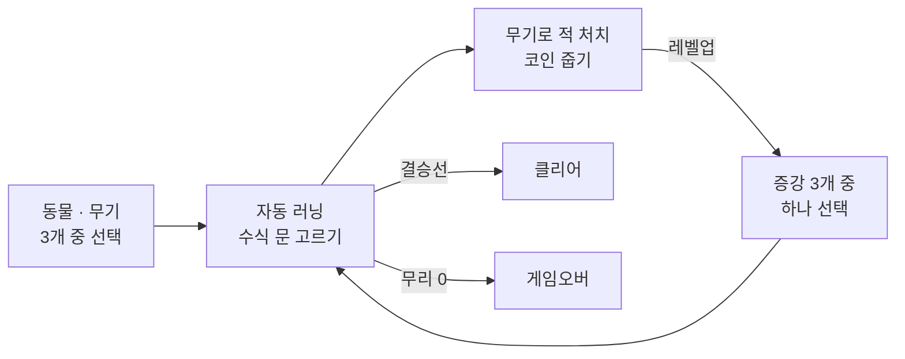
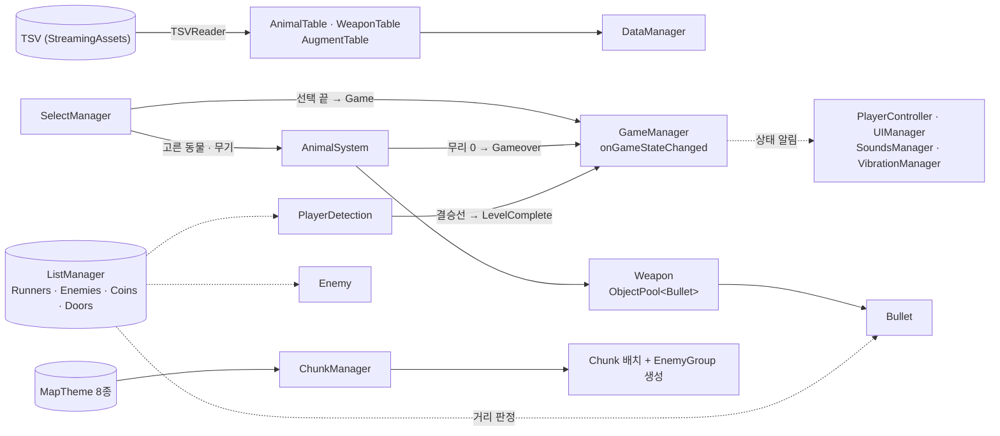
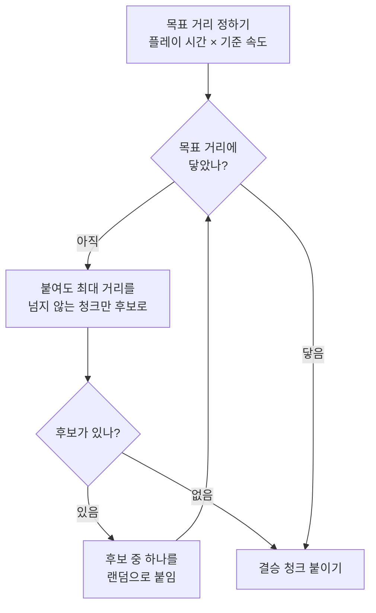
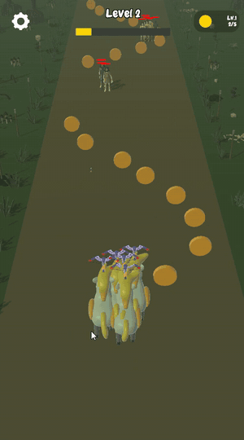
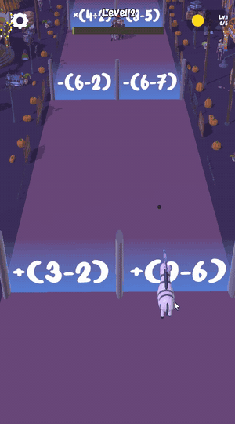
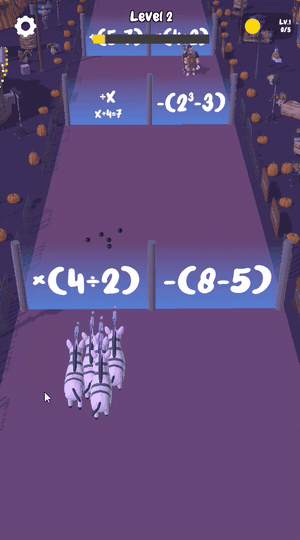

# 애니멀 런 프로젝트 문서

> **수식 문을 골라 동물 무리를 늘리고, 무기로 적을 쓰러뜨리며 결승선까지 달리는 3D 크라우드 러너**


| 항목 | 내용 |
|---|---|
| 장르 | 3D 크라우드 러너 (모바일 세로 화면) — 수식 문을 골라 동물 무리를 늘리고, 무기로 적을 쓰러뜨리며 결승선까지 달리는 게임 |
| 기간 · 인원 | 2023.10 원형 제작 → 2026.09 리팩토링 / 개인 프로젝트 |
| 엔진 · 도구 | Unity 2023.1, C#, CsvHelper (TSV 데이터), Blender(Claude Code) |
| 구현 | 기획·개발 전체 |
| 링크 | [시연 영상](https://youtu.be/vwFRyeQ6Njk) · [쇼츠](https://youtube.com/shorts/lrA1PyblqnI) (2분 24초) · [GitHub](https://github.com/tmdrn17/AnimalRun) |
| AI 활용 | 레벨 생성 일부 수정, 동물 에셋 제작 파이프라인, 맵 테마(청크 · 적 · 테마 구조) 제작에 Claude Code 사용 |

---

## 1. 개요

<a id="section-1-1"></a>
### 1.1 동물 무리를 늘리며 결승선까지 달리는 크라우드 러너

<iframe src="https://www.youtube.com/embed/vwFRyeQ6Njk" title="시연 영상" allow="accelerometer; clipboard-write; encrypted-media; gyroscope; picture-in-picture" allowfullscreen style="display:block;width:360px;max-width:55%;aspect-ratio:9/16;height:auto;margin:0 auto;border:0"></iframe>

3D 크라우드 러너 개인 프로젝트로 **절차적 레벨 생성**, **전략 패턴**, **레벨업 증강 선택**, **거리 충돌**, **ObjectPool**, **맵 테마**를 구현했습니다.

<a id="section-1-2"></a>
### 1.2 빠르게 만들어 스토어에 올리기 위한 하이퍼 캐주얼

빠르게 제작해 스토어에 올리기 위해 만들었습니다.

하이퍼 캐주얼 장르는 반복성이 있고, 에셋을 비교적 저렴한 비용으로 구매할 수 있습니다. 또 비슷한 종류의 게임이 이미 여러 사이트에서 광고되고 있어, 유저들이 받아들이기 쉬웠습니다.

**목표한 경험** — 달리면서 문에 적힌 식을 바로 암산해 더 이득인 문을 고르고, 그 판단으로 무리가 불어나는 재미를 주고 싶었습니다.

---

## 2. 시스템 구조

<a id="section-2-1"></a>
### 2.1 게임 루프

한 판 단위로 끝나는 단발성 구조입니다.



<a id="section-2-2"></a>
### 2.2 데이터 · 게임 상태 · 스테이지 · 전투의 흐름

TSV 데이터가 테이블을 거쳐 들어오고, 상태 변화는 이벤트로 알립니다.



| 클래스 | 맡은 일 |
|---|---|
| GameManager | 게임 상태(Select · Game · Gameover · LevelComplete)를 바꾸고 `onGameStateChanged`로 알림 |
| SelectManager | 동물 · 무기 · 증강 선택지를 뽑고, 고른 동물 · 무기를 AnimalSystem에 넘긴 뒤 상태를 Game으로 바꿈 |
| ChunkManager | 테마 고르기, 청크 이어 붙이기, 적 무리 배치 |
| AnimalSystem | 러너를 늘리고 줄이며 무기를 장착하고, 무리가 0이 되면 Gameover |
| PlayerDetection | 문 · 코인 · 결승선을 거리로 감지 |
| ListManager | 러너 · 적 · 코인 · 문 목록을 static 리스트 4개로 공유 |
| DataManager | 동물 · 무기 · 증강 테이블과 경험치 |

---

## 3. 핵심 기능

<a id="section-3-1"></a>
### 3.1 목표 플레이 시간에 맞춘 레벨 생성

**문제** — 처음에는 청크 수가 다른 레벨 에셋 4개(청크 4 · 5 · 6 · 7개) 중 하나를 랜덤으로 골라 길을 만들었는데, 판마다 길이가 달라 플레이 시간이 들쭉날쭉했습니다.

**해결** — 목표 거리를 '플레이 시간 × 기준 속도'로 먼저 정하고, 붙였을 때 최대 거리를 넘지 않는 청크만 후보로 모아 그중 하나를 랜덤으로 붙입니다. 결승선이 청크 안 어디에 있는지도 계산에 넣었습니다.

```csharp
// ① 목표 거리: 플레이 시간(60~90초) × 기준 속도(5) → 300~450 중 하나
float minDistance = minPlayTime * referenceMoveSpeed;
float maxDistance = maxPlayTime * referenceMoveSpeed;
float targetDistance = Random.Range(minDistance, maxDistance);

// ② 목표 거리에 닿을 때까지 청크를 붙인다
while (GetFinishDistance(chunkEndZ, finishLineOffset, startZ) < targetDistance)
{
    List<Chunk> candidates = new List<Chunk>();
    foreach (Chunk chunk in randomChunks)
    {
        // ③ 붙였을 때 최대 거리를 넘지 않는 청크만 후보로
        if (GetFinishDistance(chunkEndZ + chunk.GetLength(), finishLineOffset, startZ) <= maxDistance)
            candidates.Add(chunk);
    }

    // ④ 붙일 청크가 없으면 멈춘다
    if (candidates.Count == 0)
        break;

    Chunk randomChunk = candidates[Random.Range(0, candidates.Count)];
    levelChunks.Add(randomChunk);
    chunkEndZ += randomChunk.GetLength();
}
levelChunks.Add(finishChunk);
```

<a id="source-chunkmanager"></a>
<details>
<summary>원본 코드 전체 보기 — ChunkManager.cs</summary>

```csharp
using System.Collections.Generic;
using UnityEngine;

public class ChunkManager : MonoBehaviour
{
    public static ChunkManager instance;

    [Header(" Elements ")]
    [SerializeField] private EnemyGroup enemyGroupPrefab;
    
    [Header(" Themes ")]
    [SerializeField] private MapTheme[] themes;

    [Header(" Enemy Settings ")]
    [Tooltip("이 순서(0부터 시작)의 청크부터 적이 등장한다. 2 = 첫 번째, 두 번째 청크 제외")]
    [SerializeField] private int firstEnemyChunkIndex = 2;
    [SerializeField] private float enemySpawnHalfWidth = 3f;
    [SerializeField] private float enemyDistanceFromDoors = 3f;

    [Header(" Play Time Settings ")]
    [SerializeField] private float referenceMoveSpeed = 5f;
    [SerializeField] private float minPlayTime = 60f;
    [SerializeField] private float maxPlayTime = 90f;

    private Chunk firstChunk;
    private Chunk[] randomChunks;
    private Chunk finishChunk;
    
    private GameObject finishLine;
    private Enemy[] themeEnemyPrefabs;

    private void Awake()
    {
        if (instance != null)
            Destroy(gameObject);
        else
            instance = this;
    }

    private void Start()
    {
        ApplyTheme();
        GenerateLevel();

        finishLine = GameObject.FindWithTag("Finish");
    }

    // 테마가 있으면 이번 레벨의 테마 청크로 기본 청크를 바꿔 끼운다.
    private void ApplyTheme()
    {
        MapTheme theme = GetCurrentTheme();

        themeEnemyPrefabs = theme.EnemyPrefabs;
        firstChunk = theme.FirstChunk;
        randomChunks = theme.RandomChunks;
        finishChunk = theme.FinishChunk;

        theme.ApplyLighting(FindSun(), Camera.main);
    }

    private Light FindSun()
    {
        if (RenderSettings.sun != null)
            return RenderSettings.sun;

        foreach (Light sceneLight in FindObjectsByType<Light>(FindObjectsSortMode.None))
        {
            if (sceneLight.type == LightType.Directional)
                return sceneLight;
        }

        return null;
    }

    public MapTheme GetCurrentTheme()
    {
        int index = Random.Range(0, themes.Length);
        MapTheme theme = themes[index];

        return theme;
    }

    private void GenerateLevel()
    {
        float startZ = PlayerController.instance.transform.position.z;
        float finishLineOffset = GetFinishLineOffset();

        // 플레이어 시작 지점 ~ 결승선 사이 거리 범위 (moveSpeed 5 기준 1분 ~ 1분 30초)
        float minDistance = minPlayTime * referenceMoveSpeed;
        float maxDistance = maxPlayTime * referenceMoveSpeed;
        float targetDistance = Random.Range(minDistance, maxDistance);

        List<Chunk> levelChunks = new List<Chunk> { firstChunk };

        // 첫 청크는 원점에 중심을 두므로 끝 지점은 길이의 절반
        float chunkEndZ = firstChunk.GetLength() / 2;

        while (GetFinishDistance(chunkEndZ, finishLineOffset, startZ) < targetDistance)
        {
            List<Chunk> candidates = new List<Chunk>();

            foreach (Chunk chunk in randomChunks)
            {
                if (GetFinishDistance(chunkEndZ + chunk.GetLength(), finishLineOffset, startZ) <= maxDistance)
                    candidates.Add(chunk);
            }

            if (candidates.Count == 0)
                break;

            Chunk randomChunk = candidates[Random.Range(0, candidates.Count)];
            levelChunks.Add(randomChunk);
            chunkEndZ += randomChunk.GetLength();
        }

        levelChunks.Add(finishChunk);

        CreateLevel(levelChunks);
    }

    private float GetFinishDistance(float chunkEndZ, float finishLineOffset, float startZ)
    {
        return chunkEndZ + finishChunk.GetLength() / 2 + finishLineOffset - startZ;
    }

    private float GetFinishLineOffset()
    {
        foreach (Transform child in finishChunk.GetComponentsInChildren<Transform>(true))
        {
            if (child.CompareTag("Finish"))
                return child.position.z - finishChunk.transform.position.z;
        }

        return 0f;
    }

    private void CreateLevel(List<Chunk> levelChunks)
    {
        Vector3 chunkPosition = Vector3.zero;

        for (int i = 0; i < levelChunks.Count; i++)
        {
            Chunk chunkToCreate = levelChunks[i];

            if (i > 0)
                chunkPosition.z += chunkToCreate.GetLength() / 2;

            Chunk chunkInstance = Instantiate(chunkToCreate, chunkPosition, Quaternion.identity, transform);

            RemovePlacedEnemyGroups(chunkInstance);

            bool isFinishChunk = i == levelChunks.Count - 1;
            if (i >= firstEnemyChunkIndex && !isFinishChunk)
                SpawnEnemyGroup(chunkInstance);

            chunkPosition.z += chunkInstance.GetLength() / 2;
        }
    }

    // 청크 프리팹에 미리 배치된 적 군체는 쓰지 않고, 청크마다 랜덤으로 다시 배치한다.
    private void RemovePlacedEnemyGroups(Chunk chunk)
    {
        foreach (EnemyGroup enemyGroup in chunk.GetComponentsInChildren<EnemyGroup>(true))
        {
            // 비활성화해서 Start(적 생성)가 실행되지 않게 한 뒤 삭제한다.
            enemyGroup.gameObject.SetActive(false);
            Destroy(enemyGroup.gameObject);
        }
    }

    private void SpawnEnemyGroup(Chunk chunk)
    {
        if (enemyGroupPrefab == null)
            return;

        Doors[] doors = chunk.GetComponentsInChildren<Doors>();
        float centerZ = chunk.transform.position.z;
        float margin = enemyGroupPrefab.GetMaxRadius() + 1f;
        float halfLength = Mathf.Max(0f, chunk.GetLength() / 2 - margin);

        float spawnZ = centerZ;

        // 문과 겹치지 않는 위치를 몇 번 시도해서 찾는다.
        for (int attempt = 0; attempt < 10; attempt++)
        {
            spawnZ = centerZ + Random.Range(-halfLength, halfLength);

            bool isFarFromDoors = true;
            foreach (Doors door in doors)
            {
                if (Mathf.Abs(door.transform.position.z - spawnZ) < enemyDistanceFromDoors)
                {
                    isFarFromDoors = false;
                    break;
                }
            }

            if (isFarFromDoors)
                break;
        }

        Vector3 spawnPosition = new Vector3(Random.Range(-enemySpawnHalfWidth, enemySpawnHalfWidth), 0, spawnZ);

        // 적이 플레이어 쪽(-z)을 바라보도록 회전시킨다.
        EnemyGroup enemyGroup = Instantiate(enemyGroupPrefab, spawnPosition, Quaternion.Euler(0, 180, 0), chunk.transform);

        // 적 생성(Start)은 다음 프레임이라 지금 테마 적으로 바꿔 끼우면 반영된다.
        enemyGroup.SetEnemyPrefabs(themeEnemyPrefabs);
    }

    public float GetFinishZ()
    {
        return finishLine.transform.position.z;
    }

    public int GetLevel()
    {
        return PlayerPrefs.GetInt("level", 0);
    }
}
```

</details>

ChunkManager.cs — 목표 거리에 맞을 때까지 청크 이어 붙이기



1. **목표 거리부터 정함** — 플레이 시간 × 기준 속도로 목표 거리를 먼저 정해, 판마다 플레이 시간이 고르게 됩니다.
2. **넘치지 않는 청크만 후보로** — 최대 거리를 넘는 청크는 빼고, 남은 후보 중 하나를 랜덤으로 붙입니다.
3. **결승선 위치까지 계산** — 결승선이 청크 안 어디에 있는지(offset)도 거리 계산에 넣었습니다.
4. **붙일 청크가 없으면 멈춤** — 남은 거리가 가장 짧은 청크보다 짧으면 후보가 비는데, 이때 멈추지 않으면 끝 위치가 그대로라 반복문이 끝나지 않습니다. 그래서 결승선은 목표 거리보다 조금 짧아질 수 있지만, 최대 거리는 넘지 않습니다.

기준 속도 5, 플레이 시간 60~90초라 목표 거리는 300~450입니다. 적 무리는 첫 두 청크와 결승 청크를 빼고, 문에서 3 이상 떨어진 자리를 10번까지 찾아 0~5마리씩 놓습니다.

<a id="section-3-2"></a>
### 3.2 정답을 먼저 정하고 식을 만드는 수식 문

**문제** — 2023 원형은 문에 숫자(±1~4, ×·÷ 1~3)만 보여 줬습니다. 문에 숫자만 보여 주면 너무 단순하고, 식을 랜덤으로 만들면 결과가 얼마나 나올지 통제할 수 없었습니다.

**해결** — 결과값을 먼저 뽑고, 그 값이 나오도록 식을 거꾸로 만듭니다. 뺄셈·일차방정식·거듭제곱·나눗셈 생성기를 delegate 배열에 넣어 두고 하나를 고르는 방식이라, 새로운 식 유형은 함수 하나만 추가하면 됩니다.

**첫 문** — 첫 문은 항상 이득이 되는 쉬운 문제가 나오게 했습니다.

**결과를 색으로 알려 주지 않음** — 2023 원형은 +와 ×를 이득 색, −와 ÷를 손해 색으로 칠했습니다. 하지만 식을 풀어야 하는 문인데 색으로 표시하면 풀 이유가 없어지기 때문에, 지금은 모든 문을 같은 색으로 보여 줍니다.

```csharp
private delegate Expression ExpressionBuilder(int value);
private static readonly ExpressionBuilder[] SignedBuilders =
    { Subtraction, Subtraction, LinearEquation, Power };
```

<a id="source-doorquiz"></a>
<details>
<summary>원본 코드 전체 보기 — DoorQuiz.cs</summary>

```csharp
using UnityEngine;

/// <summary>
/// 문에 표시할 중학교 1학년 수준의 수식.
/// Value는 수식을 계산한 결과이며, 문의 연산(+, -, ×, ÷)에 그대로 적용된다.
/// </summary>
public struct DoorQuiz
{
    public BonusType Type;
    public int Value;
    public string Text;
}

/// <summary>
/// 중1 교육 과정(정수의 덧셈·뺄셈, 일차방정식, 거듭제곱)의 가장 기초적인 문제로 문 수식을 만든다.
/// 달리면서 바로 암산할 수 있도록 연산은 한 번, 식에 나오는 수는 1 ~ 9의 양수만 쓴다.
/// (음수는 "2-5"처럼 계산 결과로만 나온다.)
/// 정답(Value)을 먼저 정한 뒤 그 값이 나오도록 식을 역으로 구성한다.
/// </summary>
public static class DoorQuizGenerator
{
    private const string Times = "×";
    private const string Divide = "÷";

    // 덧셈/뺄셈 문의 계산 결과 범위 (0 제외, 음수 가능)
    private const int MinSignedValue = -3;
    private const int MaxSignedValue = 5;

    // 곱셈/나눗셈 문의 계산 결과 범위
    private const int MinMultiplier = 2;
    private const int MaxMultiplier = 3;

    // 식에 등장하는 수의 최댓값
    private const int MaxOperand = 9;

    private struct Expression
    {
        // 문의 연산 기호 뒤에 붙는 부분 (예: "(2-5)", "x", "(6÷2)")
        public string Body;
        // 방정식처럼 아래 줄에 따로 표시할 조건 (없으면 null)
        public string Condition;
    }

    private delegate Expression ExpressionBuilder(int value);

    private static readonly ExpressionBuilder[] SignedBuilders =
    {
        Subtraction, Subtraction, LinearEquation, Power
    };

    private static readonly ExpressionBuilder[] MultiplierBuilders =
    {
        Subtraction, Division, LinearEquation
    };

    private static readonly ExpressionBuilder[] EasyBuilders =
    {
        Subtraction
    };

    public static DoorQuiz Create(BonusType type)
    {
        bool isMultiplier = type == BonusType.Product || type == BonusType.Division;

        int value = isMultiplier
            ? Random.Range(MinMultiplier, MaxMultiplier + 1)
            : RandomNonZero(MinSignedValue, MaxSignedValue);

        ExpressionBuilder[] builders = isMultiplier ? MultiplierBuilders : SignedBuilders;
        Expression expression = builders[Random.Range(0, builders.Length)](value);

        return new DoorQuiz { Type = type, Value = value, Text = BuildText(type, expression) };
    }

    /// <summary>
    /// 첫 번째 문용 쉬운 문제. 결과는 항상 1 ~ 3 이므로 러너가 늘어난다.
    /// </summary>
    public static DoorQuiz CreateEasy()
    {
        int value = Random.Range(1, 4);
        Expression expression = EasyBuilders[Random.Range(0, EasyBuilders.Length)](value);

        return new DoorQuiz { Type = BonusType.Addition, Value = value, Text = BuildText(BonusType.Addition, expression) };
    }

    private static string BuildText(BonusType type, Expression expression)
    {
        string text = GetOperatorSymbol(type) + expression.Body;

        if (expression.Condition != null)
            text += "\n<size=70%>" + expression.Condition + "</size>";

        return text;
    }

    private static string GetOperatorSymbol(BonusType type)
    {
        switch (type)
        {
            case BonusType.Difference: return "-";
            case BonusType.Product: return Times;
            case BonusType.Division: return Divide;
            default: return "+";
        }
    }

    #region 수식 생성

    // 양수끼리의 뺄셈 (결과가 음수일 수 있음): (2-5) = -3, (7-4) = 3
    private static Expression Subtraction(int value)
    {
        int minB = Mathf.Max(1, 1 - value);
        int maxB = Mathf.Min(MaxOperand, MaxOperand - value);
        int b = Random.Range(minB, maxB + 1);

        return Inline($"{value + b}-{b}");
    }

    // 한 번에 풀리는 일차방정식: x (x+3=5)
    private static Expression LinearEquation(int value)
    {
        int minB = Mathf.Max(1, 1 - value);
        int b = Random.Range(minB, minB + 4);

        return new Expression { Body = "x", Condition = $"x+{b}={value + b}" };
    }

    // 거듭제곱 (2², 2³ 만 사용): (2²-1) = 3
    private static Expression Power(int value)
    {
        int exponent = Random.value < 0.5f ? 2 : 3;
        int power = exponent == 2 ? 4 : 8;
        int c = power - value;

        if (c < 0 || c > MaxOperand)
            return Subtraction(value);

        string powerText = $"2<sup>{exponent}</sup>";
        return Inline(c == 0 ? powerText : $"{powerText}-{c}");
    }

    // 양수끼리의 나눗셈: (6÷2) = 3
    private static Expression Division(int value)
    {
        int divisor = Random.Range(2, 4);
        return Inline($"{value * divisor}{Divide}{divisor}");
    }

    #endregion

    #region 표기 도우미

    private static Expression Inline(string body)
    {
        return new Expression { Body = "(" + body + ")" };
    }

    // min ~ max(포함) 사이에서 0을 제외하고 고른다.
    private static int RandomNonZero(int min, int max)
    {
        int number;
        do
        {
            number = Random.Range(min, max + 1);
        } while (number == 0);

        return number;
    }

    #endregion
}
```

</details>

DoorQuiz.cs — 식 유형을 고르는 생성기 목록

```csharp
public static DoorQuiz Create(BonusType type)
{
    bool isMultiplier = type == BonusType.Product || type == BonusType.Division;

    // ① 결과값(정답)을 먼저 정한다: +·− 문은 -3~5(0 제외), ×·÷ 문은 2~3
    int value = isMultiplier
        ? Random.Range(MinMultiplier, MaxMultiplier + 1)
        : RandomNonZero(MinSignedValue, MaxSignedValue);

    // ② 문 종류에 맞는 생성기 목록에서 하나를 골라 그 값이 나오는 식을 만든다
    ExpressionBuilder[] builders = isMultiplier ? MultiplierBuilders : SignedBuilders;
    Expression expression = builders[Random.Range(0, builders.Length)](value);

    return new DoorQuiz { Type = type, Value = value, Text = BuildText(type, expression) };
}

// ③ 거꾸로 만들기 — 결과가 value인 뺄셈 (a-b). a·b 모두 1~9
private static Expression Subtraction(int value)
{
    int minB = Mathf.Max(1, 1 - value);
    int maxB = Mathf.Min(MaxOperand, MaxOperand - value);
    int b = Random.Range(minB, maxB + 1);
    return Inline($"{value + b}-{b}");
}
```

[원본 코드: DoorQuiz.cs](#source-doorquiz)

DoorQuiz.cs — 정답을 먼저 정하고 식을 거꾸로 만들기

1. **정답부터** — +·− 문은 −3~5(0 제외), ×·÷ 문은 2~3에서 결과를 먼저 뽑습니다. 범위는 AI가 정했고, 직접 플레이하면서 문제가 없다고 판단해 그대로 썼습니다.
2. **식의 수는 1~9** — 달리면서 바로 암산할 수 있도록, 뺄셈은 b를 먼저 고른 뒤 a = 결과 + b로 만들고 a · b가 모두 1~9가 되게 범위를 잡습니다.
3. **문 종류마다 다른 생성기 목록** — +·− 문과 ×·÷ 문은 쓰는 생성기 목록이 다릅니다(×·÷ 문은 뺄셈 · 나눗셈 · 일차방정식). 거듭제곱(2² · 2³)으로 만들 수 없는 값이면 뺄셈으로 바꿉니다.
4. **문이 쓰는 법** — 문(Doors)이 시작될 때 첫 문이면 `CreateEasy()`(+ 결과 1~3), 아니면 연산을 랜덤으로 골라 `Create(type)`를 부르고, 플레이어가 지나가면 그 Value를 그대로 적용합니다.


<a id="section-3-3"></a>
### 3.3 이동 경로(선분)로 판정하는 총알 명중

**문제** — 동물마다 키가 달라 무기가 달리는 높이도 다릅니다. 콜라이더로 판정하면 기린처럼 무기가 높이 달린 동물의 총알은 적 콜라이더 위로 지나가 맞지 않을 수 있겠다고 판단했습니다. 또 콜라이더 판정은 프레임마다 위치만 보기 때문에, 총알이 빨라지면 한 프레임 사이에 적을 건너뛸 수도 있었습니다.

**해결** — 콜라이더 없이, 이번 프레임에 총알이 지나간 경로(선분)와 적 사이의 수평 거리로 명중을 판정합니다. 경로 근처에 적이 여럿이면 경로 시작점에 가장 가까운 적을 맞힙니다. 포물선 탄(Grenade)은 날아가는 동안 판정하지 않고, 사거리 끝에서 폭발합니다.

```csharp
// 이번 프레임 이동 경로(lastPosition → 현재 위치) 위에서 target과 가장 가까운 점
private Vector3 ClosestPointOnPath(Vector3 target)
{
    Vector3 path = transform.position - lastPosition;
    if (path.sqrMagnitude == 0f)
        return lastPosition;

    float t = Mathf.Clamp01(Vector3.Dot(target - lastPosition, path) / path.sqrMagnitude);
    return lastPosition + path * t;
}

// FindEnemyOnPath — 그 점과 적 사이를 수평 거리로 비교
Vector3 offset = enemy.transform.position - pointOnPath;
offset.y = 0f;
if (offset.sqrMagnitude > sqrHitRadius)
    continue;
```

<a id="source-bullet"></a>
<details>
<summary>원본 코드 전체 보기 — Bullet.cs</summary>

```csharp
using Animal_Run.Scripts.Data;
using UnityEngine;
using UnityEngine.Pool;

public class Bullet : MonoBehaviour
{
    [Header(" Settings ")]
    [SerializeField] private float speed;
    [SerializeField] private float hitRadius = 0.6f;
    [SerializeField] private float arcHeightPerRange = 0.35f;
    [SerializeField] private float spinSpeed = 720f;
    
    [SerializeField] private GameObject explosionPrefab;

    private IObjectPool<Bullet> myPool;

    private float range;
    private int damage;
    private float splashRadius;
    private bool isArc;
    private bool isSpinning;
    private bool isExplosive;

    private Vector3 startPosition;
    private Vector3 lastPosition;
    private Vector3 direction;
    private float groundY;
    private float traveledDistance;

    private void Update()
    {
        Move();

        if (isSpinning)
            transform.Rotate(Vector3.right, spinSpeed * Time.deltaTime, Space.Self);

        if (isArc == false)
        {
            Enemy enemy = FindEnemyOnPath(out Vector3 hitPoint);
            if (enemy != null)
            {
                EnemyHit(enemy, hitPoint);
                myPool.Release(this);
                return;
            }
        }

        lastPosition = transform.position;

        if (traveledDistance < range)
            return;

        if (isExplosive)
            Explode(transform.position);

        myPool.Release(this);
    }

    // 사정거리 방향으로 이동한다. 포물선 총알은 높이를 더해 사정거리 끝 지면까지 곡선을 그린다.
    private void Move()
    {
        traveledDistance = Mathf.Min(traveledDistance + speed * Time.deltaTime, range);
        Vector3 position = startPosition + direction * traveledDistance;

        if (isArc)
        {
            float progress = traveledDistance / range;
            position.y = Mathf.Lerp(startPosition.y, groundY, progress)
                         + 4f * range * arcHeightPerRange * progress * (1f - progress);
        }

        transform.position = position;
    }

    // 이번 프레임 이동 경로 근처의 적 중 경로 시작점에 가장 가까운 적을 찾는다.
    private Enemy FindEnemyOnPath(out Vector3 hitPoint)
    {
        Enemy closestEnemy = null;
        float closestSqrDistance = float.MaxValue;
        float sqrHitRadius = hitRadius * hitRadius;
        hitPoint = transform.position;

        foreach (Enemy enemy in ListManager.Enemies)
        {
            if (enemy.IsDead)
                continue;

            Vector3 pointOnPath = ClosestPointOnPath(enemy.transform.position);
            Vector3 offset = enemy.transform.position - pointOnPath;
            offset.y = 0f;
            if (offset.sqrMagnitude > sqrHitRadius)
                continue;

            float sqrDistanceFromStart = (pointOnPath - lastPosition).sqrMagnitude;
            if (sqrDistanceFromStart >= closestSqrDistance)
                continue;

            closestSqrDistance = sqrDistanceFromStart;
            closestEnemy = enemy;
            hitPoint = pointOnPath;
        }

        return closestEnemy;
    }

    // 이번 프레임 이동 경로(lastPosition → 현재 위치) 위에서 target과 가장 가까운 점을 구한다.
    private Vector3 ClosestPointOnPath(Vector3 target)
    {
        Vector3 path = transform.position - lastPosition;
        if (path.sqrMagnitude == 0f)
            return lastPosition;

        float t = Mathf.Clamp01(Vector3.Dot(target - lastPosition, path) / path.sqrMagnitude);
        return lastPosition + path * t;
    }

    private void EnemyHit(Enemy enemy, Vector3 hitPoint)
    {
        if (isExplosive)
            Explode(hitPoint);
        else
            enemy.OnDamage(damage);
    }

    // center에서 수평 거리 splashRadius 안의 모든 적에게 데미지를 준다.
    private void Explode(Vector3 center)
    {
        ExplosionEffectPool.Spawn(explosionPrefab, center, splashRadius);

        float sqrSplashRadius = splashRadius * splashRadius;

        // 데미지로 적이 죽으면 목록에서 빠질 수 있으므로 뒤에서부터 순회한다.
        for (int i = ListManager.Enemies.Count - 1; i >= 0; i--)
        {
            Enemy enemy = ListManager.Enemies[i];

            Vector3 offset = enemy.transform.position - center;
            offset.y = 0f;
            if (offset.sqrMagnitude <= sqrSplashRadius)
                enemy.OnDamage(damage);
        }
    }

    public void SetPool(IObjectPool<Bullet> pool)
    {
        myPool = pool;
    }

    public void Init(int damage, float range, float speed, float splashRadius, WeaponKind kind)
    {
        this.damage = damage;
        this.range = range;
        this.speed = speed;
        this.splashRadius = splashRadius;

        isArc = kind == WeaponKind.Grenade;
        isSpinning = isArc || kind == WeaponKind.Throwing;
        isExplosive = kind == WeaponKind.Rocket || kind == WeaponKind.Grenade;

        direction = transform.forward;
        direction.y = 0;
        direction = direction.sqrMagnitude > 0f ? direction.normalized : Vector3.forward;

        startPosition = transform.position;
        lastPosition = startPosition;
        groundY = PlayerController.instance.transform.position.y;
        traveledDistance = 0f;
    }
}
```

</details>

Bullet.cs — 이동 경로 위의 가장 가까운 점과 수평 거리 비교

1. **경로 전체로 판정** — 이번 프레임에 지나간 선분 위에서 적과 가장 가까운 점을 구해, 총알이 빨라져도 한 프레임 사이에 적을 건너뛰지 않게 했습니다.
2. **수평 거리로 비교** — 높이(y)를 빼고 비교해, 무기가 어느 높이에 달려 있든 같은 기준으로 맞게 했습니다. 폭발 범위도 같은 방식으로, 터진 곳에서 수평 거리 안의 적 모두에게 피해를 줍니다.
3. **총알·이펙트는 ObjectPool로** — 러너가 최대 150마리까지 늘어나기 때문에 총알을 재사용하고, 폭발 이펙트도 프리팹마다 풀(ExplosionEffectPool)을 만들어 재사용합니다.

**함께 고친 오류** — 범위 폭발 중에 적이 죽으면서 적 목록이 바뀌어 오류가 났습니다. 적 목록을 뒤에서부터 도는 for문으로 바꿔 해결했습니다.

<a id="section-3-3-1"></a>
#### 3.3.1 총알 풀을 직접 만들 것인가, Unity ObjectPool을 쓸 것인가

| | 직접 만든 풀 (2023 원형) | ✔ 선택: Unity ObjectPool (2026 리팩터링) |
|---|---|---|
| 방식 | 무기마다 총알을 정한 개수만큼 미리 만들어 리스트에 꺼 두고, 꺼진 총알을 찾아 켜서 발사 | `ObjectPool<Bullet>`에서 꺼내고, 사정거리 끝에 닿으면 풀로 돌려보냄 |
| 장점 | 구조가 단순해 직접 이해하고 만들 수 있음 | 꺼낼 때 · 돌려보낼 때 할 일을 정해 두면 풀이 관리해 줌 · 모자라면 새로 만들어 채움 |
| 단점 | 개수가 고정이라 모두 날아가는 중이면 그 차례는 건너뜀 · 꺼진 총알을 찾으려고 리스트를 처음부터 돎 · 특수탄은 풀 밖에서 매번 생성 · 파괴 | 사용법을 새로 익혀야 함 · 돌려보내는 시점을 직접 챙겨야 함 |

**선택한 이유** — 직접 만든 풀보다 Unity가 제공하는 ObjectPool이 더 정확하고 효율적이라고 판단했습니다. 당시에는 몰랐던 기능이라, 리팩터링하면서 학습을 겸해 바꿨고 폭발 이펙트도 같은 방식으로 풀을 만들었습니다.

<a id="section-3-4"></a>
### 3.4 데이터 테이블과 에셋 자동화

동물 18종과 무기 7종의 수치는 TSV로 관리하고, 불러올 때 프리팹과 아이콘을 연결합니다. 블렌더에서 만든 동물 모델은 에디터 툴(RunnerPrefabBuilder)이 머티리얼·애니메이터를 붙여 러너 프리팹으로 만들고, 미리보기 캡처까지 자동으로 처리합니다.

**선택한 이유** — [4.2](#section-4-2)에 정리했습니다(동물 · 무기는 TSV, 맵 테마는 ScriptableObject로 나눈 이유).

**증강을 테이블로 옮긴 과정** — 처음에는 동물 · 무기만 TSV 테이블로 만들고, 증강 7종은 AugmentDef 안에 static 리스트로 코드에 적어 두었습니다. 그러다 증강만 다른 테이블과 구조가 달라, 수치를 고치거나 증강을 추가할 때 동물 · 무기와 다른 방법을 써야 한다는 것을 발견했습니다. 로직이 붙어 있어도 기본 토대는 같아야 한다고 판단해, 증강도 Augments.tsv와 AugmentTable로 옮겨 동물 · 무기와 같은 DTO → Def 구조로 맞췄습니다(옮기는 작업은 AI에게 맡김). 판마다 쌓이는 증강 누적값(AugmentStats)은 데이터 정의가 아니라 상태라서 따로 뺐습니다.

```csharp
// 처음: 증강만 코드 안의 static 리스트
public static readonly IReadOnlyList<AugmentDef> All = new List<AugmentDef>
{
    new AugmentDef { Type = AugmentType.Damage, Name = "공격력 강화", Description = "공격력 +20%", Value = 0.2f },
    new AugmentDef { Type = AugmentType.AttackSpeed, Name = "연사 강화", Description = "공격 속도 +15%", Value = 0.15f },
    ...
};
```

<a id="source-augmentdef-cs-static"></a>
<details>
<summary>원본 코드 전체 보기 — AugmentDef.cs (static 리스트 원본)</summary>

```csharp
using System.Collections.Generic;

namespace Animal_Run.Scripts.Data
{
    public enum AugmentType
    {
        Damage,
        AttackSpeed,
        Range,
        BulletSpeed,
        Splash,
        AddRunners,
        MultiplyRunners
    }

    public class AugmentDef
    {
        public AugmentType Type;
        public string Name;
        public string Description;
        public float Value;

        // 무기 계열 증강은 무기 이미지를, 러너 계열 증강은 동물 이미지를 버튼에 사용한다.
        public bool IsRunnerAugment => Type == AugmentType.AddRunners || Type == AugmentType.MultiplyRunners;

        /// <summary>
        /// 선택한 무기에서 의미가 있는 증강인지. 폭발 범위 증강은 폭발하는 무기(Rocket, Grenade)에만 등장한다.
        /// </summary>
        public bool IsAvailableFor(WeaponDef weapon)
        {
            if (Type == AugmentType.Splash)
                return weapon.Kind == WeaponKind.Rocket || weapon.Kind == WeaponKind.Grenade;

            return true;
        }

        public static readonly IReadOnlyList<AugmentDef> All = new List<AugmentDef>
        {
            new AugmentDef { Type = AugmentType.Damage, Name = "공격력 강화", Description = "공격력 +20%", Value = 0.2f },
            new AugmentDef { Type = AugmentType.AttackSpeed, Name = "연사 강화", Description = "공격 속도 +15%", Value = 0.15f },
            new AugmentDef { Type = AugmentType.Range, Name = "사거리 강화", Description = "사거리 +20%", Value = 0.2f },
            new AugmentDef { Type = AugmentType.BulletSpeed, Name = "탄속 강화", Description = "탄속 +25%", Value = 0.25f },
            new AugmentDef { Type = AugmentType.Splash, Name = "폭발 강화", Description = "폭발 범위 +0.5", Value = 0.5f },
            new AugmentDef { Type = AugmentType.AddRunners, Name = "무리 증원", Description = "러너 +3", Value = 3 },
            new AugmentDef { Type = AugmentType.MultiplyRunners, Name = "무리 번식", Description = "러너 +50%", Value = 0.5f },
        };
    }

    /// <summary>
    /// 이번 판에 획득한 증강 효과의 누적값. 씬을 다시 불러오면 SelectManager가 초기화한다.
    /// </summary>
    public static class AugmentStats
    {
        public static float DamageMultiplier { get; private set; } = 1f;
        public static float AttackSpeedMultiplier { get; private set; } = 1f;
        public static float RangeMultiplier { get; private set; } = 1f;
        public static float BulletSpeedMultiplier { get; private set; } = 1f;
        public static float BonusSplashRadius { get; private set; }

        public static void Reset()
        {
            DamageMultiplier = 1f;
            AttackSpeedMultiplier = 1f;
            RangeMultiplier = 1f;
            BulletSpeedMultiplier = 1f;
            BonusSplashRadius = 0f;
        }

        public static void Apply(AugmentDef augment)
        {
            switch (augment.Type)
            {
                case AugmentType.Damage:
                    DamageMultiplier += augment.Value;
                    break;

                case AugmentType.AttackSpeed:
                    AttackSpeedMultiplier += augment.Value;
                    break;

                case AugmentType.Range:
                    RangeMultiplier += augment.Value;
                    break;

                case AugmentType.BulletSpeed:
                    BulletSpeedMultiplier += augment.Value;
                    break;

                case AugmentType.Splash:
                    BonusSplashRadius += augment.Value;
                    break;
            }
        }
    }
}
```

</details>

AugmentDef.cs (바꾸기 전) — 증강 수치가 코드에 적혀 있던 모습

```csharp
public void Load()
{
    augmentDefs.Clear();

    string path = Path.Combine(Application.streamingAssetsPath, TableName);
    List<AugmentDTO> rows = TSVReader.ReadTable<AugmentDTO>(path);
    if (rows == null)
        return;

    for (int i = 0; i < rows.Count; i++)
    {
        AugmentDTO dto = rows[i];
        Sprite sprite = Resources.Load<Sprite>(dto.SpriteKey);
        if (sprite == null)
            Debug.LogWarning($"[Table] {dto.SpriteKey} 경로에 파일 없음");

        AugmentDef def = new AugmentDef();
        def.ID = dto.ID;
        def.Type = dto.Type;
        def.Value = dto.Value;
        ...
        augmentDefs.Add(dto.ID, def);
    }
}
```

<a id="source-augmenttable"></a>
<details>
<summary>원본 코드 전체 보기 — AugmentTable.cs</summary>

```csharp
using System.Collections.Generic;
using System.IO;
using FileIO;
using UnityEngine;

namespace Animal_Run.Scripts.Data
{
    public class AugmentTable
    {
        private const string TableName = "Table/Animal Run/Augments.tsv";

        private Dictionary<int, AugmentDef> augmentDefs = new();

        public int Count => augmentDefs.Count;

        public IReadOnlyCollection<AugmentDef> All => augmentDefs.Values;
        public AugmentDef Get(int id) => augmentDefs[id];

        public void Load()
        {
            augmentDefs.Clear();

            string path = Path.Combine(Application.streamingAssetsPath, TableName);
            List<AugmentDTO> rows = TSVReader.ReadTable<AugmentDTO>(path);
            if (rows == null)
                return;

            for (int i = 0; i < rows.Count; i++)
            {
                AugmentDTO dto = rows[i];
                Sprite sprite = Resources.Load<Sprite>(dto.SpriteKey);
                if(sprite == null)
                    Debug.LogWarning($"[Table] {dto.SpriteKey} 경로에 파일 없음");

                AugmentDef def = new AugmentDef();
                def.ID = dto.ID;
                def.Name = dto.Name;
                def.Sprite = sprite;
                def.Description = dto.Description;
                def.Type = dto.Type;
                def.Value = dto.Value;

                augmentDefs.Add(dto.ID, def);
            }
        }
    }
}
```

</details>

AugmentTable.cs — TSV 한 줄을 증강 정의 하나로 (동물 · 무기 테이블과 같은 모양)

<a id="section-3-5"></a>
### 3.5 게임 시작 시 동물 · 무기 선택

게임을 시작할 때 동물 3개와 무기 3개를 선택지로 줍니다. 고른 동물과 무기로 한 판을 진행합니다.

**바꾼 이유** — 초기 버전에는 코인을 모아 스킨과 무기를 사는 상점이 있었습니다. 하지만 리팩터링을 하면서, 코인을 판 밖의 상점이 아니라 판 안에서 증강을 고르는 데 쓰게 하고 싶었습니다. 한 판 단위로 끝나는 단발성 루프로 중독성을 더하려는 것입니다. 그래서 상점을 지우고, 판마다 처음에 동물과 무기를 고르게 했습니다. 예전에는 같은 동물이 계속 반복되고 상점을 위해 코인을 모아야 해서 지루했는데, 지금은 판마다 동물과 무기가 달라지고 새로운 증강으로 불리한 판을 뒤집을 수 있어 반복해도 덜 지루해졌습니다.


이 선택지를 관리하기 위해 데이터 테이블을 사용합니다. AnimalTable · WeaponTable에서 ID를 무작위로 뽑고, 이미 뽑은 것과 겹치면 다시 뽑기 때문에 한 화면에 같은 선택지가 두 번 나오지 않습니다. 원본 목록을 복사하지 않고 바로 뽑으며, 동물 · 무기 · 증강이 같은 함수(PickRandomUnique)를 씁니다. 뽑을 개수는 후보 수를 넘지 않게 해, 후보가 버튼보다 적어도 무한 루프에 빠지지 않습니다.

**코드 리뷰를 받고 고친 과정** — 처음에는 뽑을 때마다 원본 목록을 복사(ToList)해 RemoveAt으로 지웠는데, "RemoveAt으로 삭제가 되냐", "쓸데없는 리스트 할당이 들어간다"는 리뷰를 받았습니다. 지워도 복사본에서만 지워지고, 레벨업마다 새 리스트가 만들어지는 것이 문제였습니다. AI에게 원인 분석을 맡겨 방향을 이해한 뒤 원본에서 바로 뽑도록 직접 고쳤고, 고친 코드를 다시 리뷰받으며 빈 리스트를 인덱싱하는 크래시, 한 칸만 비교하던 중복 검사, 무기 쪽에 동물 표의 개수를 쓴 복붙 실수를 잡았습니다. 마지막으로 동물 · 무기 · 증강이 같은 구조로 반복돼 PickRandomUnique 하나로 묶었습니다.

```csharp
private static void PickRandomUnique<T>(List<T> result, int pickCount, int poolCount, Func<int, T> getById)
{
    result.Clear();
    pickCount = Mathf.Min(pickCount, poolCount);   // 후보가 버튼보다 적어도 무한 루프에 빠지지 않게

    while (true)
    {
        if(result.Count >= pickCount) break;
        T candidate = getById(Random.Range(0, poolCount));
        if (result.Contains(candidate)) continue;
        result.Add(candidate);
    }
}
```

<a id="source-selectmanager"></a>
<details>
<summary>원본 코드 전체 보기 — SelectManager.cs</summary>

```csharp
using System;
using System.Collections.Generic;
using Animal_Run.Scripts.Data;
using UnityEngine;
using UnityEngine.Serialization;
using Random = UnityEngine.Random;

public class SelectManager : MonoBehaviour
{
    [Header(" Elements ")]
    [SerializeField] private SelectUI selectUI;
    [FormerlySerializedAs("crowdSystem")]
    [SerializeField] private AnimalSystem animalSystem;

    [Header(" Positions ")]
    [SerializeField] private Transform runnerPosition;
    [SerializeField] private Transform poolContainer;

    private DataManager dataManager;

    private readonly List<AnimalDef> animalDefs = new();
    private readonly List<WeaponDef> weaponDefs = new();
    private readonly List<AugmentDef> augmentDefs = new();

    // 고른 무기에서 등장할 수 있는 증강 후보. 무기는 한 판에 한 번만 고르므로 그때 한 번 채워 두고 레벨업마다 재사용한다.
    private readonly List<AugmentDef> availableAugments = new();
    private Func<int, AugmentDef> getAvailableAugment;

    private AnimalDef selectedAnimal;
    private WeaponDef selectedWeapon;
    private Runner firstRunner;

    // 한 번에 여러 레벨이 오르면 그 횟수만큼 연달아 증강을 고른다.
    private int pendingAugments;

    private void Awake()
    {
        AugmentStats.Reset();

        // 레벨업마다 람다를 새로 만들지 않도록 한 번만 만들어 둔다.
        getAvailableAugment = index => availableAugments[index];

        if (animalSystem == null)
            animalSystem = runnerPosition.GetComponentInParent<AnimalSystem>();
    }

    private void Start()
    {
        dataManager = DataManager.instance;
        DataManager.onLevelUp += LevelUpCallback;

        PickRandomUnique(animalDefs, selectUI.AnimalButtonCount, dataManager.animalTable.Count, dataManager.animalTable.Get);
        
        for (int i = 0; i < animalDefs.Count; i++)
            selectUI.SetAnimalButton(i, animalDefs[i]);

        PickRandomUnique(weaponDefs, selectUI.WeaponButtonCount, dataManager.weaponTable.Count, dataManager.weaponTable.Get);

        for (int i = 0; i < weaponDefs.Count; i++)
            selectUI.SetWeaponButton(i, weaponDefs[i]);
    }
    
    private static void PickRandomUnique<T>(List<T> result, int pickCount, int poolCount, Func<int, T> getById)
    {
        result.Clear();
        pickCount = Mathf.Min(pickCount, poolCount);   // 후보가 버튼보다 적어도 무한 루프에 빠지지 않게

        while (true)
        {
            if(result.Count >= pickCount) break;
            T candidate = getById(Random.Range(0, poolCount));
            if (result.Contains(candidate)) continue;
            result.Add(candidate);
        }
    }

    private void OnDestroy()
    {
        DataManager.onLevelUp -= LevelUpCallback;

        // 증강 선택 중에 씬을 벗어나도 시간이 멈춘 채로 남지 않게 한다.
        if (pendingAugments > 0)
            Time.timeScale = 1.0f;
    }

    public void SelectRunner(int index)
    {
        selectedAnimal = animalDefs[index];
        animalSystem.SetRunnerData(selectedAnimal, null, poolContainer);

        // 무기 선택 화면에서 고른 동물을 미리 보여준다.
        firstRunner = animalSystem.SpawnRunner();

        selectUI.ShowWeaponPanel();
    }

    public void SelectWeapon(int index)
    {
        selectedWeapon = weaponDefs[index];

        availableAugments.Clear();
        foreach (AugmentDef augment in dataManager.augmentTable.All)
        {
            if (augment.IsAvailableFor(selectedWeapon))
                availableAugments.Add(augment);
        }

        animalSystem.SetRunnerData(selectedAnimal, selectedWeapon, poolContainer);
        animalSystem.EquipWeapon(firstRunner);

        selectUI.CloseAll();

        GameManager.instance.SetGameState(GameManager.GameState.Game);
    }

    private void LevelUpCallback()
    {
        animalSystem.PlayVFX.PlayParticle(ParticleType.LevelUp, animalSystem.GetAnimalGroupRadius());
        
        pendingAugments++;

        if (pendingAugments == 1)
            ShowAugments();
    }

    private void ShowAugments()
    {
        Time.timeScale = 0.0f;
        PlayerController.instance.StopMoving();

        PickRandomUnique(augmentDefs, selectUI.AugmentButtonCount, availableAugments.Count, getAvailableAugment);

        for (int i = 0; i < augmentDefs.Count; i++)
        {
            selectUI.SetAugmentButton(i, augmentDefs[i], augmentDefs[i].Sprite);
        }

        selectUI.ShowAugmentPanel();
    }

    public void SelectAugment(int index)
    {
        if (pendingAugments <= 0)
            return;

        ApplyAugment(augmentDefs[index]);
        pendingAugments--;

        if (pendingAugments > 0)
        {
            ShowAugments();
            return;
        }

        selectUI.CloseAugmentPanel();
        Time.timeScale = 1.0f;
        PlayerController.instance.StartMoving();
    }

    private void ApplyAugment(AugmentDef augment)
    {
        int runnersCount = animalSystem.GetRunnersCount();

        switch (augment.Type)
        {
            case AugmentType.AddRunners:
                animalSystem.ChangeRunnersCount(runnersCount + (int)augment.Value);
                break;

            case AugmentType.MultiplyRunners:
                int runnersToAdd = Mathf.Max(1, Mathf.RoundToInt(runnersCount * augment.Value));
                animalSystem.ChangeRunnersCount(runnersCount + runnersToAdd);
                break;

            default:
                AugmentStats.Apply(augment);
                break;
        }
    }
}
```

</details>

SelectManager.cs — 겹치지 않게 무작위로 뽑는 공통 함수

```csharp
PickRandomUnique(animalDefs, selectUI.AnimalButtonCount, dataManager.animalTable.Count, dataManager.animalTable.Get);

for (int i = 0; i < animalDefs.Count; i++)
    selectUI.SetAnimalButton(i, animalDefs[i]);
```

[원본 코드: SelectManager.cs](#source-selectmanager)

SelectManager.cs — 동물 선택지 뽑기 (무기도 같은 방식)

뽑은 데이터는 통째로 선택 카드(SelectUI)에 넘기고, 카드가 종류에 맞게 꾸밉니다. 동물 · 무기 · 증강 카드는 테두리와 배지 색이 다르고, 동물 카드에는 크기 태그를, 무기 카드에는 공격력 · 공격 간격 · 사거리를 보여 줍니다.

<a id="section-3-6"></a>
### 3.6 코인으로 레벨업해 고르는 증강

러닝 중 코인을 하나 주울 때마다 경험치가 1 오르고(코인 1개 = 경험치 1), 레벨업하면 게임을 멈추고 증강 3개를 선택지로 보여 줍니다. 첫 레벨업에는 경험치 5가 필요하고, 레벨마다 3씩 늘어납니다. 증강은 무기 계열 5종(공격력 · 연사 · 사거리 · 탄속 · 폭발 범위)과 러너 계열 2종(무리 증원 러너 +3 · 무리 번식 러너 +50%)입니다.

- **증강도 데이터 테이블로** — 증강 7종은 동물 · 무기와 같은 구조로 Augments.tsv(ID · 이름 · 그림 경로 · 설명 · 종류 · 값)에서 불러옵니다(AugmentTable).
- **고른 무기에 맞는 증강만** — 폭발 범위 증강은 폭발하는 무기(로켓런처 · 수류탄 · 화염병)를 골랐을 때만 나옵니다. 무기는 한 판에 한 번만 고르므로, 무기를 고를 때 후보 목록을 한 번 채워 두고 레벨업마다 다시 씁니다.
- **레벨업이 겹쳐도 빠짐없이** — 한 번에 여러 레벨이 오르면 남은 증강 수를 세어 두고, 하나를 고를 때마다 다음 선택지를 이어서 보여 줍니다.
- **버튼 그림** — 증강마다 전용 그림을 쓰고(SpriteKey로 불러옴), 무기 강화 · 무리 강화는 카드의 배지 · 태그 색으로 구분합니다.

```csharp
// 무기를 고를 때 한 번만: 고른 무기에 맞는 증강만 후보로 (폭발 범위는 Rocket · Grenade 종류만)
availableAugments.Clear();
foreach (AugmentDef augment in dataManager.augmentTable.All)
{
    if (augment.IsAvailableFor(selectedWeapon))
        availableAugments.Add(augment);
}
```

[원본 코드: SelectManager.cs](#source-selectmanager)

SelectManager.cs — SelectWeapon에서 증강 후보를 한 번 채워 두기

```csharp
private void ShowAugments()
{
    Time.timeScale = 0.0f;   // 고르는 동안 게임 정지
    PlayerController.instance.StopMoving();

    // getAvailableAugment는 Awake에서 한 번 만든 람다 (레벨업마다 새로 만들지 않게)
    PickRandomUnique(augmentDefs, selectUI.AugmentButtonCount, availableAugments.Count, getAvailableAugment);

    for (int i = 0; i < augmentDefs.Count; i++)
    {
        selectUI.SetAugmentButton(i, augmentDefs[i], augmentDefs[i].Sprite);   // 증강마다 전용 그림
    }

    selectUI.ShowAugmentPanel();
}
```

[원본 코드: SelectManager.cs](#source-selectmanager)

SelectManager.cs — 미리 채운 후보에서 증강 3개를 겹치지 않게 뽑기

**고르는 중에도 좌우로 움직이던 문제** — 증강을 고르는 동안 Time.timeScale을 0으로 해 게임을 멈췄는데도, 좌우 조작은 계속 움직였습니다. 그래서 선택 화면이 뜨면 플레이어 이동을 따로 멈추고, 증강을 고르면 다시 움직이게 했습니다.



<a id="section-3-7"></a>
### 3.7 판마다 바뀌는 맵 테마

**문제** — 기존 맵 디자인은 단색에 아무런 조형물이나 배경도 없는 맵이 지속적으로 이어졌었습니다. 이러한 디자인은 플레이를 지루하고 단조롭게 만든다고 생각했습니다.

**해결** — 청크 묶음 · 등장하는 적 · 조명을 ScriptableObject(MapTheme) 하나에 묶고, ChunkManager가 판을 시작할 때 테마 하나를 랜덤으로 골라 그 테마의 청크로 길을 만듭니다. 청크 규칙(길이 · 문 · 코인 · 결승선)은 같고 바닥색과 길 옆 장식만 다르기 때문에, [3.1](#section-3-1)의 레벨 생성은 그대로 씁니다.

테마는 Carnival · Castle · Elven Realm · Enchanted Grove · Kingdom Village · Magic Forest · Misty Swamp · Viking Snow 8종입니다. 테마 청크와 테마별 적 프리팹은 에디터 툴(ChunkThemeBuilder · EnemyThemeBuilder)로 만듭니다.

```csharp
// 이번 판의 테마로 청크 · 적 · 조명을 바꿔 끼운다.
private void ApplyTheme()
{
    MapTheme theme = GetCurrentTheme();

    themeEnemyPrefabs = theme.EnemyPrefabs;
    firstChunk = theme.FirstChunk;
    randomChunks = theme.RandomChunks;
    finishChunk = theme.FinishChunk;

    theme.ApplyLighting(FindSun(), Camera.main);
}
```

[원본 코드: ChunkManager.cs](#source-chunkmanager)

ChunkManager.cs — 판을 시작할 때 테마 적용

| 항목 | 내용 |
|---|---|
| 테마마다 | 청크 5종(First · Medium · Long · Long Coins · Finish), 바닥 머티리얼, 조명(카니발은 보랏빛 밤 조명 · 안개) |
| 적 | Synty 캐릭터로 만든 테마별 적 33종. mixamo Idle · Run 클립을 휴머노이드 클립으로 구워 모든 캐릭터에 리타깃 |
| 제작 도구 | 에디터 메뉴 Build Themed Chunks · Build Themed Enemies — 장식은 시드를 고정해 다시 만들어도 같은 배치 |

1. **테마 하나에 묶음** — 청크 · 적 · 조명을 에셋 하나로 관리해, 테마를 추가할 때 코드를 고치지 않습니다.
2. **적도 테마에 맞게** — 적 무리(EnemyGroup)를 만든 직후 테마 적 목록을 넘겨, 그 안에서 랜덤으로 적을 고릅니다. 목록이 비어 있으면 기본 적이 나옵니다.
3. **조명 · 안개 · 배경색** — 테마에 조명 설정을 켜 두면 해 · 환경광 · 안개 · 배경색을 바꿔 밤 · 안개 같은 분위기를 냅니다.
4. **테마는 랜덤으로** — AI가 짠 처음 코드는 레벨 순서대로 테마를 골랐는데, 랜덤으로 고르도록 직접 바꾸고 강제 테마 인덱스를 지웠습니다.
5. **기본 청크 정리** — 테마로 대체된 기본 청크 5종과 Farmer · Trident 프리팹을 지우고, 기본 적을 테마 적으로 바꿨습니다.



<a id="section-3-8"></a>
### 3.8 무리가 늘고 줄어드는 것을 보여 주는 연출

| 언제 | 연출 |
|---|---|
| 러너가 늘어날 때 | 위에서 아래로 쓸어내리는 빛기둥 (DescendingLightColumnController) |
| 러너가 죽을 때 | 피격 머티리얼로 바뀐 뒤 셰이더의 `_Threshold` 값을 올려 디졸브로 사라짐 |
| 적이 총알에 맞을 때 | 색 번쩍임 · 크기 펀치 · 피격 이펙트 (EnemyHitFeedback). Synty 셰이더는 색을 바꿔도 잘 보이지 않아 발광(Emission)으로 번쩍이게 함 |
| 레벨업할 때 | 무리 반경에 맞춘 레벨업 파티클 (PlayVFX), 증강을 고르는 동안 이동 정지 |
| 그림자 | 프리팹 38개의 그림자 캐스팅을 끔 |



**Synty 적의 번쩍임이 안 보이는 문제** — 적을 Synty 캐릭터로 바꾸자 크기 펀치만 되고 번쩍임이 보이지 않았습니다. Synty 셰이더는 _BaseColor를 텍스처에 곱하는데 그 값이 흰색이라, 흰색으로 바꿔도 변화가 없었습니다. Synty 셰이더일 때는 번쩍이는 동안 발광(Emission)을 켜도록 바꿨습니다.

```csharp
// Synty 셰이더는 _BaseColor 가 텍스처에 곱해지는데 보통 흰색이라, 색을 바꿔도 번쩍임이 보이지 않는다.
// 그래서 발광(Emission)을 켜서 번쩍이게 한다.
if (material.HasProperty(EnableEmissionId) && material.HasProperty(EmissionColorId) && material.HasProperty(EmissionMapId))
{
    useEmission[i] = true;
    continue;
}
```

<a id="source-enemyhitfeedback"></a>
<details>
<summary>원본 코드 전체 보기 — EnemyHitFeedback.cs</summary>

```csharp
using System.Collections;
using UnityEngine;

/// <summary>
/// 적이 총알에 맞았을 때의 피드백(색 번쩍임, 크기 펀치, 피격 이펙트)을 재생한다.
/// Enemy.OnDamage에서 Play()를 호출한다.
/// </summary>
public class EnemyHitFeedback : MonoBehaviour
{
    private static readonly int BaseColorId = Shader.PropertyToID("_BaseColor");
    private static readonly int ColorId = Shader.PropertyToID("_Color");

    // Synty 셰이더(Generic_Basic 등)의 발광 속성
    private static readonly int EnableEmissionId = Shader.PropertyToID("_Enable_Emission");
    private static readonly int EmissionColorId = Shader.PropertyToID("_Emission_Color");
    private static readonly int EmissionMapId = Shader.PropertyToID("_Emission_Map");

    [Header(" Flash ")]
    [SerializeField] private bool useFlash = true;
    [SerializeField] private Color flashColor = Color.white;
    [SerializeField, Min(0.01f)] private float flashDuration = 0.12f;

    [Header(" Punch Scale ")]
    [SerializeField] private bool usePunchScale = true;
    [SerializeField] private float punchAmount = 0.15f;
    [SerializeField, Min(0.01f)] private float punchDuration = 0.15f;

    [Header(" Hit Effect ")]
    [SerializeField] private GameObject hitEffectPrefab;
    [SerializeField] private Vector3 hitEffectOffset = new Vector3(0f, 1f, 0f);
    [SerializeField] private float hitEffectScale = 1f;

    private Renderer[] renderers;
    private Color[] originColors;
    private int[] colorIds;
    private bool[] useEmission;
    private MaterialPropertyBlock propertyBlock;
    private Vector3 originScale;

    private Coroutine flashRoutine;
    private Coroutine punchRoutine;

    private void Awake()
    {
        propertyBlock = new MaterialPropertyBlock();
        originScale = transform.localScale;

        renderers = GetComponentsInChildren<Renderer>();
        originColors = new Color[renderers.Length];
        colorIds = new int[renderers.Length];
        useEmission = new bool[renderers.Length];

        // 렌더러마다 원래 색을 기억해 둔다. URP Lit은 _BaseColor, 구형 셰이더는 _Color를 쓴다.
        for (int i = 0; i < renderers.Length; i++)
        {
            Material material = renderers[i].sharedMaterial;
            colorIds[i] = -1;
            originColors[i] = Color.white;

            if (material == null)
                continue;

            // Synty 셰이더는 _BaseColor 가 텍스처에 곱해지는데 보통 흰색이라, 색을 바꿔도 번쩍임이 보이지 않는다.
            // 그래서 발광(Emission)을 켜서 번쩍이게 한다.
            if (material.HasProperty(EnableEmissionId) && material.HasProperty(EmissionColorId) && material.HasProperty(EmissionMapId))
            {
                useEmission[i] = true;
                continue;
            }

            if (material.HasProperty(BaseColorId))
                colorIds[i] = BaseColorId;
            else if (material.HasProperty(ColorId))
                colorIds[i] = ColorId;

            if (colorIds[i] != -1)
                originColors[i] = material.GetColor(colorIds[i]);
        }
    }

    private void OnDisable()
    {
        flashRoutine = null;
        punchRoutine = null;
        ResetFeedback();
    }

    public void Play()
    {
        if (useFlash)
            Restart(ref flashRoutine, FlashRoutine());

        if (usePunchScale)
            Restart(ref punchRoutine, PunchRoutine());

        if (hitEffectPrefab != null)
            ExplosionEffectPool.Spawn(hitEffectPrefab, transform.position + hitEffectOffset, hitEffectScale);
    }

    private void Restart(ref Coroutine routine, IEnumerator next)
    {
        if (routine != null)
            StopCoroutine(routine);

        routine = StartCoroutine(next);
    }

    private IEnumerator FlashRoutine()
    {
        float elapsed = 0f;

        while (elapsed < flashDuration)
        {
            SetFlash(1f - elapsed / flashDuration);
            elapsed += Time.deltaTime;
            yield return null;
        }

        ClearFlash();
        flashRoutine = null;
    }

    private IEnumerator PunchRoutine()
    {
        float elapsed = 0f;

        while (elapsed < punchDuration)
        {
            // 0 → 1 → 0으로 한 번 부풀었다 돌아온다.
            float wave = Mathf.Sin(elapsed / punchDuration * Mathf.PI);
            transform.localScale = originScale * (1f + punchAmount * wave);
            elapsed += Time.deltaTime;
            yield return null;
        }

        transform.localScale = originScale;
        punchRoutine = null;
    }

    // amount 1이면 flashColor, 0이면 원래 색.
    private void SetFlash(float amount)
    {
        for (int i = 0; i < renderers.Length; i++)
        {
            if (renderers[i] == null)
                continue;

            if (useEmission[i])
            {
                // 원래 발광 텍스처는 빛나는 부분만 밝아서, 번쩍이는 동안은 흰 텍스처로 바꿔 몸 전체가 빛나게 한다.
                renderers[i].GetPropertyBlock(propertyBlock);
                propertyBlock.SetFloat(EnableEmissionId, 1f);
                propertyBlock.SetTexture(EmissionMapId, Texture2D.whiteTexture);
                propertyBlock.SetColor(EmissionColorId, flashColor * amount);
                renderers[i].SetPropertyBlock(propertyBlock);
                continue;
            }

            if (colorIds[i] == -1)
                continue;

            renderers[i].GetPropertyBlock(propertyBlock);
            propertyBlock.SetColor(colorIds[i], Color.Lerp(originColors[i], flashColor, amount));
            renderers[i].SetPropertyBlock(propertyBlock);
        }
    }

    // 프로퍼티 블록을 비워 원래 머티리얼(SRP Batcher 포함) 상태로 되돌린다.
    private void ClearFlash()
    {
        foreach (Renderer targetRenderer in renderers)
        {
            if (targetRenderer != null)
                targetRenderer.SetPropertyBlock(null);
        }
    }

    private void ResetFeedback()
    {
        if (renderers != null)
            ClearFlash();

        transform.localScale = originScale;
    }
}
```

</details>

EnemyHitFeedback.cs — 셰이더에 따라 번쩍이는 방법을 고름

**재사용된 러너 문제** — 러너를 Destroy 대신 꺼 두었다가 다시 켜 쓰도록 바꾸자 두 가지 문제가 생겼습니다.

- **회색 · 무적** — 죽을 때 isDead를 켜고 회색 머티리얼로 바꾼 뒤 꺼 두는데, 다시 켤 때 되돌리지 않아 회색인 채로 나오고 다시 죽지도 않았습니다. 켜질 때(OnEnable) isDead와 원래 머티리얼을 되돌렸습니다.
- **무기가 안 켜짐** — 무기가 두 번 달리지 않도록 EquipWeapon에서 무기가 이미 있으면 돌아가게 했는데, 디졸브 연출을 넣으면서 죽을 때 무기를 꺼 두게 됐습니다. 재사용 러너는 무기가 이미 있어 바로 돌아가 버려, 꺼 둔 무기가 다시 켜지지 않았습니다. 무기 위치가 꺼져 있으면 다시 켜도록 바꿨습니다.

또 죽기 시작하면 바로 isDead를 켜고 러너 목록에서 빼서, 죽는 중에 다시 공격받지 않게 했습니다.

```csharp
// Runner.cs — 다시 켜질 때 죽기 전 상태로 되돌림
private void OnEnable()
{
    isDead = false;
    MaterialChange(false);   // 회색(피격) 머티리얼 → 원래 머티리얼
    ListManager.Runners.Add(this);
}

// AnimalSystem.cs — 재사용 러너는 숨겨 둔 무기를 다시 켬
public void EquipWeapon(Runner runner)
{
    if (runner.weaponPosition.gameObject.activeSelf == false)
    {
        runner.weaponPosition.gameObject.SetActive(true);
        return;
    }
    Weapon weapon = Instantiate(weaponDef.Prefab, runner.weaponPosition);
    ...
}
```

<a id="source-runner"></a>
<details>
<summary>원본 코드 전체 보기 — Runner.cs</summary>

```csharp
using System.Collections;
using JetBrains.Annotations;
using UnityEngine;

public class Runner : MonoBehaviour
{
    private static readonly int ThresholdId = Shader.PropertyToID("_Threshold");
    
    [Header("Elements")]
    [SerializeField] private Animator animator;
    [SerializeField] private Material hitMaterialOrigin;
    [SerializeField] private Material hitMaterialInstance;
    [SerializeField] private GameObject addEffect;
    [SerializeField] private float dieDuration = 1.0f;
    public Transform weaponPosition;

    private bool isDead;
    private Renderer bodyRenderer;
    private Material originMaterial;

    private void Awake()
    {
        animator = GetComponent<Animator>();

        bodyRenderer = GetComponentInChildren<Renderer>();
        originMaterial = bodyRenderer.sharedMaterial;

        // 객체 이니셜라이저: 객체를 만들면서 { } 안에서 속성 값을 바로 넣는 C# 문법이다.
        // 1. new Material(hitMaterialOrigin) 생성자가 먼저 실행돼 원본을 복사한 새 머티리얼을 만든다.
        // 2. 그다음 { } 안의 대입이 그 복사본에 적용된다.
        // 3. 설정이 끝난 객체가 hitMaterialInstance에 대입된다.
        // 아래처럼 풀어 쓴 것과 동작이 같다. { } 안에는 public 필드나 set 가능한 속성만 쓸 수 있고, 여러 개면 쉼표로 구분한다.
        //   hitMaterialInstance = new Material(hitMaterialOrigin);
        //   hitMaterialInstance.mainTexture = originMaterial.mainTexture;
        hitMaterialInstance = new Material(hitMaterialOrigin)
        {
            mainTexture = originMaterial.mainTexture
        };
    }

    private void OnEnable()
    {
        isDead = false;
        MaterialChange(false);
        ListManager.Runners.Add(this);
    }

    private void OnDisable()
    {
        ListManager.Runners.Remove(this);
    }

    public void AddEffectPlay()
    {
        StartCoroutine(AddEffectRoutine());
    }
    
    private IEnumerator AddEffectRoutine()
    {
        float elapsed = addEffect.GetComponent<DescendingLightColumnController>().DescendDuration;
        Debug.Log(elapsed);
        
        addEffect.SetActive(true);
        
        yield return new WaitForSeconds(elapsed);
        
        addEffect.SetActive(false);
    }

    public void Dead(Enemy enemy = null)
    {
        if (isDead)
            return;
        
        if (enemy != null && enemy.TryKillByRunner() == false)
            return;

        StartCoroutine(DieRoutine());
    }

    public Animator GetAnimator()
    {
        return animator;
    }

    public void MaterialChange(bool isHit)
    {
        bodyRenderer.sharedMaterial = isHit ? hitMaterialInstance : originMaterial;
    }

    private IEnumerator DieRoutine()
    {
        isDead = true;
        
        ListManager.Runners.Remove(this);
        
        weaponPosition.gameObject.SetActive(false);
        
        Transform currentParent = transform.parent;
        transform.SetParent(null);
        
        MaterialChange(true);
        
        float elapsed = 0f;
        float safeDuration = Mathf.Max(0.01f, dieDuration);

        while (elapsed < safeDuration)
        {
            float progress = elapsed / safeDuration;
            bodyRenderer.sharedMaterial.SetFloat(ThresholdId, Mathf.Lerp(0f, 1f, progress));
            elapsed += Time.deltaTime;
            yield return null;
        }

        yield return new WaitForSecondsRealtime(dieDuration);

        gameObject.SetActive(false);
        transform.SetParent(currentParent);
    }
}
```

</details>

<a id="source-animalsystem"></a>
<details>
<summary>원본 코드 전체 보기 — AnimalSystem.cs</summary>

```csharp
using System;
using System.Collections;
using Animal_Run.Scripts.Data;
using UnityEngine;

public class AnimalSystem : MonoBehaviour
{
    [Header(" Elements ")]
    [SerializeField] private PlayerAnimator playerAnimator;
    [SerializeField] private Transform runnersParent;
    [SerializeField] private PlayVFX playVFX;

    [Header(" Settings ")] 
    [SerializeField] private float radius;
    [SerializeField] private float angle;
    [SerializeField] private int maxRunners = 150;

    private AnimalDef animalDef;
    private WeaponDef weaponDef;
    private Transform bulletContainer;
    
    public PlayVFX PlayVFX => playVFX;
    
    private void Start()
    {
        playerAnimator = GetComponent<PlayerAnimator>();
        playVFX = GetComponentInChildren<PlayVFX>();
    }

    private void Update()
    {
        if (!GameManager.instance.IsGameState(GameManager.GameState.Game))
            return;

        PlaceRunners();

        if (GetRunnersCount() <= 0)
            GameManager.instance.SetGameState(GameManager.GameState.Gameover);
    }

    private void PlaceRunners()
    {
        // 꺼진 러너는 건너뛰고, 켜진 러너에게만 0번부터 자리를 매겨 빈자리가 생기지 않게 한다.
        int index = 0;

        for (int i = 0; i < runnersParent.childCount; i++)
        {
            Transform runner = runnersParent.GetChild(i);
            if (runner.gameObject.activeSelf == false)
                continue;

            if (Vector3.Distance(runner.localPosition, GetRunnerLocalPosition(index)) > 0.01f)
                runner.localPosition =
                    Vector3.Lerp(runner.localPosition, GetRunnerLocalPosition(index), Time.deltaTime * 10);
            else
                runner.localPosition = GetRunnerLocalPosition(index);
            index++;
        }
    }

    private Vector3 GetRunnerLocalPosition(int index)
    {
        float x = radius * Mathf.Sqrt(index) * Mathf.Cos(Mathf.Deg2Rad * index * angle);
        float z = radius * Mathf.Sqrt(index) * Mathf.Sin(Mathf.Deg2Rad * index * angle);

        return new Vector3(x, 0, z);
    }

    public float GetAnimalGroupRadius()
    {
        return radius * Mathf.Sqrt(GetRunnersCount());
    }

    public int GetRunnersCount()
    {
        int count = 0;
        
        for (int i = 0; i < runnersParent.childCount; i++)
        {
            if(runnersParent.GetChild(i).gameObject.activeSelf)
                count++;
        }
        
        return count;
    }

    /// <summary>
    /// 선택한 동물과 무기를 저장해 두고, 이후 증식하는 러너도 같은 동물·무기로 생성한다.
    /// </summary>
    public void SetRunnerData(AnimalDef animal, WeaponDef weapon, Transform poolContainer)
    {
        animalDef = animal;
        weaponDef = weapon;
        bulletContainer = poolContainer;
    }

    public Runner SpawnRunner()
    {
        for (int i = 0; i < runnersParent.childCount; i++)
        {
            if (runnersParent.GetChild(i).gameObject.activeSelf == false)
            {
                Transform child = runnersParent.GetChild(i);
                Runner disableRunner = child.GetComponent<Runner>();
                
                disableRunner.transform.localPosition = Vector3.zero;
                disableRunner.transform.localRotation = Quaternion.identity;
                disableRunner.gameObject.SetActive(true);
                
                return disableRunner;
            }
        }
        
        Runner runner = Instantiate(animalDef.Prefab, runnersParent);
        runner.transform.localPosition = Vector3.zero;
        runner.transform.localRotation = Quaternion.identity;
        return runner;
    }

    public void EquipWeapon(Runner runner)
    {
        if (runner.weaponPosition.gameObject.activeSelf == false)
        {
            Debug.Log("weapon return");
            runner.weaponPosition.gameObject.SetActive(true);
            return;
        }
        
        Weapon weapon = Instantiate(weaponDef.Prefab, runner.weaponPosition);
        weapon.transform.localPosition = Vector3.zero;
        // 프리팹에 지정된 회전을 그대로 사용한다. (도끼·식칼은 X축 90도로 머리 위에 누워 있다.)
        weapon.transform.localRotation = weaponDef.Prefab.transform.localRotation;
        weapon.Init(weaponDef, bulletContainer);
    }

    public void ApplyBonus(BonusType bonusType, int bonusAmount)
    {
        int currentCount = GetRunnersCount();
        int targetCount = currentCount;

        // 문의 수식 결과가 음수일 수도 있다. (예: +(-3) 은 3명 감소, -(-3) 은 3명 증가)
        switch (bonusType)
        {
            case BonusType.Addition:
                targetCount = currentCount + bonusAmount;
                break;

            case BonusType.Difference:
                targetCount = currentCount - bonusAmount;
                break;

            case BonusType.Product:
                targetCount = currentCount * bonusAmount;
                break;

            case BonusType.Division:
                if (bonusAmount != 0)
                    targetCount = currentCount / bonusAmount;
                break;
        }

        ChangeRunnersCount(targetCount);
    }

    public void ChangeRunnersCount(int targetCount)
    {
        targetCount = Mathf.Clamp(targetCount, 0, maxRunners);
        int currentCount = GetRunnersCount();

        if (targetCount > currentCount)
            AddRunners(targetCount - currentCount);
        else if (targetCount < currentCount)
            RemoveRunners(currentCount - targetCount);
    }

    private void AddRunners(int amount)
    {
        if (animalDef == null || weaponDef == null)
            return;

        for (int i = 0; i < amount; i++)
        {
            Runner runner = SpawnRunner();
            EquipWeapon(runner);
            runner.AddEffectPlay();
        }

        playVFX.PlayParticle(ParticleType.GetRunner, GetAnimalGroupRadius());
        playerAnimator.Run();
    }

    private void RemoveRunners(int amount)
    {
        // 뒤에서부터 켜진 러너만 amount 마리 제거한다. 이미 꺼진 러너는 세지 않는다.
        for (int i = runnersParent.childCount - 1; i >= 0 && amount > 0; i--)
        {
            Transform child = runnersParent.GetChild(i);
            
            if (child.gameObject.activeSelf)
            {
                child.GetComponent<Runner>().Dead();
                amount--;
            }
        }
    }
    

}
```

</details>

Runner.cs · AnimalSystem.cs — 재사용할 때 상태와 무기 되돌리기

---

## 4. 고민과 선택

<a id="section-4-1"></a>
### 4.1 총알 · 적 · 플레이어의 충돌을 콜라이더로 판정할 것인가

| | 콜라이더 + Rigidbody (2023 원형) | ✔ 선택: 거리 충돌 (2026 리팩터링) |
|---|---|---|
| 방식 | 콜라이더 검색(OverlapSphere)과 트리거(OnTriggerEnter)로 판정 | 러너 목록 · 적 목록을 돌며 거리로 판정 |
| 장점 | Unity가 충돌을 처리해 주므로 판정 코드를 직접 짜지 않아도 됨 | 늘어나는 러너와 쏟아지는 총알에 콜라이더 · 리지드바디를 붙이지 않아도 됨 |
| 단점 | 무기가 높이 달린 동물은 총알이 적 콜라이더 위로 지나갈 수 있음 · 총알이 빨라지면 한 프레임 사이에 적을 건너뛸 수 있음 | 총알마다 모든 적을 확인하는 구조라 적이 많아지면 비용이 커짐 |

**선택한 이유** — 러너는 무수히 늘어나고 총알도 계속 쏟아지는 장르 특성상, 굳이 콜라이더와 리지드바디를 사용할 필요가 없다고 판단했습니다. 호떡 서바이버에서 물리 엔진 대신 거리로 충돌을 직접 판정해 본 경험도 있어, 게임이 진행될수록 늘어나는 러너와 총알에 Rigidbody · Collider가 붙은 개체 수를 줄이는 쪽을 택했습니다. 적도 같은 기준으로 Rigidbody · Collider 없이 거리로 판정합니다.

<a id="section-4-2"></a>
### 4.2 동물 · 무기는 TSV, 맵 테마는 ScriptableObject로 나눈 이유

모든 데이터를 한 방식으로 통일해서 관리하지 않고, 데이터의 성격과 작업 흐름에 맞춰 관리 방식을 나눴습니다.

| | TSV 테이블 | ScriptableObject |
|---|---|---|
| 데이터 성격 | 공격 간격 · 공격력 · 사거리 · 탄속 · 폭발 범위 같은 수치 위주 | 청크 · 적 프리팹 같은 에셋 참조와 조명 설정 위주 |
| 장점 | Unity를 모르는 사람도 엑셀 같은 외부 도구로 고칠 수 있음 | 인스펙터에서 에셋을 바로 연결하고, 에디터 빌더가 만든 프리팹도 코드로 바로 연결할 수 있음 |
| 단점 | 프리팹은 경로 문자열(PrefabKey)로 찾아야 해, 프리팹을 Resources 폴더에 두고 키를 따로 관리해야 함 | Unity 에디터 밖에서는 고치기 어려움 |
| 결과물 | Animals.tsv(동물 18종) · Weapons.tsv(무기 7종) ([3.4](#section-3-4)) | MapTheme 에셋 8개 ([3.7](#section-3-7)) |

**동물 · 무기 테이블 → TSV 테이블**

1. **수치를 한눈에 비교하고 조정** — 무기는 공격 간격 · 공격력 · 사거리 · 탄속 · 폭발 범위를 무기끼리 맞춰 봐야 합니다. 한 줄에 한 항목씩 표로 두면 값을 나란히 놓고 고칠 수 있습니다.
2. **외부 도구로 수정** — 수치 조정은 Unity를 열지 않아도 엑셀 같은 도구로 할 수 있습니다.
3. **추가가 쉬움** — 동물 · 무기를 늘릴 때 표에 한 줄을 더하면 됩니다.

**결과** — TSVReader가 Animals.tsv · Weapons.tsv를 읽어 AnimalTable · WeaponTable을 만들고, 불러올 때 PrefabKey · SpriteKey로 프리팹과 아이콘을 연결합니다(Resources.Load). 경로 키를 관리해야 하는 단점은 받아들였습니다.

**맵 테마 → ScriptableObject**

1. **에셋 참조가 대부분** — 맵 테마는 숫자보다 시작 · 랜덤 · 결승 청크와 적 프리팹 같은 에셋 참조가 대부분이라, 경로 키를 관리하는 TSV보다 에셋을 바로 연결하는 쪽이 맞다고 판단했습니다.
2. **테마 단위로 독립** — 테마마다 청크 구성 · 등장 적 · 조명(달빛 색, 안개, 배경색)이 다릅니다. 테마 하나를 에셋 하나로 묶어, 추가하거나 고칠 때 다른 테마에 영향을 주지 않습니다.
3. **로직과 데이터 분리** — 청크 · 적 배치는 ChunkManager가, 조명 적용은 MapTheme.ApplyLighting()이 처리하고, 테마 에셋은 설정값과 에셋 참조만 줍니다.
4. **작업이 에디터 안에서 이뤄짐** — 맵 데이터는 프리팹 구성 · 청크 연결 · 조명 확인처럼 에디터에서 해야 하는 일이 많아, 외부 도구로 고칠 수 있다는 TSV의 장점이 크게 필요하지 않습니다.

**결과** — 테마 8종을 MapTheme 에셋 8개로 만들어 ChunkManager의 테마 목록에 연결했습니다. 새 테마를 추가해도 로직 코드는 바꾸지 않습니다. 처음에는 AI에게 테마 제작을 맡기면서 ScriptableObject로 만들어졌고, 이후 TSV와 직접 비교해 이 방식을 유지했습니다.

<a id="section-4-3"></a>
### 4.3 리팩터링으로 바뀐 충돌 판정

| 판정 | 2023 원형 | 2026 지금 |
|---|---|---|
| 적이 쫓을 러너 찾기 | Physics.OverlapSphere로 주변 콜라이더 검색 | 러너 목록(ListManager.Runners)을 돌며 가장 가까운 러너 선택 |
| 총알 명중 | 총알 Rigidbody + OnTriggerEnter | 총알의 Rigidbody · Collider를 없애고, 이번 프레임에 지나온 경로(선분)와 적 사이의 수평 거리로 판정 |
| 러너와 적의 접촉 | OnTriggerEnter | 적과 쫓는 러너 사이 거리가 runnerHitDistance 이하일 때 |
| 문 · 결승선 | 무리 반경의 OverlapSphere | 무리 앞쪽 끝(중심 z + 무리 반경)이 문 · 결승선의 z를 지났을 때 |
| 코인 | 무리 반경의 OverlapSphere | 코인 목록을 돌며 수평 거리의 제곱을 (무리 반경 + 감지 거리)²과 비교 |

**바꾼 이유** — 총알과 적, 플레이어의 충돌을 거리 비교로 바꿨는데, 나머지 판정을 콜라이더와 리지드바디를 쓰는 충돌 판정으로 그대로 두면 콜라이더 · 리지드바디를 쓰지 않는 충돌로 바꾼 의미가 없어집니다. 즉, 충돌 비용을 줄인다는 목적이 의미가 없어지기 때문에 다섯 가지 판정을 모두 거리로 바꿨습니다.

그래서 청크 · 코인 · 문 · 결승선 · 총알 · 러너 프리팹에서 쓰지 않게 된 Rigidbody · Collider를 지웠습니다. 총알 거리 판정을 넣은 커밋에서만 Rigidbody 5개와 Collider 13개가 빠졌고, 지금 러너 프리팹 18개에는 둘 다 없습니다.

총알이 적을 건너뛸 수 있다는 걱정은 숫자로도 맞습니다. 기관총 탄속이 40이라 30fps에서는 한 프레임에 약 1.33을 움직이는데, 판정 지름은 1.2(반지름 0.6)입니다. 위치만 보는 판정이면 그 사이에 있는 적을 지나칠 수 있어, 지나온 경로 전체로 판정했습니다([3.3](#section-3-3)).

```csharp
float coinRange = groupRadius + detectDistance;
float sqrCoinRange = coinRange * coinRange;

for (int i = ListManager.Coins.Count - 1; i >= 0; i--)
{
    Coin coin = ListManager.Coins[i];
    Vector3 offset = coin.transform.position - center;
    offset.y = 0;

    if (offset.sqrMagnitude > sqrCoinRange)
        continue;

    ListManager.Coins.RemoveAt(i);
    coin.gameObject.SetActive(false);
    DataManager.instance.AddExp(1);
}
```

<a id="source-playerdetection"></a>
<details>
<summary>원본 코드 전체 보기 — PlayerDetection.cs</summary>

```csharp
using UnityEngine;
using System;

public class PlayerDetection : MonoBehaviour
{
    [Header(" Elements ")]
    [SerializeField] private AnimalSystem animalSystem;
    [SerializeField] private float detectDistance;

    [Header(" Events ")]
    public static Action onDoorsHit;

    private void Update()
    {
        if(GameManager.instance.IsGameState(GameManager.GameState.Game))
            DetectedObject();
    }

    private void DetectedObject()
    {
        float groupRadius = animalSystem.GetAnimalGroupRadius();
        Vector3 center = transform.position;
        float frontZ = center.z + groupRadius;
        
        for (int i = ListManager.Doors.Count - 1; i >= 0; i--)
        {
            Doors door = ListManager.Doors[i];

            if (door.transform.position.z > frontZ)
                continue;

            int bonusAmount = door.GetBonusAmount(center.x);
            BonusType bonusType = door.GetBonusType(center.x);

            door.Disable();

            onDoorsHit?.Invoke();

            animalSystem.ApplyBonus(bonusType, bonusAmount);
        }
        
        float coinRange = groupRadius + detectDistance;
        float sqrCoinRange = coinRange * coinRange;
        
        for (int i = ListManager.Coins.Count - 1; i >= 0; i--)
        {
            Coin coin = ListManager.Coins[i];
            Vector3 offset = coin.transform.position - center;
            offset.y = 0;

            if (offset.sqrMagnitude > sqrCoinRange)
                continue;

            ListManager.Coins.RemoveAt(i);
            coin.gameObject.SetActive(false);
            DataManager.instance.AddExp(1);
        }

        if (FinishLine.instance.transform.position.z <= frontZ)
        {
            PlayerPrefs.SetInt("level", PlayerPrefs.GetInt("level") + 1);
            GameManager.instance.SetGameState(GameManager.GameState.LevelComplete);
        }
    }
}
```

</details>

PlayerDetection.cs — 코인을 거리로 감지 (뒤에서부터 돌아 목록에서 빼도 안전)

---

## 5. AI 협업

- **쓴 방식** — 양이 많은 반복 작업을 통째로 맡기고, 커밋마다 AI가 쓴 부분과 직접 쓴 부분을 나눠 기록했습니다.
- **맡긴 것** — 레벨 생성 일부 수정, 동물 에셋 제작 파이프라인(Blender), 맵 테마(청크 · 적 · 테마 구조) 제작에 Claude Code를 썼습니다.
- **확인한 방법** — 빌더 끝에 프리팹을 다시 임포트해 Animator 연결을 검사하고, 발 높이 · 동작 폭 검증과 미리보기 캡처 도구로 결과를 확인했습니다(아래).

이번 업데이트(맵 테마 · 연출)에서 Claude Code를 썼고, 커밋마다 AI가 작성한 부분과 직접 작성한 부분을 나눠 적었습니다.

| 작업 | AI에게 맡긴 것 | 직접 한 것 | AI를 쓴 이유 |
|---|---|---|---|
| 맵 테마 | MapTheme, 테마 적용 코드, 청크 · 적 빌더, 테마 청크 · 적 프리팹 생성 | 판타지 방향과 테마 컨셉 결정(카니발은 할로윈), 테마 선택을 랜덤으로 변경, 맵 데이터를 ScriptableObject로 유지할지 검토 | Synty 에셋으로 기존 맵 생성 규칙을 지키는 여러 테마의 청크를 만드는 대량 배치 작업 |
| 기본 청크 · Farmer 삭제 | 남은 참조 검사, 적 무리의 기본 적 교체 | 기본 청크 · Farmer · Trident 삭제 | 지운 뒤에 남은 참조 때문에 맵 · 적이 안 나오는 곳이 없는지 확인하려고 |
| 적 피격 피드백 | EnemyHitFeedback 전체와 Enemy 연결 코드, Synty 번쩍임 원인 분석 | 연출 값 조절 | 기본 구조를 빠르게 잡고 값은 직접 만지려고 |
| 러너 사망 디졸브 | 디졸브 셰이더와 DissolveController | 러너 사망 루틴 연결 | — |

**확인한 방법과 겪은 일**

- 빌드 직후 메모리에서는 적의 Animator 컨트롤러가 비어 보여, 적이 동작 없이 미끄러졌습니다. 빌더 끝에 프리팹을 다시 임포트해 컨트롤러가 실제로 연결됐는지 검사하게 했습니다.
- 처음 구운 애니메이션 클립은 적이 길에 묻히고 동작이 재생되지 않았습니다. 발 높이 · 동작 폭 검증과 미리보기 · 피격 플래시 캡처 도구를 빌더에 넣어 확인했습니다.
- 적을 바꾼 뒤 크기 펀치만 되고 번쩍임이 안 보이는 것을 발견해, 원인 확인을 AI에게 맡겼습니다([3.8](#section-3-8)).

---

## 6. 결과와 회고

<a id="section-6-1"></a>
### 6.1 결과

더 공부한 이후 다시 열어 2023 원형을 아래처럼 바꿨고, 초기 버전 보다 훨씬 게임에 가까운 모습으로 변했습니다. 지금은 업데이트를 잠시 멈췄지만 곧 다시 시작할 계획입니다.

| 항목 | 2023 원형 | 2026 지금 |
|---|---|---|
| 레벨 생성 | ScriptableObject 청크 배열 섞기 | 목표 플레이 시간 기반 생성 ([3.1](#section-3-1)) |
| 수식 문 | 타입별 if-else 하드코딩 | 결과값 역산 + 전략 패턴(생성기 목록) ([3.2](#section-3-2)) |
| 시작 선택 | 상점(ShopManager · SkinButton) | 상점 삭제 → 동물 3개 · 무기 3개 선택지 ([3.5](#section-3-5)) |
| 데이터 | 하드코딩 · ScriptableObject | TSV 테이블 ([3.4](#section-3-4)) |
| 충돌 판정 | 콜라이더 검색 · 트리거 | 다섯 가지 판정 모두 거리 판정 ([4.3](#section-4-3)) |
| 맵 | 청크 한 벌 | 맵 테마 8종 중 하나를 골라 생성 ([3.7](#section-3-7)) |
| 재사용 | 직접 만든 총알 풀(리스트에 미리 만들어 두고 켜고 끔) | Unity ObjectPool로 총알 · 폭발 이펙트 풀, 러너 재사용, 무리 최대 150마리 ([3.3](#section-3-3), [3.8](#section-3-8)) |

<a id="section-6-2"></a>
### 6.2 배운 점

예전 코드를 전략 패턴 · 데이터 테이블 · 거리 충돌로 다시 짰습니다. 문에 단순한 숫자 대신 수식을 보여 주는 로직은 AI에게 맡겼고, 그 과정에서 178줄짜리 Doors.cs가 문 처리(Doors)와 식 생성(DoorQuiz)으로 나뉘었습니다.

**변경을 기록으로 남기기** — 2023년 커밋 메시지는 "aa", "update", "change"뿐이었습니다. 그래서 문서를 쓰거나 남에게 설명할 때 제 기억과 커밋 변경 내용에 의존해야 했고, 시간이 지나면 기억이 나지 않아 설명하기 어려웠습니다. 리팩터링부터는 커밋마다 작업 내용 · AI가 작성한 부분 · 직접 작성한 부분 · AI를 쓴 이유를 나눠 적었습니다. 어떤 변경을 어떻게 했는지가 명확해 다시 봤을 때 이해하기 쉽고, 기억이 흐려져도 남에게 설명할 수 있었습니다.

**AI에게 큰 작업을 맡길 때** — AI가 만든 결과는 제가 반드시 확인해야 하고, AI는 코드를 쓴 이유를 스스로 남기지 않는다는 것을 느꼈습니다. 그래서 선택이 필요한 부분은 제가 알면 이유와 함께 직접 정해 주고, 모르면 AI에게 이유를 함께 쓰게 해야겠다고 생각했습니다.

<a id="section-6-3"></a>
### 6.3 아쉬운 점과 개선 계획

- **개발 지연으로 스토어 업로드에는 실패** — 그때보다 실력도 늘고 AI도 더 잘 다루게 됐으니, 전체 구조를 먼저 짠 뒤 개발 속도를 올려 게임 루프를 빠르게 뽑아내고, 그 위에 업데이트를 이어 가겠습니다.
- **총알마다 모든 적을 확인함** — 적이 많아지면 비용이 커집니다. 호떡 서바이버에서 썼던 공간 분할 격자를 적용할 계획입니다.
- **적은 아직 생성/삭제 방식** — 총알 · 폭발 이펙트 · 러너는 재사용하지만, 적은 아직 Instantiate · Destroy로 만들고 지웁니다. 적도 풀링하고, 전역 static 목록(ListManager) 의존을 줄이려 합니다.

## 종합 회고

이번 프로젝트에서는 역할 분리와 설계 패턴 적용으로 코드 구조를 개선하고, 세분화된 커밋 기록을 통해 개발 과정의 추적성과 이해도를 높였습니다. 동시에 반복적인 충돌 검사와 오브젝트 생성·삭제 등 성능 측면의 한계를 확인하며, **초기 설계 단계부터 전체 구조와 성능을 함께 고려**해야 한다는 점을 체감했습니다.