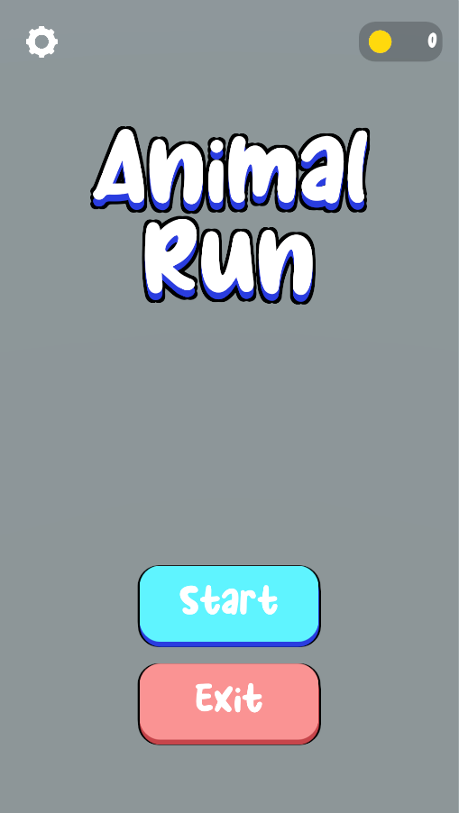
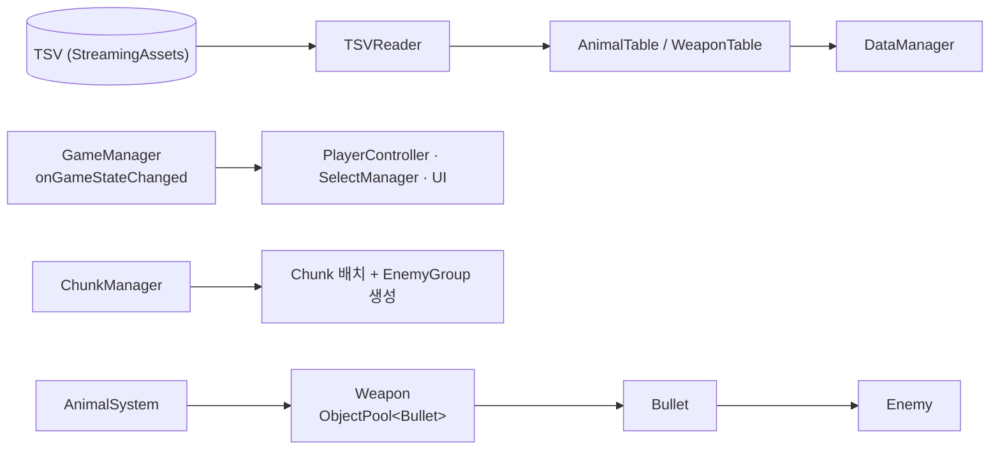
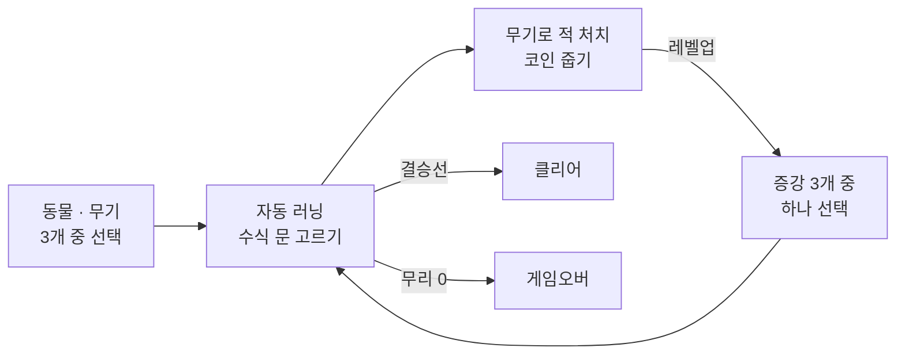
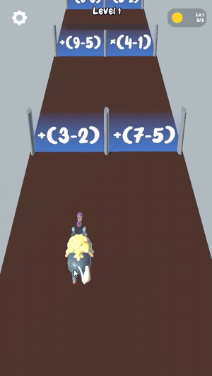
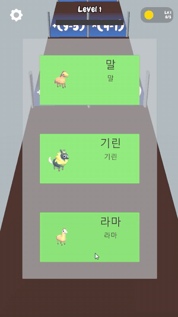
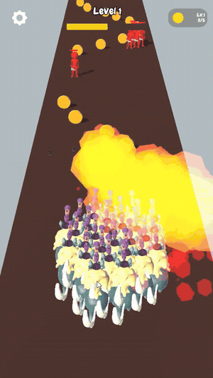

# 애니멀 런 (가제) 기술 문서

> **수식 문을 골라 동물 무리를 늘리고, 무기로 적을 쓰러뜨리며 결승선까지 달리는 3D 크라우드 러너 — 개발 중**



| 항목 | 내용 |
|---|---|
| 장르 | 3D 크라우드 러너 (모바일 세로 화면) — 수식 문을 골라 동물 무리를 늘리고, 무기로 적을 쓰러뜨리며 결승선까지 달리는 게임 |
| 기간 · 인원 | 2023.10 원형 제작 → 2026.09 재개, 개발 중 / 개인 프로젝트 (졸업 후 스토어 출시를 목표로 모인 팀 안에서 혼자 작업) |
| 엔진 · 도구 | Unity 2023.1, C#, CsvHelper (TSV 데이터), Blender |
| 구현 | 기획·개발 전체 |
| 현재 상태 | 한 판(동물·무기 선택 → 러닝 → 증강 → 클리어/게임오버)이 처음부터 끝까지 동작. 다음 단계로 마을 건설·디펜스 모드를 기획 중 |
| 링크 | [시연 영상](https://tmdrn17.github.io/portfolio/src/05-AnimalRun/video/animal-run.mp4) (1분 43초) · GitHub 요청 시 공유 |
| AI 활용 | 레벨 생성 일부 수정, 동물 에셋 제작 파이프라인에 Claude 사용 |

---

## 1. 개요

### 1.1 무엇을 만들었나

<video src="video/animal-run.mp4" controls preload="metadata" playsinline style="display:block;max-height:640px;margin:0 auto"></video>

3D 크라우드 러너 개인 프로젝트로 **절차적 레벨 생성**, **전략 패턴**, **레벨업 증강 선택**, **거리 충돌**, **ObjectPool**을 구현했습니다.

한 판(동물·무기 선택 → 러닝 → 증강 → 클리어/게임오버)이 처음부터 끝까지 동작합니다.

### 1.2 왜 만들었나

빠르게 제작해 스토어에 올리기 위해 만들었습니다.

하이퍼 캐주얼 장르는 반복성이 있고, 에셋을 비교적 저렴한 비용으로 구매할 수 있습니다. 또 비슷한 종류의 게임이 이미 여러 사이트에서 광고되고 있어, 유저들이 받아들이기 쉬웠습니다.

---

## 2. 시스템 구조

### 2.1 데이터 · 게임 상태 · 스테이지 · 전투의 흐름

TSV 데이터가 테이블을 거쳐 들어오고, 상태 변화는 이벤트로 알립니다.



### 2.2 게임 루프

한 판 단위로 끝나는 단발성 구조입니다.



---

## 3. 핵심 기능

### 3.1 목표 플레이 시간에 맞춘 레벨 생성

**문제** — 처음에는 미리 만든 청크 배열을 섞어서 길을 만들었는데, 판마다 길이가 달라 플레이 시간이 들쭉날쭉했습니다.

**해결** — 목표 거리를 '플레이 시간 × 기준 속도'로 먼저 정하고, 붙였을 때 최대 거리를 넘지 않는 청크만 후보로 모아 그중 하나를 랜덤으로 붙입니다. 결승선이 청크 안 어디에 있는지도 계산에 넣었습니다.

```csharp
// ① 목표 거리(플레이 시간 × 기준 속도)에 닿을 때까지
while (GetFinishDistance(chunkEndZ, finishLineOffset, startZ) < targetDistance)
{
    List<Chunk> candidates = new List<Chunk>();
    foreach (Chunk chunk in randomChunks)
    {
        // ② 붙였을 때 최대 거리를 넘지 않는 청크만 후보로
        if (GetFinishDistance(chunkEndZ + chunk.GetLength(), finishLineOffset, startZ) <= maxDistance)
            candidates.Add(chunk);
    }
    if (candidates.Count == 0) break;
    ...
}
```

ChunkManager.cs — 목표 거리에 맞을 때까지 청크 이어 붙이기

1. **목표 거리부터 정함** — 플레이 시간 × 기준 속도로 목표 거리를 먼저 정해, 판마다 플레이 시간이 고르게 됩니다.
2. **넘치지 않는 청크만 후보로** — 최대 거리를 넘는 청크는 빼고, 남은 후보 중 하나를 랜덤으로 붙입니다.
3. **결승선 위치까지 계산** — 결승선이 청크 안 어디에 있는지(offset)도 거리 계산에 넣었습니다.

### 3.2 정답을 먼저 정하고 식을 만드는 수식 문

**문제** — 문에 숫자만 보여 주면 너무 단순하고, 식을 랜덤으로 만들면 결과가 얼마나 나올지 통제할 수 없었습니다.

**해결** — 결과값을 먼저 뽑고, 그 값이 나오도록 식을 거꾸로 만듭니다. 뺄셈·일차방정식·거듭제곱·나눗셈 생성기를 delegate 배열에 넣어 두고 하나를 고르는 방식이라, 새로운 식 유형은 함수 하나만 추가하면 됩니다.

**첫 문** — 첫 문은 항상 이득이 되는 쉬운 문제가 나오게 했습니다.

```csharp
private delegate Expression ExpressionBuilder(int value);
private static readonly ExpressionBuilder[] SignedBuilders =
    { Subtraction, Subtraction, LinearEquation, Power };
```

DoorQuiz.cs — 식 유형을 고르는 생성기 목록



### 3.3 이동 경로(선분)로 판정하는 총알 명중

**문제** — 기린처럼 무기가 높이 달린 동물은 총알이 적 콜라이더 위로 지나가 충돌이 나지 않았고, 빠른 총알은 적을 그냥 통과하기도 했습니다.

**해결** — 콜라이더 충돌과 별개로, 이번 프레임에 총알이 지나간 선분과 적 사이의 수평 거리로 명중을 판정합니다. 포물선 탄은 일정 높이 아래로 내려왔을 때만 판정합니다. 러너가 최대 150마리까지 늘어나기 때문에 총알은 ObjectPool로 재사용합니다.

```csharp
// 점(적)과 선분(이번 프레임에 총알이 지나간 경로) 사이의 거리
private static float DistanceToSegment(Vector2 point, Vector2 start, Vector2 end)
{
    Vector2 segment = end - start;
    float lengthSquared = segment.sqrMagnitude;
    if (lengthSquared <= 0f)
        return Vector2.Distance(point, start);

    float t = Mathf.Clamp01(Vector2.Dot(point - start, segment) / lengthSquared);
    return Vector2.Distance(point, start + segment * t);
}
```

Bullet.cs — 점과 선분 사이의 거리

1. **경로 전체로 판정** — 이번 프레임에 지나간 선분과 적 사이의 거리를 봐서, 빠른 총알도 적을 건너뛰지 않습니다.
2. **수평 거리로 비교** — 높이를 빼고 수평 거리로 판정해, 무기가 높이 달린 동물의 총알도 맞습니다. 포물선 탄은 일정 높이 아래에서만 판정합니다.
3. **총알은 ObjectPool로** — 러너가 최대 150마리까지 늘어나기 때문에 총알을 재사용합니다.

### 3.4 데이터 테이블과 에셋 자동화

동물 19종과 무기 7종의 수치는 TSV로 관리하고, 불러올 때 프리팹과 아이콘을 연결합니다. 블렌더에서 만든 동물 모델은 에디터 툴(RunnerPrefabBuilder)이 머티리얼·애니메이터를 붙여 러너 프리팹으로 만들고, 미리보기 캡처까지 자동으로 처리합니다.

**선택한 이유** — 데이터 테이블을 쓰면 동물·무기 같은 오브젝트를 관리하기 쉽고, 계속 추가하기도 쉬웠습니다.

### 3.5 상점 대신 게임 시작 시 동물 · 무기 선택

리팩토링을 통해 상점 시스템을 삭제하고, 게임을 시작할 때 동물 3개와 무기 3개를 선택지로 줍니다. 고른 동물과 무기로 한 판을 진행합니다.

**바꾼 이유** — 리팩터링으로 상점을 지우고, 시작할 때 동물 3개와 무기 3개를 선택지로 줍니다. 한 판 단위로 끝나는 단발성 루프로 중독성을 더하고, 판 안에서 코인을 모아 증강을 고르는 컨셉과 맞추고 싶었습니다.



이 선택지를 관리하기 위해 데이터 테이블을 사용합니다. AnimalTable · WeaponTable의 전체 목록에서 뽑은 항목은 목록에서 빼기 때문에, 한 화면에 같은 선택지가 두 번 나오지 않습니다.

```csharp
List<AnimalDef> allAnimalDefs = dataManager.animalTable.All.ToList();

for (int i = 0; i < selectUI.AnimalButtonCount; i++)
{
    int randNum = Random.Range(0, allAnimalDefs.Count);
    animalDefs[i] = allAnimalDefs[randNum];
    selectUI.SetAnimalButton(i, animalDefs[i].Sprite, animalDefs[i].Name, animalDefs[i].Name);
    allAnimalDefs.RemoveAt(randNum);
}
```

SelectManager.cs — 동물 선택지 뽑기 (무기도 같은 방식)

### 3.6 코인으로 레벨업해 고르는 증강

러닝 중 코인을 하나 주울 때마다 경험치가 1 오르고(코인 1개 = 경험치 1), 레벨업하면 게임을 멈추고 증강 3개를 선택지로 보여 줍니다. 증강은 무기 계열 5종(공격력 · 연사 · 사거리 · 탄속 · 폭발 범위)과 러너 계열 2종(무리 증원 러너 +3 · 무리 번식 러너 +50%)입니다.

- **고른 무기에 맞는 증강만** — 폭발 범위 증강은 폭발하는 무기(Rocket, Grenade)를 골랐을 때만 나옵니다.
- **레벨업이 겹쳐도 빠짐없이** — 한 번에 여러 레벨이 오르면 남은 증강 수를 세어 두고, 하나를 고를 때마다 다음 선택지를 이어서 보여 줍니다.
- **버튼 그림** — 무기 계열 증강은 고른 무기 그림을, 러너 계열 증강은 고른 동물 그림을 씁니다.

```csharp
private void ShowAugments()
{
    Time.timeScale = 0.0f;   // 고르는 동안 게임 정지

    // 고른 무기에 맞는 증강만 (폭발 범위는 Rocket · Grenade만)
    List<AugmentDef> allAugmentDefs = AugmentDef.All
        .Where(augment => augment.IsAvailableFor(selectedWeapon)).ToList();

    for (int i = 0; i < selectUI.AugmentButtonCount; i++)
    {
        int randNum = Random.Range(0, allAugmentDefs.Count);
        augmentDefs[i] = allAugmentDefs[randNum];
        Sprite sprite = augmentDefs[i].IsRunnerAugment ? selectedAnimal.Sprite : selectedWeapon.Sprite;
        selectUI.SetAugmentButton(i, sprite, augmentDefs[i].Name, augmentDefs[i].Description);
        allAugmentDefs.RemoveAt(randNum);   // 같은 선택지가 두 번 나오지 않게
    }
    selectUI.ShowAugmentPanel();
}
```

SelectManager.cs — 고른 무기에 맞는 증강 3개를 겹치지 않게 뽑기



---

## 4. 고민과 선택

### 4.1 총알 · 적 · 플레이어의 충돌을 콜라이더로 판정할 것인가

| | 콜라이더 + Rigidbody (2023 원형) | ✔ 선택: 거리 충돌 (2026 리팩터링) |
|---|---|---|
| 방식 | 콜라이더 검색(OverlapSphere)과 트리거(OnTriggerEnter)로 판정 | 러너 목록 · 적 목록을 돌며 거리로 판정 |
| 장점 | Unity가 충돌을 처리해 주므로 판정 코드를 직접 짜지 않아도 됨 | 늘어나는 러너와 쏟아지는 총알에 콜라이더 · 리지드바디를 붙이지 않아도 됨 |
| 단점 | 무기가 높이 달린 동물은 총알이 적 콜라이더 위로 지나감 · 빠른 총알은 적을 그냥 통과하기도 함 | 총알마다 모든 적을 확인하는 구조라 적이 많아지면 비용이 커짐 |

**선택한 이유** — 러너는 무수히 늘어나고 총알도 계속 쏟아지는 장르 특성상, 굳이 콜라이더와 리지드바디를 사용할 필요가 없다고 판단했습니다. 그래서 팀 해체 이후 리팩터링으로 총알과 적, 플레이어의 충돌을 콜라이더 충돌에서 거리 판정으로 옮기고 있습니다.

### 4.2 리팩터링으로 바뀐 충돌 판정

| 판정 | 2023 원형 | 2026 지금 |
|---|---|---|
| 적이 쫓을 러너 찾기 | Physics.OverlapSphere로 주변 콜라이더 검색 | 러너 목록(ListManager.Runners)을 돌며 가장 가까운 러너 선택 |
| 총알 명중 | 총알 Rigidbody + OnTriggerEnter | OnTriggerEnter에 더해, 이번 프레임에 지나온 경로(선분)와 적 사이의 수평 거리로 판정 |
| 러너와 적의 접촉 | OnTriggerEnter | OnTriggerEnter (아직 그대로) |
| 문 · 결승선 · 코인 감지 | 무리 반경의 OverlapSphere | 무리 반경의 OverlapSphere (그대로) |

적이 러너를 찾는 판정은 거리로 바꿨고, 총알 명중은 트리거와 경로 거리 판정을 함께 씁니다.

---

## 5. 결과와 회고

### 5.1 결과

스토어 업로드에는 실패했습니다. 예상보다 결과가 늦게 나왔고, 팀이 이미 다른 게임(타 팀원 제작)의 라이브 서비스에 집중하고 있었습니다.

팀 해체 이후 다시 열어 2023 원형을 아래처럼 바꿨고, 지금은 한 판이 처음부터 끝까지 동작합니다.

| 항목 | 2023 원형 | 2026 지금 |
|---|---|---|
| 레벨 생성 | ScriptableObject 청크 배열 섞기 | 목표 플레이 시간 기반 생성 (3.1) |
| 수식 문 | 타입별 if-else 하드코딩 | 결과값 역산 + 전략 패턴(생성기 목록) (3.2) |
| 시작 선택 | 상점(ShopManager · SkinButton) | 상점 삭제 → 동물 3개 · 무기 3개 선택지 (3.5) |
| 데이터 | 하드코딩 · ScriptableObject | TSV 테이블 (3.4) |
| 충돌 판정 | 콜라이더 검색 · 트리거 | 거리 판정으로 옮기는 중 (4.2) |

### 5.2 아쉬운 점과 개선 계획

- **총알마다 모든 적을 확인함** — 적이 많아지면 비용이 커집니다. 호떡 서바이버에서 썼던 공간 분할 격자를 적용할 계획입니다.
- **러너와 적의 접촉은 아직 트리거** — OnTriggerEnter로 판정합니다. 이것도 거리 충돌로 바꿀 계획입니다.
- **풀링 범위와 전역 목록** — 러너·적·이펙트는 아직 생성/삭제 방식입니다. 풀링 범위를 넓히고, 전역 static 목록 의존을 줄이려 합니다.

### 5.3 한 줄 회고

예전 코드를 전략 패턴 · 데이터 테이블 · 거리 충돌로 다시 짜는 중입니다.
