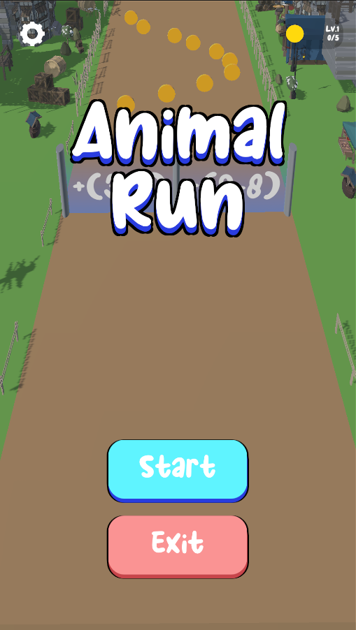
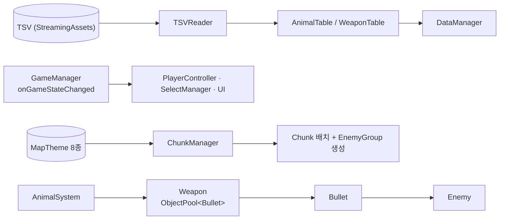
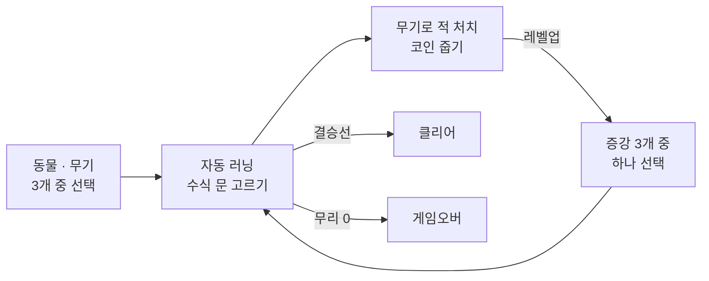
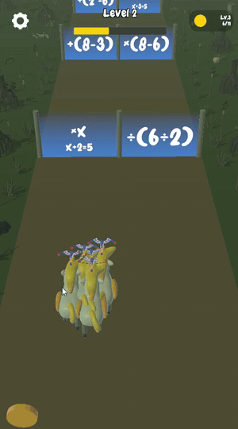
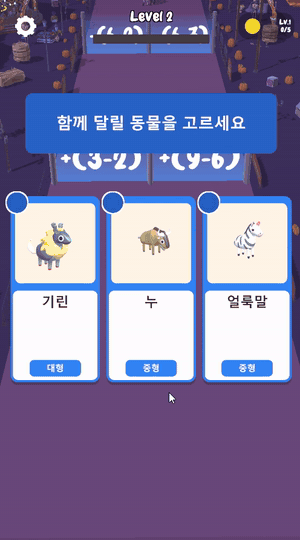

# 애니멀 런 프로젝트 문서

> **수식 문을 골라 동물 무리를 늘리고, 무기로 적을 쓰러뜨리며 결승선까지 달리는 3D 크라우드 러너**



| 항목 | 내용 |
|---|---|
| 장르 | 3D 크라우드 러너 (모바일 세로 화면) — 수식 문을 골라 동물 무리를 늘리고, 무기로 적을 쓰러뜨리며 결승선까지 달리는 게임 |
| 기간 · 인원 | 2023.10 원형 제작 → 2026.09 리팩토링 / 개인 프로젝트 |
| 엔진 · 도구 | Unity 2023.1, C#, CsvHelper (TSV 데이터), Blender(Claude) |
| 구현 | 기획·개발 전체 |
| 링크 | [시연 영상](https://tmdrn17.github.io/portfolio/src/05-AnimalRun/video/animal-run.mp4) (1분 43초) · GitHub 요청 시 공유 |
| AI 활용 | 레벨 생성 일부 수정, 동물 에셋 제작 파이프라인, 맵 테마(청크 · 적 · 테마 구조) 제작에 Claude 사용 |

---

## 1. 개요

### 1.1 동물 무리를 늘리며 결승선까지 달리는 크라우드 러너

<video src="video/animal-run.mp4" controls preload="metadata" playsinline style="display:block;max-height:640px;margin:0 auto"></video>

3D 크라우드 러너 개인 프로젝트로 **절차적 레벨 생성**, **전략 패턴**, **레벨업 증강 선택**, **거리 충돌**, **ObjectPool**, **맵 테마**를 구현했습니다.

한 판(동물·무기 선택 → 러닝 → 증강 → 클리어/게임오버)이 처음부터 끝까지 동작합니다.

### 1.2 빠르게 만들어 스토어에 올리기 위한 하이퍼 캐주얼

빠르게 제작해 스토어에 올리기 위해 만들었습니다.

하이퍼 캐주얼 장르는 반복성이 있고, 에셋을 비교적 저렴한 비용으로 구매할 수 있습니다. 또 비슷한 종류의 게임이 이미 여러 사이트에서 광고되고 있어, 유저들이 받아들이기 쉬웠습니다.

---

## 2. 시스템 구조

### 2.1 데이터 · 게임 상태 · 스테이지 · 전투의 흐름

TSV 데이터가 테이블을 거쳐 들어오고, 상태 변화는 이벤트로 알립니다.



### 2.2 게임 루프

한 판 단위로 끝나는 단발성 구조입니다.



---

## 3. 핵심 기능

### 3.1 목표 플레이 시간에 맞춘 레벨 생성

**문제** — 처음에는 미리 만든 청크 배열을 섞어서 길을 만들었는데, 판마다 길이가 달라 플레이 시간이 들쭉날쭉했습니다.

**해결** — 목표 거리를 '플레이 시간 × 기준 속도'로 먼저 정하고, 붙였을 때 최대 거리를 넘지 않는 청크만 후보로 모아 그중 하나를 랜덤으로 붙입니다. 결승선이 청크 안 어디에 있는지도 계산에 넣었습니다.

```csharp
// ① 목표 거리(플레이 시간 × 기준 속도)에 닿을 때까지
while (GetFinishDistance(chunkEndZ, finishLineOffset, startZ) < targetDistance)
{
    List<Chunk> candidates = new List<Chunk>();
    foreach (Chunk chunk in randomChunks)
    {
        // ② 붙였을 때 최대 거리를 넘지 않는 청크만 후보로
        if (GetFinishDistance(chunkEndZ + chunk.GetLength(), finishLineOffset, startZ) <= maxDistance)
            candidates.Add(chunk);
    }
    if (candidates.Count == 0) break;
    ...
}
```

ChunkManager.cs — 목표 거리에 맞을 때까지 청크 이어 붙이기

1. **목표 거리부터 정함** — 플레이 시간 × 기준 속도로 목표 거리를 먼저 정해, 판마다 플레이 시간이 고르게 됩니다.
2. **넘치지 않는 청크만 후보로** — 최대 거리를 넘는 청크는 빼고, 남은 후보 중 하나를 랜덤으로 붙입니다.
3. **결승선 위치까지 계산** — 결승선이 청크 안 어디에 있는지(offset)도 거리 계산에 넣었습니다.

### 3.2 정답을 먼저 정하고 식을 만드는 수식 문

**문제** — 문에 숫자만 보여 주면 너무 단순하고, 식을 랜덤으로 만들면 결과가 얼마나 나올지 통제할 수 없었습니다.

**해결** — 결과값을 먼저 뽑고, 그 값이 나오도록 식을 거꾸로 만듭니다. 뺄셈·일차방정식·거듭제곱·나눗셈 생성기를 delegate 배열에 넣어 두고 하나를 고르는 방식이라, 새로운 식 유형은 함수 하나만 추가하면 됩니다.

**첫 문** — 첫 문은 항상 이득이 되는 쉬운 문제가 나오게 했습니다.

```csharp
private delegate Expression ExpressionBuilder(int value);
private static readonly ExpressionBuilder[] SignedBuilders =
    { Subtraction, Subtraction, LinearEquation, Power };
```

DoorQuiz.cs — 식 유형을 고르는 생성기 목록



### 3.3 이동 경로(선분)로 판정하는 총알 명중

**문제** — 동물마다 키가 달라 무기가 달리는 높이도 다릅니다. 콜라이더로 판정하면 기린처럼 무기가 높이 달린 동물의 총알은 적 콜라이더 위로 지나가 맞지 않을 수 있겠다고 판단했습니다. 또 콜라이더 판정은 프레임마다 위치만 보기 때문에, 총알이 빨라지면 한 프레임 사이에 적을 건너뛸 수도 있었습니다.

**해결** — 콜라이더 없이, 이번 프레임에 총알이 지나간 경로(선분)와 적 사이의 수평 거리로 명중을 판정합니다. 경로 근처에 적이 여럿이면 경로 시작점에 가장 가까운 적을 맞힙니다. 포물선 탄(Grenade)은 날아가는 동안 판정하지 않고, 사거리 끝에서 폭발합니다.

```csharp
// 이번 프레임 이동 경로(lastPosition → 현재 위치) 위에서 target과 가장 가까운 점
private Vector3 ClosestPointOnPath(Vector3 target)
{
    Vector3 path = transform.position - lastPosition;
    if (path.sqrMagnitude == 0f)
        return lastPosition;

    float t = Mathf.Clamp01(Vector3.Dot(target - lastPosition, path) / path.sqrMagnitude);
    return lastPosition + path * t;
}

// FindEnemyOnPath — 그 점과 적 사이를 수평 거리로 비교
Vector3 offset = enemy.transform.position - pointOnPath;
offset.y = 0f;
if (offset.sqrMagnitude > sqrHitRadius)
    continue;
```

Bullet.cs — 이동 경로 위의 가장 가까운 점과 수평 거리 비교

1. **경로 전체로 판정** — 이번 프레임에 지나간 선분 위에서 적과 가장 가까운 점을 구해, 총알이 빨라져도 한 프레임 사이에 적을 건너뛰지 않게 했습니다.
2. **수평 거리로 비교** — 높이(y)를 빼고 비교해, 무기가 어느 높이에 달려 있든 같은 기준으로 맞게 했습니다. 폭발 범위도 같은 방식으로, 터진 곳에서 수평 거리 안의 적 모두에게 피해를 줍니다.
3. **총알·이펙트는 ObjectPool로** — 러너가 최대 150마리까지 늘어나기 때문에 총알을 재사용하고, 폭발 이펙트도 프리팹마다 풀(ExplosionEffectPool)을 만들어 재사용합니다.

### 3.4 데이터 테이블과 에셋 자동화

동물 19종과 무기 7종의 수치는 TSV로 관리하고, 불러올 때 프리팹과 아이콘을 연결합니다. 블렌더에서 만든 동물 모델은 에디터 툴(RunnerPrefabBuilder)이 머티리얼·애니메이터를 붙여 러너 프리팹으로 만들고, 미리보기 캡처까지 자동으로 처리합니다.

**선택한 이유** — 4.2에 정리했습니다(동물 · 무기는 TSV, 맵 테마는 ScriptableObject로 나눈 이유).

### 3.5 게임 시작 시 동물 · 무기 선택

게임을 시작할 때 동물 3개와 무기 3개를 선택지로 줍니다. 고른 동물과 무기로 한 판을 진행합니다.

**바꾼 이유** — 초기 버전에는 코인을 모아 스킨과 무기를 사는 상점이 있었습니다. 하지만 리팩터링을 하면서, 코인을 판 밖의 상점이 아니라 판 안에서 증강을 고르는 데 쓰게 하고 싶었습니다. 한 판 단위로 끝나는 단발성 루프로 중독성을 더하려는 것입니다. 그래서 상점을 지우고, 판마다 처음에 동물과 무기를 고르게 했습니다.



이 선택지를 관리하기 위해 데이터 테이블을 사용합니다. AnimalTable · WeaponTable의 전체 목록에서 뽑은 항목은 목록에서 빼기 때문에, 한 화면에 같은 선택지가 두 번 나오지 않습니다.

```csharp
List<AnimalDef> allAnimalDefs = dataManager.animalTable.All.ToList();

for (int i = 0; i < selectUI.AnimalButtonCount; i++)
{
    int randNum = Random.Range(0, allAnimalDefs.Count);
    animalDefs[i] = allAnimalDefs[randNum];
    selectUI.SetAnimalButton(i, animalDefs[i].Sprite, animalDefs[i].Name, animalDefs[i].Name);
    allAnimalDefs.RemoveAt(randNum);
}
```

SelectManager.cs — 동물 선택지 뽑기 (무기도 같은 방식)

### 3.6 코인으로 레벨업해 고르는 증강

러닝 중 코인을 하나 주울 때마다 경험치가 1 오르고(코인 1개 = 경험치 1), 레벨업하면 게임을 멈추고 증강 3개를 선택지로 보여 줍니다. 증강은 무기 계열 5종(공격력 · 연사 · 사거리 · 탄속 · 폭발 범위)과 러너 계열 2종(무리 증원 러너 +3 · 무리 번식 러너 +50%)입니다.

- **고른 무기에 맞는 증강만** — 폭발 범위 증강은 폭발하는 무기(Rocket, Grenade)를 골랐을 때만 나옵니다.
- **레벨업이 겹쳐도 빠짐없이** — 한 번에 여러 레벨이 오르면 남은 증강 수를 세어 두고, 하나를 고를 때마다 다음 선택지를 이어서 보여 줍니다.
- **버튼 그림** — 무기 계열 증강은 고른 무기 그림을, 러너 계열 증강은 고른 동물 그림을 씁니다.

```csharp
private void ShowAugments()
{
    Time.timeScale = 0.0f;   // 고르는 동안 게임 정지

    // 고른 무기에 맞는 증강만 (폭발 범위는 Rocket · Grenade만)
    List<AugmentDef> allAugmentDefs = AugmentDef.All
        .Where(augment => augment.IsAvailableFor(selectedWeapon)).ToList();

    for (int i = 0; i < selectUI.AugmentButtonCount; i++)
    {
        int randNum = Random.Range(0, allAugmentDefs.Count);
        augmentDefs[i] = allAugmentDefs[randNum];
        Sprite sprite = augmentDefs[i].IsRunnerAugment ? selectedAnimal.Sprite : selectedWeapon.Sprite;
        selectUI.SetAugmentButton(i, sprite, augmentDefs[i].Name, augmentDefs[i].Description);
        allAugmentDefs.RemoveAt(randNum);   // 같은 선택지가 두 번 나오지 않게
    }
    selectUI.ShowAugmentPanel();
}
```

SelectManager.cs — 고른 무기에 맞는 증강 3개를 겹치지 않게 뽑기


### 3.7 판마다 바뀌는 맵 테마

**문제** — 기존 맵 디자인은 단색에 아무런 조형물이나 배경도 없는 맵이 지속적으로 이어졌었습니다. 이러한 디자인은 플레이를 지루하고 단조롭게 만든다고 생각했습니다.

**해결** — 청크 묶음 · 등장하는 적 · 조명을 ScriptableObject(MapTheme) 하나에 묶고, ChunkManager가 판을 시작할 때 테마 하나를 랜덤으로 골라 그 테마의 청크로 길을 만듭니다. 청크 규칙(길이 · 문 · 코인 · 결승선)은 같고 바닥색과 길 옆 장식만 다르기 때문에, 3.1의 레벨 생성은 그대로 씁니다.

테마는 Carnival · Castle · Elven Realm · Enchanted Grove · Kingdom Village · Magic Forest · Misty Swamp · Viking Snow 8종입니다. 테마 청크와 테마별 적 프리팹은 에디터 툴(ChunkThemeBuilder · EnemyThemeBuilder)로 만듭니다.

```csharp
// 이번 판의 테마로 청크 · 적 · 조명을 바꿔 끼운다.
private void ApplyTheme()
{
    MapTheme theme = GetCurrentTheme();

    themeEnemyPrefabs = theme.EnemyPrefabs;
    firstChunk = theme.FirstChunk;
    randomChunks = theme.RandomChunks;
    finishChunk = theme.FinishChunk;

    theme.ApplyLighting(FindSun(), Camera.main);
}
```

ChunkManager.cs — 판을 시작할 때 테마 적용

1. **테마 하나에 묶음** — 청크 · 적 · 조명을 에셋 하나로 관리해, 테마를 추가할 때 코드를 고치지 않습니다.
2. **적도 테마에 맞게** — 적 무리(EnemyGroup)를 만든 직후 테마 적 목록을 넘겨, 그 안에서 랜덤으로 적을 고릅니다. 목록이 비어 있으면 기본 적이 나옵니다.
3. **조명 · 안개 · 배경색** — 테마에 조명 설정을 켜 두면 해 · 환경광 · 안개 · 배경색을 바꿔 밤 · 안개 같은 분위기를 냅니다.

**(✍ 그림 자리: 테마가 바뀌는 GIF를 images/에 넣고 이 줄을 ``로 바꿔 주세요)**

### 3.8 무리가 늘고 줄어드는 것을 보여 주는 연출


| 언제 | 연출 |
|---|---|
| 러너가 늘어날 때 | 위에서 아래로 쓸어내리는 빛기둥 (DescendingLightColumnController) |
| 러너가 죽을 때 | 피격 머티리얼로 바뀐 뒤 셰이더의 `_Threshold` 값을 올려 디졸브로 사라짐 |
| 적이 총알에 맞을 때 | 색 번쩍임 · 크기 펀치 · 피격 이펙트 (EnemyHitFeedback). Synty 셰이더는 색을 바꿔도 잘 보이지 않아 발광(Emission)으로 번쩍이게 함 |
| 레벨업할 때 | 무리 반경에 맞춘 레벨업 파티클 (PlayVFX), 증강을 고르는 동안 이동 정지 |

**(✍ 그림 자리: 빛기둥 · 디졸브가 보이는 GIF를 images/에 넣고 이 줄을 ``로 바꿔 주세요)**

---

## 4. 고민과 선택

### 4.1 총알 · 적 · 플레이어의 충돌을 콜라이더로 판정할 것인가

| | 콜라이더 + Rigidbody (2023 원형) | ✔ 선택: 거리 충돌 (2026 리팩터링) |
|---|---|---|
| 방식 | 콜라이더 검색(OverlapSphere)과 트리거(OnTriggerEnter)로 판정 | 러너 목록 · 적 목록을 돌며 거리로 판정 |
| 장점 | Unity가 충돌을 처리해 주므로 판정 코드를 직접 짜지 않아도 됨 | 늘어나는 러너와 쏟아지는 총알에 콜라이더 · 리지드바디를 붙이지 않아도 됨 |
| 단점 | 무기가 높이 달린 동물은 총알이 적 콜라이더 위로 지나갈 수 있음 · 총알이 빨라지면 한 프레임 사이에 적을 건너뛸 수 있음 | 총알마다 모든 적을 확인하는 구조라 적이 많아지면 비용이 커짐 |

**선택한 이유** — 러너는 무수히 늘어나고 총알도 계속 쏟아지는 장르 특성상, 굳이 콜라이더와 리지드바디를 사용할 필요가 없다고 판단했습니다.

### 4.2 동물 · 무기는 TSV, 맵 테마는 ScriptableObject로 나눈 이유

모든 데이터를 한 방식으로 통일해서 관리하지 않고, 데이터의 성격과 작업 흐름에 맞춰 관리 방식을 나눴습니다.

| | TSV 테이블 | ScriptableObject |
|---|---|---|
| 데이터 성격 | 공격 간격 · 공격력 · 사거리 · 탄속 · 폭발 범위 같은 수치 위주 | 청크 · 적 프리팹 같은 에셋 참조와 조명 설정 위주 |
| 장점 | Unity를 모르는 사람도 엑셀 같은 외부 도구로 고칠 수 있음 | 인스펙터에서 에셋을 바로 연결하고, 에디터 빌더가 만든 프리팹도 코드로 바로 연결할 수 있음 |
| 단점 | 프리팹은 경로 문자열(PrefabKey)로 찾아야 해, 프리팹을 Resources 폴더에 두고 키를 따로 관리해야 함 | Unity 에디터 밖에서는 고치기 어려움 |
| 결과물 | Animals.tsv(동물 19종) · Weapons.tsv(무기 7종) (3.4) | MapTheme 에셋 8개 (3.7) |

**동물 · 무기 테이블 → TSV 테이블**

1. **수치를 한눈에 비교하고 조정** — 무기는 공격 간격 · 공격력 · 사거리 · 탄속 · 폭발 범위를 무기끼리 맞춰 봐야 합니다. 한 줄에 한 항목씩 표로 두면 값을 나란히 놓고 고칠 수 있습니다.
2. **외부 도구로 수정** — 수치 조정은 Unity를 열지 않아도 엑셀 같은 도구로 할 수 있습니다.
3. **추가가 쉬움** — 동물 · 무기를 늘릴 때 표에 한 줄을 더하면 됩니다.

**결과** — TSVReader가 Animals.tsv · Weapons.tsv를 읽어 AnimalTable · WeaponTable을 만들고, 불러올 때 PrefabKey · SpriteKey로 프리팹과 아이콘을 연결합니다(Resources.Load). 경로 키를 관리해야 하는 단점은 받아들였습니다.

**맵 테마 → ScriptableObject**

1. **에셋 참조가 대부분** — 맵 테마는 숫자보다 시작 · 랜덤 · 결승 청크와 적 프리팹 같은 에셋 참조가 대부분이라, 경로 키를 관리하는 TSV보다 에셋을 바로 연결하는 쪽이 맞다고 판단했습니다.
2. **테마 단위로 독립** — 테마마다 청크 구성 · 등장 적 · 조명(달빛 색, 안개, 배경색)이 다릅니다. 테마 하나를 에셋 하나로 묶어, 추가하거나 고칠 때 다른 테마에 영향을 주지 않습니다.
3. **로직과 데이터 분리** — 청크 · 적 배치는 ChunkManager가, 조명 적용은 MapTheme.ApplyLighting()이 처리하고, 테마 에셋은 설정값과 에셋 참조만 줍니다.
4. **작업이 에디터 안에서 이뤄짐** — 맵 데이터는 프리팹 구성 · 청크 연결 · 조명 확인처럼 에디터에서 해야 하는 일이 많아, 외부 도구로 고칠 수 있다는 TSV의 장점이 크게 필요하지 않습니다.

**결과** — 테마 8종을 MapTheme 에셋 8개로 만들어 ChunkManager의 테마 목록에 연결했습니다. 새 테마를 추가해도 로직 코드는 바꾸지 않습니다. 처음에는 AI에게 테마 제작을 맡기면서 ScriptableObject로 만들어졌고, 이후 TSV와 직접 비교해 이 방식을 유지했습니다.

---

## AI 협업

- **맡긴 것** — 레벨 생성 일부 수정, 동물 에셋 제작 파이프라인(Blender), 맵 테마(청크 · 적 · 테마 구조) 제작에 Claude를 썼습니다.
- **직접 판단한 것** — 맵 테마는 AI에게 제작을 맡기면서 ScriptableObject로 만들어졌는데, 이후 TSV와 직접 비교해 이 방식을 유지했습니다(4.2).

---

## 5. 결과와 회고

### 5.1 결과

스토어 업로드에는 실패했습니다. 예상보다 결과가 늦게 나왔고, 팀이 이미 다른 게임(타 팀원 제작)의 라이브 서비스에 집중하고 있었습니다.

팀 해체 이후 다시 열어 2023 원형을 아래처럼 바꿨고, 지금은 한 판이 처음부터 끝까지 동작합니다.

| 항목 | 2023 원형 | 2026 지금 |
|---|---|---|
| 레벨 생성 | ScriptableObject 청크 배열 섞기 | 목표 플레이 시간 기반 생성 (3.1) |
| 수식 문 | 타입별 if-else 하드코딩 | 결과값 역산 + 전략 패턴(생성기 목록) (3.2) |
| 시작 선택 | 상점(ShopManager · SkinButton) | 상점 삭제 → 동물 3개 · 무기 3개 선택지 (3.5) |
| 데이터 | 하드코딩 · ScriptableObject | TSV 테이블 (3.4) |
| 충돌 판정 | 콜라이더 검색 · 트리거 | 목록 순회 + 거리 판정 (4.1) |
| 맵 | 청크 한 벌 | 맵 테마 8종 중 하나를 골라 생성 (3.7) |

### 5.2 아쉬운 점과 개선 계획

- **총알마다 모든 적을 확인함** — 적이 많아지면 비용이 커집니다. 호떡 서바이버에서 썼던 공간 분할 격자를 적용할 계획입니다.
- **적은 아직 생성/삭제 방식** — 총알 · 폭발 이펙트 · 러너는 재사용하지만, 적은 아직 Instantiate · Destroy로 만들고 지웁니다. 적도 풀링하고, 전역 static 목록(ListManager) 의존을 줄이려 합니다.

### 5.3 한 줄 회고

예전 코드를 전략 패턴 · 데이터 테이블 · 거리 충돌로 다시 짰습니다. **(✍ 확인해 주세요: 지금 생각에 맞게 직접 고쳐 주세요)**
